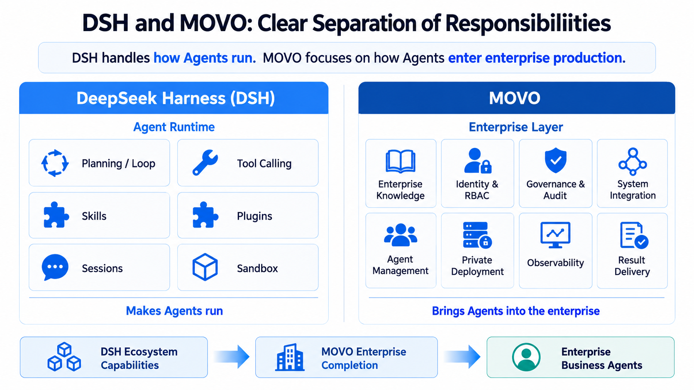
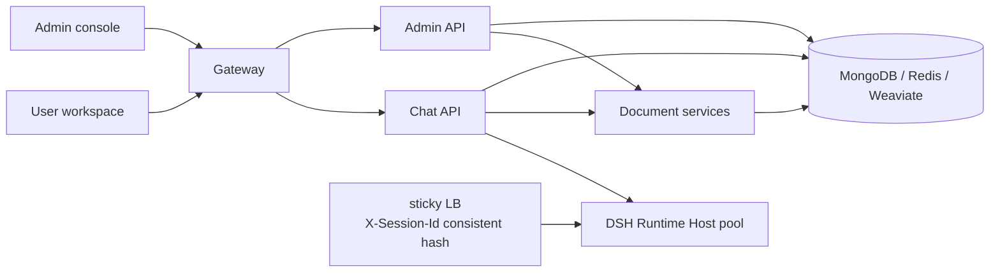

<p align="center">
  
</p>

<h1 align="center">MOGO</h1>

<p align="center">
  An enterprise Agent platform built on DeepSeek Harness (DSH), developed from the open-source MOGO platform.
</p>

<p align="center">
  <strong>English</strong> · <a href="README.zh-CN.md">简体中文</a>
</p>

<p align="center">
  <a href="#start-in-5-minutes"><strong>🚀 Quick Start</strong></a> ·
  <a href="docs/企业级智能体功能补强规划.md"><strong>📐 Capability Roadmap</strong></a> ·
  <a href="docs/SDD界面呈现对照表.md"><strong>🔍 SDD Traceability</strong></a> ·
  <a href="docs/cases/README.md"><strong>🧩 Cases</strong></a>
</p>

<br>

## 典型场景与不适用边界

**典型场景**（本仓库开箱即用的能力）：
- 自建企业内网 Agent 平台：Docker Compose 一键拉起 14 服务（chat-api / admin-api / document-parser / user-web / admin-web 等），本地或私有云自托管。
- 文档与知识检索：PDF / DOCX / XLSX / PPTX / CSV 多格式解析 + Docling OCR + 企业知识 RAG。
- 多形态 Agent 执行：Browser Agent、Code Agent、桌面子代理、SkillHub 技能市场。
- 报告与内容生成：文章、PPTX、Excel、PDF、翻译与表单填充。

**不适用边界**（本仓库不覆盖的场景）：
- **商业多租户 SaaS**：MOGO 开源版是单租户自托管，不提供多租户隔离、计费与 SaaS 运营后台；相关能力在 MOGO 商业版中。
- **多区域 / 多活灾备**：首期仅支持单区域部署 + 可验证的备份恢复；跨区域灾备属后续版本。
- **全自动弹性扩缩容**：水平扩展需手动扩副本 + 前置容量模型；不内置 K8s 或自动弹性调度。
- **微服务拆分**：仓库内服务是模块化单体（Python + Vue3），不引入微服务治理。
- **非 Apache-2.0 商用**：LICENSE 允许在 Apache-2.0 下商用，但不得移除或修改商标与版权声明；若需 MOGO 社区许可或商业白名单，联系维护者。

> **一句话定位**：DSH 运行 Agent，MOGO 把 Agent 带进企业生产。

MOGO is an enterprise Agent platform built on top of the open-source MOGO platform. It keeps the execution foundation and product surface the upstream project already proved, and carries them into enterprise production along three lines: **adopting the spec-kit SDD workflow**, **hardening enterprise capabilities**, and **supporting horizontal scaling of Agent instances**.

> **In one sentence:** DSH runs the Agent; MOGO brings the Agent into enterprise production.

<br>

<p align="center">
  
</p>

<br>

This repository contains the self-hosted MOGO Open-Source Edition.

## Relationship to open-source MOGO

MOGO is not a platform written from scratch. It is the enterprise evolution of the open-source MOGO project, a comparatively complete starting point. Five capabilities the upstream project already proved are treated as a "do not rebuild" boundary:

| Capability MOGO leads on | What it provides |
| --- | --- |
| Containerised self-hosting | One-command multi-service Docker Compose deployment, CLI launcher and backup/restore — the production operations base is ready |
| Docling multi-format parsing | PDF / DOCX / XLSX / PPTX / CSV plus LibreOffice preview, with complete document understanding |
| Content and file generation | Reports, articles, PPTX, spreadsheets, PDF, translation and form filling — a clear differentiator against comparable solutions |
| Multiple Agent forms | Browser Agent, Code Agent and sub-agents (desktop), covering rich execution shapes |
| SkillHub ecosystem | Enterprise knowledge research, citation evidence, Skill marketplace and ZIP installation — the knowledge loop and distribution model are in place |

MOGO only **adds** on top of these five; every new capability belongs to one of the three lines below.

## Line one: the spec-kit SDD workflow

MOGO adopts [spec-kit](https://github.com/github/spec-kit) Spec-Driven Development so that every capability addition becomes a traceable specification asset instead of a scattering of commit history.

The `.specify/` and `specs/` directories carry that contract:

```text
.specify/                 # spec-kit workflows, templates and project constitution
  memory/constitution.md  #   constitution: agent operating rules, boundaries, quality gates
  templates/              #   spec / plan / tasks templates
  scripts/bash/           #   create-new-feature, setup-plan and friends
  workflows/speckit/      #   workflow registry

specs/                    # 44 feature specifications (001–044), each with a complete chain
  001-gatekeeper-governance/
  ...
  020-platform-multi-tenancy/
  021-unified-context-address/
  022-security-hardening/
  023-observability-resilience/
  024-deployment-hardening/
  025-api-contract-hardening/
  026-performance-scalability/
  027-mongo-to-panweidb-migration/
  028-user-web-trajectory-tab/
  029-user-web-sso-receiver/
  030-ontology-data-permission/
  031-model-provider-discover/
  032-eval-gate/ … 044-multi-agent-modes/   # AgentOS integration batch (032–044, 13 new features, 2026-10-23)
  INDEX.md                # specification index
```

Each of the 44 feature directories holds `spec.md` (requirements and acceptance), `plan.md` (technical approach) and `tasks.md` (the executable breakdown); all carry `checklists/requirements.md` (quality checklist) and `quickstart.md`. Six of them (001, 007, 008, 009, 020) additionally carry a `contracts/` directory.

They fall into seven groups:

- **17 gap-closing features** (001/002/007–021) — the original backlog plus the platform and context-address scope. **All 17 `tasks.md` files (354 items) are checked off**, with implementation and tests landed together.
- **5 quality-hardening features** (022–026) — split out of the 2026-10-11 QualityForge full-repository QA audit (412 tasks in total). **Status (updated 2026-10-24): 022 security-hardening is fully implemented (58/58 checked), and 025 api-contract-hardening has started — its Phase 1 (T001–T007: unified RFC 9457 error structure, trace_id middleware, error-code registry, CI uniqueness gate) landed with all three back-end services' full test suites green (7/52 checked).** 023 (0/126), 024 (0/119) and 026 (0/57) carry complete spec/plan/tasks/checklist documents but **implementation has not started**. The former spec-level blocker — 023's eight open questions (OQ-1~OQ-8) — was resolved via `/speckit-clarify` on 2026-10-24 (Loki / Tempo / pybreaker / local disk + S3-compatible offsite / IM webhook + email / SLO 99.9%·P99<3s / RTO≤30min·RPO≤15min / single-host drill, declared honestly), so all four specs now have zero spec-level blockers (see [Quality hardening: 022–026](#quality-hardening-022026) below).
- **4 retrospective features** (003–006) — re-document capabilities the upstream project already had. They originally shipped without `tasks.md`; it was backfilled on 2026-10-11 (141 items).
- **1 data-backend migration** (027) — an opt-in MongoDB → PanWeiDB (openGauss kernel) migration whose compatibility layer (R1: a Motor/PyMongo-compatible facade), aggregation-pipeline compiler + bulk_write wiring (R2) and 44-table relational flattening (R3) have all landed. The default backend is still **MongoDB**; PanWeiDB is enabled opt-in via `MOGO_DATA_BACKEND=panweidb`, and rollback is a single environment variable — no code change.
- **4 data-backend and user-web experience features** (028–031) — both user-web experience features (028–029) landed on 2026-10-15: 028 promotes the per-message execution process to a session-level Chat/Trajectory dual tab, and 029 turns user-web into an SSO receiver so an external portal's logged-in users enter the workspace without a second login; 030 adds per-ontology data-scoped permission (P1, 2026-10-16); 031 adds model-provider discover with multi-protocol support including Anthropic / Gemini / Ollama (P1, 2026-10-18) (see [Data backend and user-web experience: 027–031](#data-backend-and-user-web-experience-027031) below).
- **13 AgentOS integration features** (032–044) — the 2026-10-23 enterprise Agent OS product-landing batch: 13 brand-new features (eval gate, canary rollout, credential encryption, cost attribution, trust rating, unified portal, egress sandbox, visual orchestration, model-tier routing, connector market, three-level quota, session replay, multi-agent modes); each carries spec/plan/tasks/checklist and the code landed on 2026-10-24 (see [AgentOS integration batch: 032–044](#agentos-integration-batch-032044) below).

Interface contracts live in two places: the 6 T998 contracts in the top-level [`contracts/`](contracts/) (`orchestration`, `self-evolution`, `session-versioning-contract`, `harness-config`, `a2a-gateway`, `memory-context-contract`), plus 5 per-feature `contracts/` directories inside `specs/` ([`001/contracts/gatekeeper.md`](specs/001-gatekeeper-governance/contracts/gatekeeper.md), [`007/contracts/resilience.md`](specs/007-llm-gateway-resilience/contracts/resilience.md), [`008/contracts/dashboard.md`](specs/008-ops-dashboard/contracts/dashboard.md), [`009/contracts/hooks.md`](specs/009-hooks-interception/contracts/hooks.md), [`020/contracts/tenants.md`](specs/020-platform-multi-tenancy/contracts/tenants.md)).

[`specs/INDEX.md`](specs/INDEX.md) is the authoritative inventory: it groups the 44 features into retrospective (003–006), gap-closing (001/002/007–019 and 021), newly-added platform scope (020), the quality-hardening set (022–026), the data-backend migration (027), the user-web / data-permission / model-discover experience set (028–031) and the AgentOS integration batch (032–044), and records the clarify decisions behind each threshold.

The payoff is that every enterprise capability has a documented requirement source, acceptance criteria and test evidence. The mapping from specifications to UI touch points is recorded in [`docs/SDD界面呈现对照表.md`](docs/SDD界面呈现对照表.md).

## Line two: enterprise capability hardening

The hardening backlog comes from [`docs/企业级智能体功能补强规划.md`](docs/企业级智能体功能补强规划.md) and is sequenced P0 → P1 → P2. **All 15 backlog items are implemented and covered by tests** (the governance item itself spans several sub-capabilities: the six-layer gate, the risk matrix, permission codes and redaction). "Implemented" here means library code plus unit tests, all green; four of them (the 001 six-layer gate on the runtime side, 007 gateway resilience, 009 hooks, 002 session versioning) have completed **production wiring + UI delivery** — see the wiring notes in [`docs/SDD界面呈现对照表.md`](docs/SDD界面呈现对照表.md) §4.

### P0 — the compliance entry ticket: production availability

| Capability | What it delivers |
| --- | --- |
| **Gatekeeper six-layer gate** | Identity → RBAC → redaction → approval → quota → audit as one serial chain. R4 red-line actions cannot be overridden by any layer. |
| **Risk grading and autonomy matrix** | R0–R4 tool risk tiers plus an L1–L5 × R0–R4 autonomy matrix (25 cells) that turns ad-hoc "approve the sensitive tool" prompts into systematic, graded delegation of authority. |
| **Fine-grained RBAC permission codes** | `<resource>:<action>[:<target>]` codes with three-level isolation and fail-closed behaviour, replacing coarse job-role checks. |
| **PII redaction** | Private keys, national IDs, bank cards and phone numbers handled by `mask` / `remove` / `hash` / `abstract` policies — applied both at runtime and when a session is saved or shared, with reversible placeholders and read-only clones. |
| **LLM gateway resilience** | Primary → standby failover, a degradation chain that steps down through fallback models, exponential-backoff retry, and usage and cost metering. |
| **Operations dashboard** | A four-dimension cockpit in the admin console: cost, usage, quality and trends. |

### P1 — reliable execution and session hand-off

| Capability | What it delivers |
| --- | --- |
| **Hooks interception** | Five lifecycle events (SessionStart / PreToolUse / PostToolUse / SessionEnd / MemoryCommit) with timeout protection, fail-closed semantics and declarative rules (`deny_tool` / `require_field` / `observe`). PreToolUse ships with tool > session > tenant precedence and a ≤5 s latency budget. |
| **DAG orchestration engine** | Four modes (sequential / supervisor / hybrid / graph), topological sorting with cycle detection, conditional skipping with tri-state fail-closed evaluation and tracing, and node-level exponential-backoff retry. |
| **Session and workflow versioning** | Session `commit` builds a linear timeline, one-time `share` links hand over requirements, discussion and execution context, and co-presence lets several people work in the same session. Workflow definitions are versioned through the orchestration engine. |

### P2 — scale-out ecosystem: nine self-evolving and ecosystem capabilities

The third tier of the backlog holds **nine** planned capabilities, all implemented and covered by tests:

| # | Capability | What it delivers | Spec |
| :-: | --- | --- | :-: |
| 1 | **Dream Cycle self-evolution** | Friction capture → candidate ranking → improvement MR (Jaccard ≥ 0.7, sample ≥ 5, draft intermediate state) plus low-adoption retirement (14 days / ≥20 exposures / <10%), with configurable end-to-end audit | [011](specs/011-dream-cycle-self-evolution/) |
| 2 | **A2A Agent interop gateway** | AgentCard (Dify-first) + three JSON-RPC methods + idempotent task ids + outbound client (30 s timeout / failover / backoff) with governance-refusal short-circuit | [012](specs/012-a2a-agent-gateway/) |
| 3 | **Multi-IM entry points** | ChannelRouter (register / enable / disable, read-only) + session-channel binding + webhook entry with unified audit | [013](specs/013-multi-im-entry/) |
| 4 | **Business-system semantic index** | Entity pointer index (never writes to business databases) reusing the retrieval client, with citation anchors on hits | [014](specs/014-business-semantic-index/) |
| 5 | **Knowledge graph layer** | Nodes and edges with multi-hop traversal (CycleGuard) and mutual-exclusion / transitive / cardinality constraints (flagged, not blocking) | [015](specs/015-knowledge-graph-layer/) |
| 6 | **Skill marketplace hardening + consolidation loop** | Quality scoring, rollback and low-quality marking; the loop connects session → experience → Skill draft | [016](specs/016-skill-market-hardening/) |
| 7 | **Three-scope memory** | personal / workspace / org visibility with promotion authorization, 30-day decay and scope-filtered RAG ordering, plus the L0 / L1 / L2 density axis and progressive retrieval | [017](specs/017-three-scope-memory/) |
| 8 | **Capability asset registration** | Four-part contract, scan de-duplication, governance views, status approval and the `a2a_exposed` marker | [018](specs/018-capability-asset-registration/) |
| 9 | **Elastic Harness profiles** | Three-layer profile override chain, layer switches and a compliance floor (R4 always denied) wired into the Gatekeeper | [019](specs/019-harness-elastic-config/) |

### New scope beyond the backlog

Two capabilities sit outside the 15-item backlog. Both were added afterwards as new scope and carry their own spec, plan, checklist and tasks; 020 additionally ships a `contracts/` directory and a `quickstart.md`:

| # | Capability | What it delivers | Spec |
| :-: | --- | --- | :-: |
| 10 | **Platform multi-tenancy** | Tenant provisioning on top of the existing `tenant_id` partitioning: a `tenants` master table, one platform administrator (`__platform__`) created by the first-run bootstrap, mandatory tenant selection at login, archive / restore / purge lifecycle with audit and tombstones, and unlimited quota by default | [020](specs/020-platform-multi-tenancy/) |
| 11 | **Unified context address space** | One `mogo://` grammar across four roots (memory / resource / skill / session) with a virtual router, per-tenant adapters, delegated visibility and a unified retrieval trace. The address layer never re-decides authorization — it forwards to the owning spec. The first tenant is memory, which also gains the L0 / L1 / L2 density axis and progressive retrieval | [021](specs/021-unified-context-address/) |

Together the nine backlog items point at the same target: stringing **session → experience → Skill** into one line, so that one person's session becomes the starting point for a team and for later automation. Platform multi-tenancy (020) extends the reach from a single enterprise to many, on one deployment — the existing deployment semantics were "one deployment, one enterprise". The unified context address space (021) then gives every capability one addressable context: a memory, a Skill, a session and a resource are all reached through the same `mogo://` grammar instead of four ad-hoc APIs.

#### Quality hardening: 022–026

The 2026-10-11 QualityForge full-repository QA audit (964 items) surfaced 283 P0/P1 defects that needed new capability rather than a point fix, so they were split into five features — one per risk domain. Each runs the full spec → plan → tasks → checklist chain (412 tasks in total). **Landing status is not uniform: 022 is fully implemented (58/58); 025 has landed Phase 1 only (7/52 — unified error contract + trace_id + CI gate); 023 / 024 / 026 are spec-complete but not yet implemented (0/126, 0/119, 0/57). 023's OQ-1~OQ-8 gate was cleared by the 2026-10-24 clarify round:**

| # | Capability | What it delivers | Spec |
| :-: | --- | --- | :-: |
| 12 | **Security hardening** | 96 P0/P1 defects closed across seven domains (authentication, MFA, tokens, authorisation, input, data, supply chain): a unified password/MFA policy, 1-hour access tokens with one-time refresh rotation and whole-family replay revocation, idle and absolute session timeouts, per-service credentials bound to `service_id`/`tenant_id`/`user_id`, AES-GCM storage with masked responses, an explicit CORS origin allow-list, SSO ticket exchange that keeps tokens out of URLs and browser history, a TLS-terminating gateway, a tamper-evident audit chain in a separate database, and a repository-wide secret-scan gate | [022](specs/022-security-hardening/) |
| 13 | **Observability and resilience** | 74 P0/P1 defects across logging, tracing, metrics, alerting, fault tolerance and recovery | [023](specs/023-observability-resilience/) |
| 14 | **Deployment and release hardening** | 42 P0/P1 defects across deployment security, artefacts, canary release, rollback and disaster recovery | [024](specs/024-deployment-hardening/) |
| 15 | **API contract and semantics** | 50 P0/P1 defects across semantics, error handling, contracts and evolution — including a static check that no GET route writes to the database. **Phase 1 landed (2026-10-24): unified `ErrorResponse` (RFC 9457 + compat keys), `X-Trace-ID` middleware and the cross-service error-code uniqueness CI gate across all three services (7/52).** US1–US4 pending | [025](specs/025-api-contract-hardening/) |
| 16 | **Performance and scalability** | 51 P0/P1 defects across performance baselines, database, cache, frontend and scaling, with p95 latency regression guards | [026](specs/026-performance-scalability/) |

### Data backend and user-web experience: 027–031

Four specs landed after the hardening waves — one data-backend migration, two user-web experience upgrades, one ontology data-permission feature and one model-provider discover feature. Each carries its own spec, plan and tasks. The two user-web features (028–029) are implemented on main; for 027 the compatibility layer (R1), aggregation/bulk_write wiring (R2) and relational flattening (R3) have all landed, while the data layer still defaults to MongoDB and PanWeiDB is selectable via `MOGO_DATA_BACKEND`:

| # | Capability | What it delivers | Spec |
| :-: | --- | --- | :-: |
| 17 | **Data backend migration: MongoDB → PanWeiDB (opt-in)** | An opt-in backend `MOGO_DATA_BACKEND=panweidb` (OpenGauss kernel) shipped behind a Motor/PyMongo-compatible facade (R1), with an aggregation-pipeline compiler + bulk_write wiring (R2) and 44-table relational flattening (R3) all landed; the default backend remains **MongoDB** and existing call sites keep working unchanged — rollback is a single environment variable, no code change | [027](specs/027-mongo-to-panweidb-migration/) |
| 18 | **user-web session-level Chat / Trajectory tabs** | The per-message collapsible execution process is promoted to a session-level "Trajectory" tab sitting next to "Chat". The two views are projections of the same V3 events, so the switch is a pure front-end view change with zero data-layer additions: per-session (pane) tab memory, default "Chat", bilingual labels, and `v-show` switching that never interrupts an in-flight stream — `ChatWindow.vue` itself stays untouched. Route C deliberately keeps four boundaries: no embedded official dsh web (iframe), no direct call to its `/api`, no `@deepseek-ai/dsh-client-ui-*` dependency (React + cordis vs Vue 3), and no bypass of chat-api governance (multi-tenancy / quota / enterprise-skill admission / approval / Mongo persistence) | [028](specs/028-user-web-trajectory-tab/) |
| 19 | **user-web SSO receiver** | Users already logged into an external portal enter the MOGO user workspace without a second login. Four decisions are fixed: accounts match on the shared primary key `id` (not email/login_name), no JIT provisioning, multi-tenant users go through the existing tenant-selection challenge, and tickets cross domains via `state=`/POST (no shared cookie). The portal backend mints a one-time HMAC ticket through the 022 service identity (`POST /api/auth/portal-ticket`, 60 s TTL); user-web exchanges it on startup (`POST /api/auth/portal-exchange`) and reuses the existing `_create_session()`. Replay and expired tickets are rejected by constant-time `hmac.compare_digest` with accept-once, the signing key is the independent `PORTAL_SSO_SECRET` and is rotatable, and any failure falls back to the login dialog instead of a dead page | [029](specs/029-user-web-sso-receiver/) |
| 20 | **ontology data permission** | A data-scope permission layer over the existing ontology domain, orthogonal to RBAC: `mesc_ontology_grant` / `mesc_ontology_class_detail` / `mesc_ontology_perm_audit` plus a general `sys_config` toggle. Runtime resolves visible ontologies per `(tenant_id, user_id)` with fail-closed semantics and 60 s cache; retrieval filters by `ontology_id`. Admin side ships 13 routes plus 1 internal endpoint, a full-list view and a per-user grant dialog. Dual-backend (Mongo + PanWeiDB) both populated; unimplemented rows flagged in tasks | [030](specs/030-ontology-data-permission/) |
| 21 | **model provider discover & multi-protocol** | admin-web 「新增模型配置」免手填模型 ID: backend `POST /api/models/discover` calls the configured provider's real API to pull the model list; frontend 「获取列表」 popup pre-fills the form. Discovered protocols expanded from OpenAI/Azure to Anthropic Claude, Google Gemini and Ollama (local); three new protocol seeds plus dedicated `SetupModelFields` hints per type; five-value `provider_type` system贯穿 seed/setup/connection-test/frontend | [031](specs/031-model-provider-discover/) |

### AgentOS integration batch: 032–044

Thirteen features close the gap between MOGO and the *Enterprise Agent OS* product-landing plan (2026-10-15) and its code-level assessment (`docs/MOGO-AgentOS整合方案.md`). Each is a brand-new feature — spec/plan/tasks were written before implementation (unlike 027/030/031, which were retrospective) — and all 13 landed on 2026-10-24. Per ADR-7, the mobile surface is covered by the 013 multi-IM entry (no separate mobile or desktop client):

| # | Capability | What it delivers | Spec |
| :-: | --- | --- | :-: |
| 22 | **Eval gate** | A golden test set plus a publish-time evaluation with hard pass/fail thresholds (hallucination reframed as citation-support rate / refusal-correctness / task-success); an under-performing Agent is refused at `publish()` | [032](specs/032-eval-gate/) |
| 23 | **Canary rollout** | Percentage ramp 1%→10%→50%→100% with shadow dual-run (non-polluting) plus rollback — extends 016's per-tenant canary to ratio stepping | [033](specs/033-canary-rollout/) |
| 24 | **Credential encryption** | Wires 022's AES-GCM / KMS path (built, never called) into tool-credential storage — encrypt on write / decrypt on read / mask in response — plus a plaintext migration; Agent-side server injection is unchanged | [034](specs/034-credential-encryption/) |
| 25 | **Cost attribution** | Adds department / Agent / space / business-line dimensions (four new `agent_id` instrumentation points on `TokenUsageRecord`), six-dimension roll-up and per-call drill-down with single-call cost — replacing 008's placeholder | [035](specs/035-cost-attribution/) |
| 26 | **Trust rating** | Asset trust tiers L1–L4 (experiment → critical, dual review) bound to permissions; maps onto 001's L1–L5 × R0–R4 matrix (caps autonomy); auto-downgrades after 3 weeks below threshold | [036](specs/036-trust-rating/) |
| 27 | **Unified portal** | user-web app portal: catalog → self-service claim → 001 approval → ready-to-use; Web form (ADR-7), distributed via 029 SSO and IM | [037](specs/037-unified-portal/) |
| 28 | **Egress sandbox** | Outbound domain allow-list (default-deny + audit + hot reload) for HTTP tools / browser Agent; the script sandbox's network-deny semantics promoted to unified egress control; remote sandbox kept as a contract reservation | [038](specs/038-egress-sandbox/) |
| 29 | **Visual orchestration canvas** | The 010 engine's front-end canvas (vue-flow): canvas ↔ YAML two-way round-trip (YAML is authoritative), reusing the existing node / tool selectors | [039](specs/039-visual-orchestration/) |
| 30 | **Model-tier routing** | Routes by task complexity (rule-based) across light / main / flagship tiers; backfills the missing `model_routing.yaml`; divides work with 007 (routing picks the cheapest fit, degradation picks the fallback) | [040](specs/040-model-tier-routing/) |
| 31 | **Connector market** | Pre-set connector templates (first 10–20, count not promised) with a "create from template" wizard; upgrades rather than parallels the existing enterprise-tool connections; credential hosting depends on 034 | [041](specs/041-connector-market/) |
| 32 | **Three-level quota** | Quota extended from tenant + user to team/project + tenant + user (teams reuse the department tree, projects are new groups); three levels take the minimum; 001's gate layer gains three-level semantics with zero changes | [042](specs/042-three-level-quota/) |
| 33 | **Session replay** | 028's trajectory promoted from read-only display to jump-to replay: Stage 1 (front-end-only projection — timeline + jump + drill-down, zero backend change) is the MVP; Stage 2 (true replay) is pre-research only | [043](specs/043-session-replay/) |
| 34 | **Multi-agent modes** | 010 engine gains `round_robin` (three configurable selection strategies) and `debate` (round cap + three convergence conditions); the existing four modes are unchanged | [044](specs/044-multi-agent-modes/) |

Wave 1 (governance closed loop) = 032 + 033 + 034; Wave 2 (operations & product completeness) = 035 + 036 + 037 + 038; Wave 3 (ecosystem experience) = 039–044, picked by resource availability.

## Line three: multi-instance Agent runtime

In a single-instance deployment the Node DSH Runtime Host keeps kernel session state in process memory. Scale it out and any session request load-balanced to a different replica can no longer find its session.

MOGO implements the layer-A **sticky routing** design from [`docs/open-source-productization/agent-multi-instance-evaluation.md`](docs/open-source-productization/agent-multi-instance-evaluation.md):

- **Consistent hashing on `kernel_session_id`** — every request carries `X-Session-Id`, and a fronting nginx pins that session to one replica with `hash $http_x_session_id consistent`
- **Stable hashing** — `hashlib.sha256` rather than the process-randomised builtin `hash`, so a session still lands on the same replica after a restart
- **Backwards compatible** — with a single Runtime Host configured, behaviour is identical to before
- **Configuration** — `DSH_RUNTIME_HOSTS_URL` (comma separated) declares the replica list; `docker-compose.yml` ships three replicas plus the sticky LB

Contract tests cover hash stability and distribution, single-URL backwards compatibility, header propagation, and a **50 concurrent request × 3 replica session-affinity check**.

## Cases

[`docs/cases/`](docs/cases/README.md) holds two runnable end-to-end cases showing how MOGO's capabilities combine in real work. Both are covered by end-to-end tests that need neither an external LLM nor network access.

| Case | Type | Core capabilities |
| --- | --- | --- |
| [**Customer feedback triage**](docs/cases/single-agent-customer-feedback-triage.md) | Single agent · single Skill | Document parsing · Spreadsheet · RAG · PII redaction · approval · audit · cost dashboard |
| [**Competitor deep dive**](docs/cases/multi-agent-competitor-deep-dive.md) | Multi-agent · DAG graph | DAG orchestration · parallel execution · conditional skipping · failure propagation · report synthesis · cost aggregation |

**One is single-agent and the other multi-agent**, which illustrates the selection rule: use a single agent when the task boundary is clear and sub-tasks depend on each other in sequence; pay the context-rebuild cost of multiple agents only when sub-tasks have genuinely independent data sources and analysis modes.

### Case one: customer feedback triage

Support teams receive hundreds of items a day across tickets, email, community channels and in-app reports. Manual triage is slow and easy to let urgent issues slip. The case turns a batch of feedback (Excel / CSV / text) into a structured triage report in one pass: P0–P3 grading, module categorisation, identification of items needing immediate response, follow-up summaries, and an approval event once P0 volume crosses a threshold.

It ships a `customer_feedback_triage` Skill (templates, scripts and a validation contract) plus a runnable triage runtime, covering batch performance, P0 recall, zero PII leakage, approval triggering, cost accounting, audit completeness, session resume and Skill-package installability.

### Case two: competitor deep dive

Strategy teams need recurring deep research covering market, product, financial and sentiment dimensions — two to three weeks of manual work. The case orchestrates four parallel analysis sub-agents as a **DAG graph**, then a synthesis node cross-references their outputs into an analyst-grade report:

- The four analysis nodes **run in parallel** (their data sources are independent); the synthesis node waits for all of them
- **Conditional skipping**: financial analysis is skipped for a private competitor, with the reason stated in the report
- **Failure propagation**: one sub-agent failing does not stop the others; when fewer than three complete, the synthesis node is skipped and a degraded report is emitted instead of a misleading conclusion
- **Traceable evidence**: every claim carries an evidence id that can be looked up

This required a new YAML orchestration loader, so orchestration definitions can be maintained as declarative documents with topology and condition syntax validated at load time.

## Start in 5 minutes

With Git and Docker Desktop (or Docker Engine with Docker Compose v2) installed:

```bash
git clone https://github.com/cooper2006/mogo.git
cd mogo
chmod +x mogo

# The gateway serves HTTPS by default and certificates are not committed, so
# generate a self-signed pair first (browsers will warn; fine for localhost).
# For a real deployment, drop your CA-issued server.crt/server.key here instead.
openssl req -x509 -nodes -days 365 -newkey rsa:2048 \
  -keyout server.key -out server.crt -subj '/CN=localhost' \
  -addext 'subjectAltName = DNS:localhost,IP:127.0.0.1'
bash deploy/tls/setup-certs.sh   # copies into deploy/tls/ and normalises the key mode to 0644

./mogo up
```

Then open:

```text
https://localhost/admin/setup
```

The launcher pulls the official prebuilt images, waits for the services to become healthy and prints the setup address. No `.env` file or local image build is required. HTTPS is on by default — certificates are **not** committed, so the `openssl` step above (or your own CA-issued pair) is a prerequisite; see [HTTPS and TLS certificates](#https-and-tls-certificates). Windows users should run MOGO inside an Ubuntu WSL 2 distribution; see the [Windows installation guide](docs/windows-installation.md).

## Open-Source Edition

A tenant created by the self-hosted setup flow is marked as `community`:

- no member-count limit;
- billing and commercial plan enforcement are disabled;
- self-managed model connections are enabled;
- data and runtime services remain in your own deployment.

The repository includes the Web user workspace, administration console, conversation and Agent APIs, DSH Runtime Host, document parser and retrieval services, and Docker deployment configuration.

### Browser Agent and Code Agent

The self-hosted Web workspace supports chat, research, knowledge, files and content generation. To use **Browser Agent** or **Code Agent**, install the MOGO desktop client and connect it to your self-hosted MOGO service.

The desktop client provides the local browser session, code workspace, project terminal and Git integration these capabilities require. It is distributed separately as proprietary software; its source code is not included in this repository.

| Capability | Self-hosted Web | Desktop client |
| --- | :---: | :---: |
| Chat, research and enterprise knowledge | ✓ | ✓ |
| Document understanding and content generation | ✓ | ✓ |
| Browser Agent | — | ✓ |
| Code Agent, local projects, terminal and Git | — | ✓ |
| Requires a self-hosted MOGO service | ✓ | ✓, connects to that service |
| Source included in this repository | ✓ | —, distributed separately |

## 浏览器与系统支持矩阵

| 浏览器 | 支持版本 | 备注 |
| --- | --- | --- |
| Chrome / Chromium | 最近 2 个大版本 | 推荐浏览器 |
| Microsoft Edge | 最近 2 个大版本 | Chromium 内核 |
| Safari | 最近 2 个大版本 | iOS Safari 同步支持 |
| Firefox | 最近 2 个大版本 | 基础功能支持 |

**不支持**：Internet Explorer 及所有版本；Chrome/Firefox 的 ESR 旧版本（超过
2 个大版本）；非标准浏览器（如 Opera 仅保证基础功能）。

**降级行为**：不支持的浏览器可能无法显示部分 UI 或功能受限。vite 构建目标为
`es2015+`（见 `apps/*/package.json` 的 `browserslist` 字段）。

## Architecture



The default Docker Compose deployment starts the gateway, two Web applications, three application APIs, the DSH Runtime Host (multiple replicas behind a sticky load balancer), a document worker, MongoDB, Redis, Weaviate and a one-time secret bootstrap service.

PanWeiDB (the optional MongoDB → PanWeiDB migration target) is managed by the same Compose file behind the `panweidb` profile: setting `MOGO_DATA_BACKEND=panweidb` in `.env` brings the database container into the topology, so a single `./mogo up` starts the whole stack including the database. Its data lives in the `panweidb-storage` volume, and the container starts and stops the database itself (no manual `gs_ctl`). See [docs/panweidb-compose-integration.md](docs/panweidb-compose-integration.md).

## Deployment and operations

### Requirements and platform notes

- Git
- Docker Desktop, or Docker Engine with Docker Compose v2
- at least 8 GB of available memory
- at least 20 GB of available disk space for images and application data
- network access to GHCR and Docker Hub during the initial image pull
- credentials for at least one compatible model API to complete setup

The quick-start command above works on Linux and macOS. `./mogo up` pulls the published images sequentially and keeps retrying network failures until the pull succeeds or the user presses `Ctrl+C`. The first startup downloads several container images and can take some time. Normal users do **not** need to build the images locally.

On Windows, use Docker Desktop with WSL 2 and Ubuntu. Check that Ubuntu exists with `wsl -l -v`, then enter it explicitly with `wsl -d Ubuntu`; do not run MOGO from a prompt beginning with `docker-desktop:`. See the complete [Windows installation guide](docs/windows-installation.md).

You can also start the same official prebuilt images directly with `docker compose up -d`, including from Windows PowerShell or Command Prompt. Neither command requires an `.env` file, but native Compose pulls in parallel and does not provide the launcher's retry loop or readiness wait. To build and start local images from source instead, use `./mogo up --build`.

After setup:

| Entry | Default URL | Purpose |
| --- | --- | --- |
| User workspace | `https://localhost/` | Conversations, research, knowledge, files and content generation |
| Admin console | `https://localhost/admin/` | Users, models, knowledge, Skills, Tools and governance |
| Setup wizard | `https://localhost/admin/setup` | First-run initialization only |

The gateway terminates TLS on 443 by default. Plain HTTP on the host port (`MOGO_PORT`, default 3000) answers `301` to the matching HTTPS URL, except `/healthz`, which keeps answering HTTP `200` so load balancers and container health checks are unaffected.

The setup wizard checks the deployment and guides you through creating the organization and initial accounts, connecting a default chat model, and optionally configuring embedding, reranking, vision, image generation and Web search providers. Provider credentials are encrypted before storage.

### HTTPS and TLS certificates

The gateway terminates TLS itself. `deploy/nginx/nginx.conf` is the single source of truth for the HTTPS server and `docker-compose.yml` mounts it by default; TLS 1.2/1.3 only, HSTS with `preload`, and the usual security headers are configured there.

**A certificate pair must exist before the first start.** Certificates are deliberately not committed (`deploy/tls/.gitignore`), so a fresh clone has none and the gateway crash-loops on `cannot load certificate key`.

| File | Mode | Description |
| --- | --- | --- |
| `deploy/tls/fullchain.pem` | `0644` | Certificate plus intermediates |
| `deploy/tls/privkey.pem` | `0644` | Private key |

Place them either directly in `deploy/tls/`, or as `server.crt` / `server.key` in the repository root and run `bash deploy/tls/setup-certs.sh`, which copies them across, checks expiry and SAN, normalises the key mode and self-checks that the key is readable by a non-owner uid.

**The private key must be `0644`.** The gateway runs as the non-root `appuser` (UID 10001) and the certificate directory is a bind mount, which on Linux preserves the host uid — a `0600` key is then unreadable inside the container and nginx exits immediately:

```text
nginx: [emerg] cannot load certificate key "/etc/nginx/certs/privkey.pem" (13: Permission denied)
```

`openssl req -newkey` writes `0600` and `cp` preserves the source mode, so always `chmod` after installing certificates. macOS/OrbStack maps bind-mount ownership to the container user, so `0600` looks fine locally while still breaking on production Linux. To keep the key out of world-readable territory, hand it to the container uid instead:

```bash
sudo chown 10001:10001 deploy/tls/privkey.pem && chmod 0600 deploy/tls/privkey.pem
```

Both the certificate directory and the gateway config are parameterised, so CA-managed certificates work too — point `MOGO_TLS_CERTS_DIR` at a **copy** rather than Let's Encrypt's `live/` directory, whose symlinks lead into `archive/` (root `0700`) that UID 10001 cannot traverse.

```env
MOGO_TLS_CERTS_DIR=/etc/letsencrypt/live/example.com
MOGO_NGINX_CONF=./deploy/nginx/nginx.conf
```

Because the configuration is mounted rather than baked into the image, switching TLS on or off only needs the gateway container recreated — no image rebuild:

```bash
MOGO_GATEWAY_IMAGE="$(docker inspect mogo-gateway-1 --format '{{.Config.Image}}')" \
  docker compose up -d --no-deps gateway
```

Do **not** use a bare `docker compose up -d gateway`: without an explicit image name the gateway resolves to `ghcr.io/mogoai/gateway:latest` and pulls a remote image over your local build.

To fall back to plain HTTP (local or trusted-network debugging only), point the same variable at the HTTP config and recreate the gateway:

```env
MOGO_NGINX_CONF=./deploy/docker/nginx.conf
```

Verify the switch:

```bash
curl -k https://localhost/healthz                                           # 200
curl -s -o /dev/null -w '%{http_code}\n' http://localhost:3000/admin/setup   # 301
curl -s http://localhost:3000/healthz                                       # 200 (probe exemption)
openssl s_client -connect localhost:443 -servername localhost </dev/null 2>/dev/null \
  | openssl x509 -noout -subject -dates
```

Two behaviours worth knowing before debugging:

- The redirect is `return 301 https://$host$request_uri`. nginx's `$host` carries no port, so `http://localhost:3000/x` lands on `https://localhost/x` (443). Changing `MOGO_HTTPS_PORT` away from 443 therefore also needs the redirect target edited in the config — it is a static file and cannot see the host port.
- If another process already owns host IPv4 `443`, the redirect target is unreachable even though the stack is healthy; use `https://localhost/` (IPv6/loopback) or free the port.

Full operational detail — including the certificate helper, the known-pitfall table and troubleshooting — lives in [`deploy/tls/README.md`](deploy/tls/README.md); the regression guard is `deploy/tests/test_tls_gateway_config.py`.

### Common operations

```bash
./mogo status
./mogo logs chat-api
./mogo restart
./mogo update
./mogo backup /path/on/a/large-disk/mogo-backup
./mogo down       # Stop containers and preserve data
./mogo down -v    # Permanently delete MOGO data after confirmation
```

For production, pin a release tag instead of using `latest`. See [Docker deployment](docs/docker-deployment.md) for image selection, upgrades, backup and restore, reverse proxy configuration and the production baseline.

### Horizontal scaling

The DSH Runtime Host supports multiple replicas, pinned per session by the fronting sticky load balancer:

```env
# Comma separated Runtime Host replicas; empty falls back to DSH_RUNTIME_HOST_URL
DSH_RUNTIME_HOSTS_URL=http://dsh-runtime-host-1:8101,http://dsh-runtime-host-2:8101,http://dsh-runtime-host-3:8101
```

`docker-compose.yml` ships a reference configuration with three replicas and the sticky LB; the LB rules live in `deploy/docker/dsh-runtime-lb.conf`. Adding a replica means extending `DSH_RUNTIME_HOSTS_URL` and adding the matching service.

### Runtime versions and dependency pinning

Each service pins its Python runtime on the first line of its Dockerfile (`ARG BASE_IMAGE`), so the interpreter version travels with the image:

| Service | Python | Dependency integrity |
| --- | --- | --- |
| chat-api | 3.13 | `--require-hashes` against 2775 sha256 hashes |
| admin-api | 3.13 | `--require-hashes` against 1063 sha256 hashes |
| document-parser | 3.13 | `--require-hashes` against 1312 sha256 hashes in `requirements.txt`; `requirements-docling.txt` pins versions but carries no hashes by design (see below) |

`services/*/requirements.txt` carries the full hash set for all three services. Regenerate it with `scripts/generate-hashes.sh`, which points pip-compile at the Tsinghua mirror — that alone cuts hash generation from over five minutes to about three. CI installs all three services with `--require-hashes`, so the CI environment stays isomorphic with the production image.

document-parser additionally ships `requirements-docling.txt`, holding the Docling family (`docling==2.108.0`, `docling-core`, `docling-ibm-models`, `docling-parse`, `rapidocr`) plus a relaxed `numpy>=1.24.0,<3.0.0`. That file is deliberately **not** hashed: the pinned Docling tree resolves to CUDA-flavoured `torch` plus 15 `nvidia-*` packages on PyPI, while the image installs CPU wheels from `download.pytorch.org/whl/cpu` — hashing that set either fails the build or drags gigabytes of CUDA wheels into the image. It therefore ships fully `==`-pinned and is installed with `--prefer-binary` (no hash flag) inside the Docker image only. The probe and reasoning are recorded in `docs/WORK_LOG.md` (2026-10-07).

### Air-gapped and cross-architecture releases

Sites without outbound network cannot pull from GHCR, so the release path builds the images locally, packages them as tarballs and imports them offline:

```bash
cd deploy/production
./prepare-release.sh               # version defaults to the git short hash
./prepare-release.sh --skip-build  # reuse local images, package only
```

One run produces `prod-images-<TAG>/` holding four tarballs (base images, the small app images, chat-api, document-parser), a rendered `docker-compose.portainer.yml` ready to paste into a Portainer standalone stack, a self-contained `DEPLOY.md`, and a `bundle.json` recording every tag and sha256. `verify_bundle.py` checks each archive: expected `RepoTags`, `architecture == amd64/linux`, and `len(Layers) == len(rootfs.diff_ids)` — the last one being a hard precondition of classic `docker load`.

Building for `linux/amd64` from an Apple Silicon machine needs one extra step for the base images, because `docker save` will not export a platform it has not pulled:

```bash
scripts/export_base_images.sh save --platform linux/amd64 ./base-images-amd64
```

Loading a single-platform archive **replaces** a multi-platform tag, so the loader refuses a cross-platform import unless `--allow-platform-mismatch` is passed explicitly. [Docker deployment](docs/docker-deployment.md) covers the full procedure.

Backup, restore and rollback are exercised end to end without touching Docker:

```bash
bash scripts/test_backup_restore_rollback.sh
```

It mocks the Docker calls and asserts all three legs — backup archives the eight named volumes and writes `SHA256SUMS`, restore verifies the checksums and the volume prefix before extracting, and rollback moves `MOGO_VERSION` forward and back.

### DSH runtime version

MOGO pins the DeepSeek Harness (DSH) Agent kernel to an exact release train rather than a floating range, so a rebuild cannot silently change Agent behavior:

| Item | Value |
| --- | --- |
| DSH release train | `0.2.1-rc.2` |
| Pinned packages | 40 `@deepseek-ai/dsh*` packages in `services/chat-api/dsh/runtime-host/package.json` |
| Node runtime | `^22.19.0 \|\| >=24.0.0` |
| Host protocol | `askai.dsh-host.v1` |
| Host overlay | `askai-dsh-host-v1` |

The authoritative declaration lives in [`services/chat-api/dsh/compatibility-matrix.yaml`](services/chat-api/dsh/compatibility-matrix.yaml); the resolved dependency graph is locked in `services/chat-api/dsh/runtime-host/pnpm-lock.yaml`, and `versions.lock` plus `sbom.cdx.json` under `services/chat-api/dsh/` are regenerated alongside it. Prebuilt images already carry the pinned kernel, so a normal `./mogo update` does not change the DSH train.

**Upgrading the DSH train** is a source change, because the kernel is a build-time dependency:

1. Update the pinned versions in `services/chat-api/dsh/runtime-host/package.json`, refresh that directory's `pnpm-lock.yaml`, then regenerate `versions.lock` and `sbom.cdx.json` under `services/chat-api/dsh/`.
2. Update `active_release` and `supported_releases` in `compatibility-matrix.yaml`. Keep the previous train listed so a rollback image still has a declared contract.
3. Rebuild the Runtime Host image and rebuild from source (`./mogo up --build`).
4. Run the guard tests before deploying: `services/chat-api/dsh/runtime-host` (`node --test tests/*.test.mjs`) and `services/chat-api/tests/dsh_runtime/test_dsh_upgrade_contract.py`, which fails when the matrix, `package.json` and the shipped web app disagree.

Treat a train upgrade as a compatibility change, not a patch bump. DSH releases have historically renamed preset mechanisms, changed tool-result message shapes, and tightened plugin visibility rules; each of those can break a host overlay that still boots successfully. When upgrading, diff the host plane the new train ships before assuming the old overlay still applies — the `0.1.6-alpha.1` → `0.1.7-rc.2` move required the overlay to re-emit the disabled rows the official web-app patch declares. `docs/WORK_LOG.md` records the concrete breakages found in that move, and `docs/DSH-0.1.7-skill-catalog-定位报告.md` documents one of them end to end.

A second trap, hit during the `0.1.7-rc.2` → `0.2.0-rc.2` move: never branch on the kernel version *string*. Production code in `src/official-host/installation.mjs` already detects the preset-plane generation the durable way — by resolving which preset package is actually installed (`isPresetRegistryTrain`) — but a test had written the equivalent check as `ASKAI_DSH_KERNEL_VERSION === '0.1.7-rc.2'`, so the moment the version changed it silently fell back to the old-train branch and asserted a `@deepseek-ai/dsh-agent-presets` package that no longer exists. Branch on resolved package identity, not on a version literal.

### Configuration

The default local deployment does not require an `.env` file. To change the public port, canonical URL, image version or volume prefix:

```bash
cp .env.example .env
```

```env
MOGO_PORT=3000
MOGO_VOLUME_PREFIX=mogo
MOGO_IMAGE_REGISTRY=ghcr.io/mogoai
MOGO_VERSION=vX.Y.Z
PUBLIC_BASE_URL=https://mogo.example.com
```

Keep `MOGO_VOLUME_PREFIX` stable after first startup. DNS, TLS certificates and the external reverse proxy remain the deployment operator's responsibility.

## Build from source

Building locally is intended for contributors and developers:

```bash
./mogo up --build
```

To build the images without starting the services:

```bash
./mogo build
```

Source builds download Playwright, LibreOffice, Docling and model assets, so they need substantially more time and disk space than the prebuilt-image path.

`./mogo build` skips the DSH Runtime Host, whose Compose service is gated behind
the `single-host` profile. The Runtime Host pool reuses that same image name, so
build it explicitly when you want it to match your working tree:

```bash
docker compose -f docker-compose.yml -f docker-compose.build.yml \
  --profile single-host build dsh-runtime-host
```

See [docs/docker-deployment.md](docs/docker-deployment.md) for details.

## Repository layout

| Path | Component |
| --- | --- |
| `specs/` | spec-kit SDD specification assets (44 features, plus `INDEX.md`) |
| `contracts/` | the 6 T998 interface contracts (orchestration, self-evolution, session versioning, harness config, A2A gateway, memory-context) |
| `.specify/` | spec-kit workflows, templates and project constitution |
| `apps/user-web/` | Vue 3 user workspace |
| `apps/admin-web/` | Vue 3 setup and administration console |
| `services/chat-api/` | FastAPI conversation, task, Agent, Skill and DSH gateway |
| `services/chat-api/dsh/runtime-host/` | Node.js DSH Runtime Host |
| `services/admin-api/` | FastAPI organization, user, model and platform management API |
| `services/document-parser/` | Document parsing, preview, retrieval API and worker |
| `deploy/` | Bootstrap scripts, gateway and sticky LB configuration |
| `deploy/production/` | Offline release packaging for air-gapped sites (Portainer stack template, bundle verifier, deploy doc renderer) |
| `docs/` | Capability roadmap, SDD traceability, cases and operations docs |

## Contributing and support

Issues and feature requests are welcome. Clear use cases and reproducible feedback may be implemented quickly when they benefit the wider community.

- [GitHub Discussions](https://github.com/cooper2006/mogo/discussions) for questions, ideas and deployment experience
- [GitHub Issues](https://github.com/cooper2006/mogo/issues) for reproducible bugs
- [Contribution guide](CONTRIBUTING.md)
- [Security policy](SECURITY.md)
- [Community support policy](SUPPORT.md)
- [Maintainer release process](docs/release-process.md)
- Security, commercial licensing and support: `support@mogo.com`

Before submitting a change, run the relevant checks described in [CONTRIBUTING.md](CONTRIBUTING.md). CI enforces five jobs on every pull request: `version-consistency` (the version in every manifest must match the newest CHANGELOG heading), `frontend-quality` (typecheck, build and lint for both Vue apps), `backend-quality` (compile, production-wiring check, test suite and per-module coverage floors), `dsh-host-e2e` (the Node Runtime Host as a subprocess) and `security-quality` (secret, content-type and container image scanning). At minimum, the repository hygiene check is:

```bash
python3 scripts/check_open_source_hygiene.py
```

Two of those are worth calling out because they catch failures unit tests cannot. `services/chat-api/scripts/check_production_wiring.py` fails when a subsystem has green tests but no production import — the mode where a whole feature ships unreachable. `scripts/check_module_coverage.py` applies stricter floors than the global 55% to the newer subsystems (017 memory, 021 context space, 009 hooks).

## License

MOGO Open-Source Edition is source-available under the [MOGO Community License](LICENSE), based on Apache License 2.0 with additional conditions. Without written authorization, the license does not permit operating a hosted multi-tenant SaaS offering, removing or modifying the logo and copyright notices in the included frontends, or selling MOGO or a derivative as an OEM, white-label, or rebranded enterprise Agent platform whose primary product is MOGO itself.

These additional restrictions mean that the MOGO Community License is not the unmodified Apache License 2.0 and should not be represented as an OSI-approved open-source license. For commercial licensing, multi-tenant SaaS authorization, OEM or white-label distribution, or alternative branding rights, contact `support@mogo.com`.

## Dependency Mirror Sources

The Docker build images use Chinese mirrors by default, so dependency installation stays fast in mainland China:

| Image | Mirror | Configuration |
| --- | --- | --- |
| user-web | npmmirror.com | `ARG MOGO_NPM_REGISTRY=https://registry.npmmirror.com` in `apps/user-web/Dockerfile.prod` |
| admin-web | npmmirror.com | `ARG MOGO_NPM_REGISTRY=https://registry.npmmirror.com` in `apps/admin-web/Dockerfile` |
| chat-api | tuna.tsinghua.edu.cn | `ENV PIP_INDEX_URL=https://pypi.tuna.tsinghua.edu.cn/simple` in `services/chat-api/Dockerfile` |
| admin-api | tuna.tsinghua.edu.cn | `ENV PIP_INDEX_URL=https://pypi.tuna.tsinghua.edu.cn/simple` in `services/admin-api/Dockerfile` |
| document-parser | tuna.tsinghua.edu.cn | `ARG MOGO_PYPI_INDEX_URL=https://pypi.tuna.tsinghua.edu.cn/simple` in `services/document-parser/Dockerfile` |
| DSH Runtime Host | npmmirror.com | `ARG MOGO_NPM_REGISTRY=https://registry.npmmirror.com` in `services/chat-api/dsh/runtime-host/Dockerfile` |

Three more mirrors are wired in alongside them: the Python base images come from `docker.m.daocloud.io` through `ARG BASE_IMAGE`, chat-api downloads Playwright browsers from `cdn.npmmirror.com`, and chat-api, document-parser and the Runtime Host rewrite `deb.debian.org` to `mirrors.tuna.tsinghua.edu.cn/debian` via `ARG MOGO_APT_MIRROR`.

The movo→mogo brand migration is complete: build args accept the `MOGO_` prefix only, and `MOGO_` is now the single authoritative spelling. The transitional fallback mechanism (the `MOVO_` key fallback, secret double-writes, the `movo` volume-prefix default and the CLI's internal `movo_*` helper names) has been fully retired — any `MOVO_*` keys still left in `.env` or CI must be renamed to `MOGO_*`.

To use official sources instead, override the build args:

```bash
# npm
docker build --build-arg MOGO_NPM_REGISTRY=https://registry.npmjs.org -t image-name .

# pip (document-parser)
docker build --build-arg MOGO_PYPI_INDEX_URL=https://pypi.org/simple -t image-name .

# Python base image
docker build --build-arg BASE_IMAGE=python:3.13-slim-bookworm -t image-name .

# Debian packages
docker build --build-arg MOGO_APT_MIRROR=http://deb.debian.org/debian -t image-name .
```

chat-api and admin-api declare `PIP_INDEX_URL` as an `ENV` rather than an `ARG`, so switching those two to an official index means editing the Dockerfile. No authentication credentials are required for any of these mirrors; they are public read-only proxies.
