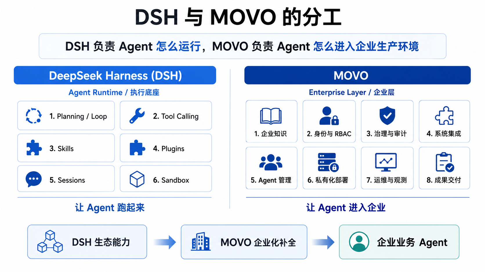
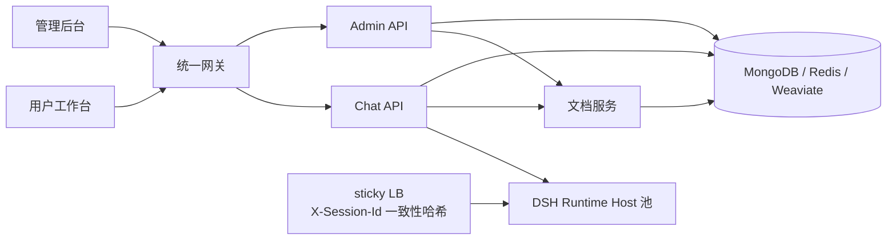

<p align="center">
  
</p>

<h1 align="center">墨攻 MOGO</h1>

<p align="center">
  基于 DeepSeek Harness（DSH）的企业级智能体平台，在开源 MOGO 基础上构建。
</p>

<p align="center">
  <a href="README.md">English</a> · <strong>简体中文</strong>
</p>

<p align="center">
  <a href="#5-分钟快速启动"><strong>🚀 快速开始</strong></a> ·
  <a href="docs/企业级智能体功能补强规划.md"><strong>📐 功能补强规划</strong></a> ·
  <a href="docs/SDD界面呈现对照表.md"><strong>🔍 SDD 界面呈现对照表</strong></a> ·
  <a href="docs/cases/README.md"><strong>🧩 落地案例</strong></a>
</p>

<br>

墨攻（MOGO）是在开源 MOGO 平台基础上构建的企业级智能体平台。它保留上游项目已验证的执行底座与产品形态，并沿三条主线推进到企业生产：**引入 spec-kit SDD 开发规范**、**补强企业级功能**、**支持智能体多实例横向扩展**。

> **一句话理解墨攻：** DSH 负责智能体如何运行，墨攻负责智能体如何进入企业生产环境。

<br>

<p align="center">
  
</p>

<br>

本仓库包含可私有化部署的墨攻开源版。

## 与开源 MOGO 的关系

墨攻不是从零开始的新平台，而是站在开源 MOGO 这个较完整起点上的企业化演进。已在上游项目验证并**明确不重复投入**的五块能力，作为"不重复造轮子"的边界：

| 已领先的能力 | 说明 |
| --- | --- |
| 容器化自托管部署 | Docker Compose 一键启动 14 个服务 + CLI 启动器 + 备份/恢复，生产运维底座已就绪 |
| Docling 多格式解析 | PDF / DOCX / XLSX / PPTX / CSV + LibreOffice 预览，文档理解能力完整 |
| 内容与文件生成 | 报告 / 文章 / PPTX / 表格 / PDF / 翻译 / 表单填写，是相对同类方案的差异化强项 |
| 多形态 Agent | 浏览器 Agent、代码 Agent、子智能体（桌面端），执行形态丰富 |
| SkillHub 生态 | 企业知识研究、引用证据、Skill 市场 + ZIP 安装，知识闭环与生态分发已成型 |

墨攻在这五块之上**只做加法**，新增能力集中在下面三条主线。

## 主线一：spec-kit SDD 开发规范

墨攻引入 [spec-kit](https://github.com/github/spec-kit) 的规格驱动开发（Spec-Driven Development）流程，把每一项功能补强都固化成可追溯的规格资产，而不是散落在提交记录里。

仓库中的 `.specify/` 与 `specs/` 承载这套规范：

```text
.specify/                 # spec-kit 工作流、模板与项目宪法
  memory/constitution.md  #   项目宪法：代理操作规则、边界与质量约束
  templates/              #   spec / plan / tasks 模板
  scripts/bash/           #   create-new-feature、setup-plan 等脚本
  workflows/speckit/      #   工作流注册表

specs/                    # 44 个特性规格（001–044），每个含完整规格链路
  001-gatekeeper-governance/
  ...
  020-platform-multi-tenancy/
  021-unified-context-address/
  022-security-hardening/
  023-observability-resilience/
  024-deployment-hardening/
  025-api-contract-hardening/
  026-performance-scalability/
  027-mongo-to-panweidb-migration/
  028-user-web-trajectory-tab/
  029-user-web-sso-receiver/
  030-ontology-data-permission/
  031-model-provider-discover/
  032-eval-gate/ … 044-multi-agent-modes/   # AgentOS 整合批次（032–044，13 项全新特性，2026-10-23 新增）
  INDEX.md                # 规格索引
```

44 个特性目录都包含 `spec.md`（需求与验收）、`plan.md`（技术方案）与 `tasks.md`（可执行任务拆分），每份均配有 `checklists/requirements.md`（质量清单）与 `quickstart.md`。其中 5 个（001、007、008、009、020）另附 `contracts/` 目录。

它们分为七组：

- **17 个补齐特性**（001/002/007–021）——原始补强清单加上平台化与地址空间两个新增范围。**17 份 `tasks.md`（354 项）已全部勾选完成**，实现与测试同步落地。
- **5 个质量加固特性**（022–026）——从 2026-10-11 QualityForge 全量 QA 审计中拆出，共 412 项任务。**落地状态（2026-10-26 更新）：022 安全加固已完整落地（58/58）；023 可观测性与韧性已完整落地（126/126）；024 部署与发布加固 112/119（余 7 项：T081/T085/T086/T106/T107 需真实环境演练、B004/B005 需真实 docker daemon）；025 API 契约加固已完整落地（52/52）；026 性能与扩展性 56/57（余 T041 需真实水平扩展压测）**。剩余缺口全部为环境类，如实留空不勾（见各特性 `tasks.md` 保留项）。原规约层阻塞已解除：023 的 OQ-1~OQ-8 已于 2026-10-24 经 `/speckit-clarify` 全部消解（Loki / Tempo / pybreaker / 本地磁盘+S3 兼容异地 / IM webhook+邮件 / SLO 99.9%·P99<3s / RTO≤30min·RPO≤15min / 单宿主机演练如实声明）（详见下文[质量加固：022–026](#质量加固022026)）。
- **4 个既有回溯特性**（003–006）——重述上游项目已有能力。它们最初未建 `tasks.md`，2026-10-11 补齐了 141 项任务。
- **1 个数据后端迁移**（027）——数据层从 MongoDB 迁到 PanWeiDB（openGauss 内核）：兼容门面（R1）+ 聚合管道编译与 bulk_write 接线（R2）+ 44 表关系扁平化（R3）全量落地，开关式回滚、既有调用点零改写；默认仍为 MongoDB，经 `MOGO_DATA_BACKEND=panweidb` 可选开启。
- **4 个 user-web / 数据体验特性**（028–031）——028 把每条消息内联的执行过程提升为会话级「对话 / 轨迹」双 tab；029 把 user-web 变成 SSO 接收方，外部门户已登录用户免二次登录进入工作台（2026-10-15）；030 为本体域新增数据范围权限（P1，2026-10-16）；031 新增模型供应商发现与多协议接入（Anthropic / Gemini / Ollama，P1，2026-10-18）（详见下文[数据后端与 user-web 体验：027–031](#数据后端与-user-web-体验027031)）。
- **13 个 AgentOS 整合特性**（032–044）——2026-10-23 企业级 Agent OS 产品落地批次：13 项全新特性（评估门禁、灰度发布、凭证加密、成本归因、信任评级、统一门户、出口沙箱、可视化编排、模型分级路由、连接器市场、三级配额、会话回放、多智能体模式）；每一项都含 spec/plan/tasks/checklist，代码于 2026-10-24 落地（详见下文[AgentOS 整合批次：032–044](#agentos-整合批次032044)）。

接口契约分布在两处：顶层 [`contracts/`](contracts/) 下 6 份 T998 契约（`orchestration`、`self-evolution`、`session-versioning-contract`、`harness-config`、`a2a-gateway`、`memory-context-contract`），加上 `specs/` 内 5 个按特性划分的 `contracts/` 目录（[`001/contracts/gatekeeper.md`](specs/001-gatekeeper-governance/contracts/gatekeeper.md)、[`007/contracts/resilience.md`](specs/007-llm-gateway-resilience/contracts/resilience.md)、[`008/contracts/dashboard.md`](specs/008-ops-dashboard/contracts/dashboard.md)、[`009/contracts/hooks.md`](specs/009-hooks-interception/contracts/hooks.md)、[`020/contracts/tenants.md`](specs/020-platform-multi-tenancy/contracts/tenants.md)）。

[`specs/INDEX.md`](specs/INDEX.md) 是权威清单：它把 44 个特性分为既有回溯（003–006）、缺口新特性（001/002/007–019 与 021）、新增平台范围（020）、质量加固（022–026）、数据后端迁移（027）、user-web / 本体权限 / 模型发现体验（028–031）与 AgentOS 整合批次（032–044）七组，并记录每条阈值的 clarify 决策依据。

这样做的收益是：每一条企业能力都有对应的需求来源、验收标准与测试证据，界面触点与规格的映射关系记录在 [`docs/SDD界面呈现对照表.md`](docs/SDD界面呈现对照表.md)。

## 主线二：企业级功能补强

补强清单来自 [`docs/企业级智能体功能补强规划.md`](docs/企业级智能体功能补强规划.md)，按 P0 → P1 → P2 三档优先级推进。规划中的 15 个清单项（其中治理与风控层含六层门禁、风险矩阵、权限码、脱敏等子能力）**已全部实现并通过测试**（口径：库代码 + 单测，全绿；其中 001 六层门禁（运行时侧）、007 网关韧性、009 Hooks、002 会话版本化已完成生产接线 + UI 落地，详见 [`docs/SDD界面呈现对照表.md`](docs/SDD界面呈现对照表.md) §4 的接线状态说明）。

### P0 —— 企业入场券：合规刚需与生产可用性

| 能力 | 交付内容 |
| --- | --- |
| **Gatekeeper 六层串行门禁** | 身份 → RBAC → 脱敏 → 审批 → 配额 → 审计串成一条门禁链；R4 红线动作不可被任何一层覆盖 |
| **风险分级与自主矩阵** | R0–R4 工具风险分级，配合 L1–L5 × R0–R4 自主级别矩阵（25 格），把零散的"敏感工具审批"升级为系统化、分级放权 |
| **细粒度 RBAC 权限码** | `<resource>:<action>[:<target>]` 权限码，支持三级隔离与 fail-closed，替代粗粒度的岗位角色判断 |
| **PII 脱敏** | 私钥 / 身份证 / 银行卡 / 手机号等按 `mask` / `remove` / `hash` / `abstract` 策略处理；运行时与会话保存/分享时双重生效，敏感内容替换为可逆占位符，clone 默认只读 |
| **LLM 网关韧性** | 主 → 备供应商 failover、逐级降档的 degradation chain、指数退避重试，以及用量与成本计量上报 |
| **运营驾驶舱** | 管理后台四维看板——成本、使用、质量、趋势 |

### P1 —— 可靠执行与会话交接

| 能力 | 交付内容 |
| --- | --- |
| **Hooks 拦截机制** | 五个生命周期事件（SessionStart / PreToolUse / PostToolUse / SessionEnd / MemoryCommit），配套超时保护、fail-closed 语义与声明式规则（`deny_tool` / `require_field` / `observe`）；PreToolUse 已实现 tool > session > tenant 规则优先级与 ≤5s 延迟预算 |
| **DAG 编排引擎** | 四种模式（sequential / supervisor / hybrid / graph）、拓扑排序与环检测、带三态 fail-closed 求值与追溯的条件跳过、节点级指数退避重试 |
| **会话与工作流双版本化** | 会话 `commit` 形成线性时间线，一次性 `share` 链接把需求、讨论与执行过程一并交接，共在线支持多人围绕同一会话协作；工作流定义通过编排引擎做版本化 |

### P2 —— 规模化生态：九项自进化与生态能力

这是补强清单的第三档，共 **9 项**，全部已实现并通过测试：

| # | 能力 | 交付内容 | 规格 |
| :-: | --- | --- | :-: |
| 1 | **Dream Cycle 自进化** | friction 捕获 → 候选排名 → 改进 MR（Jaccard ≥ 0.7 且样本 ≥ 5，draft 中间态）+ 低采纳退役（14 天 / ≥20 曝光 / <10%），全链路审计可配置 | [011](specs/011-dream-cycle-self-evolution/) |
| 2 | **A2A Agent 互通网关** | AgentCard（Dify 优先）+ JSON-RPC 三方法 + task id 幂等 + 出站客户端（30s 超时 / failover / 退避），治理拒绝短路 | [012](specs/012-a2a-agent-gateway/) |
| 3 | **多 IM 入口** | ChannelRouter（注册 / 启用 / 停用只读）+ 会话-渠道绑定 + webhook 入口 + 统一审计 | [013](specs/013-multi-im-entry/) |
| 4 | **业务系统语义索引** | 实体指针索引（不写业务库）+ 复用检索客户端，命中带 citation 锚点 | [014](specs/014-business-semantic-index/) |
| 5 | **知识图谱层** | 节点 / 边 + 多跳遍历（CycleGuard）+ 互斥 / 传递 / 基数约束（标记不阻断） | [015](specs/015-knowledge-graph-layer/) |
| 6 | **Skill 市场强化 + 沉淀闭环** | 质量打分 / 回滚 / 低质标记；沉淀闭环打通"会话 → 经验 → Skill 草稿" | [016](specs/016-skill-market-hardening/) |
| 7 | **三范围 Memory** | personal / workspace / org 三级可见性 + 升级授权 + 30 天衰减 + RAG 按 scope 过滤排序，并叠加 L0 / L1 / L2 密度轴与渐进检索 | [017](specs/017-three-scope-memory/) |
| 8 | **能力资产化"发现→注册"** | 契约四段 + 扫描去重 + 治理视图 + 状态审批 + `a2a_exposed` 标记 | [018](specs/018-capability-asset-registration/) |
| 9 | **厚/薄 Harness 弹性配置** | profile 三层覆盖链 + 层开关 + 合规底线（R4 恒 deny）+ 与 Gatekeeper 对接 | [019](specs/019-harness-elastic-config/) |

### 清单之外的新增范围

有两项能力不在这 15 项清单内。它们都是后来新增的范围，各自配有 spec、plan、checklist 与 tasks；020 另附 `contracts/` 目录与 `quickstart.md`：

| # | 能力 | 交付内容 | 规格 |
| :-: | --- | --- | :-: |
| 10 | **平台化多租户** | 在既有 `tenant_id` 分区之上补齐租户供给：`tenants` 主表、由首次启动引导创建的平台管理员（`__platform__`）、登录强制选择企业、归档 / 恢复 / 彻底清理生命周期（含审计与墓碑记录），配额默认不限额 | [020](specs/020-platform-multi-tenancy/) |
| 11 | **统一上下文地址空间** | 用同一套 `mogo://` 语法覆盖四根（memory / resource / skill / session），配虚拟路由、按租户适配器、委托式可见性与统一检索轨迹。地址层不复写授权判定，一律转发给拥有该上下文的 spec。首期 tenant 为 memory，并同步引入 L0 / L1 / L2 密度轴与渐进检索 | [021](specs/021-unified-context-address/) |

这九项补强能力共同指向"Agent 越用越聪明"的目标形态：把**会话 → 经验 → Skill** 串成主线，让一个人的会话成为团队与后续自动化的起点；平台化多租户（020）则把这套形态从单个企业延伸到一套部署承载多个企业——既有部署语义本是"一套部署 = 一个企业"；统一上下文地址空间（021）进一步让每类上下文都有唯一可寻址的入口：记忆、Skill、会话与资源走同一套 `mogo://` 语法，而不是四套各写各的 API。

#### 质量加固：022–026

2026-10-11 的 QualityForge 全量 QA 审计（964 项）暴露出 283 个 P0/P1 缺陷，它们需要新建能力才能修复，而不是打补丁，于是按风险域拆成 5 个特性。每个都走完整的 spec → plan → tasks → checklist 链路（共 412 项任务）。**落地状态（2026-10-26 更新）：022 已完整落地（58/58）；023 已完整落地（126/126）；024 112/119（余 7 项为真实环境演练 / 真实 docker daemon）；025 已完整落地（52/52）；026 56/57（余 T041 为真实水平扩展压测）。023 原受 OQ-1~OQ-8 clarify 门禁约束，已于 2026-10-24 消解：**

| # | 能力 | 交付内容 | 规格 |
| :-: | --- | --- | :-: |
| 12 | **安全加固** | 闭合 96 个 P0/P1 缺陷，覆盖认证、MFA、令牌、授权、输入、数据、供应链 7 个域：统一口令/MFA 策略；1 小时访问令牌 + 一次性刷新轮换与整族重放吊销；空闲/绝对会话超时；按 `service_id`/`tenant_id`/`user_id` 绑定的服务间凭证；AES-GCM 加密存储与脱敏响应；显式 CORS 源白名单；SSO 票据换取（令牌不再进地址栏与历史）；TLS 终结网关；独立数据库中的防篡改审计链；以及全仓密钥扫描门禁 | [022](specs/022-security-hardening/) |
| 13 | **可观测性与韧性** | 74 个 P0/P1 缺陷，覆盖日志、追踪、指标、告警、容错与恢复 6 个域 | [023](specs/023-observability-resilience/) |
| 14 | **部署与发布加固** | 42 个 P0/P1 缺陷，覆盖部署安全、制品、灰度、回滚与灾备 5 个域 | [024](specs/024-deployment-hardening/) |
| 15 | **API 契约与语义** | 50 个 P0/P1 缺陷，覆盖语义、错误处理、契约与演进 4 个域——含一个静态检查：任何 GET 路由都不得写数据库。**完整落地（2026-10-26，52/52）：三服务统一 `ErrorResponse`（RFC 9457 + 兼容键）、`X-Trace-ID` 中间件、跨服务错误码唯一性 CI 门禁，以及契约 / OpenAPI / 版本化门禁；US1–US4 全部完成** | [025](specs/025-api-contract-hardening/) |
| 16 | **性能与扩展性** | 51 个 P0/P1 缺陷，覆盖性能基线、数据库、缓存、前端与扩展性 5 个域，附 p95 延迟回归守卫 | [026](specs/026-performance-scalability/) |

### 数据后端与 user-web 体验：027–031

质量加固之后又落地了 5 个特性——1 项基础设施迁移、2 项 user-web 体验升级、1 项本体数据权限和 1 项模型供应商发现。每个都配有 spec、plan 与 tasks，且均已实现：

| # | 能力 | 交付内容 | 规格 |
| :-: | --- | --- | :-: |
| 17 | **数据后端迁移：MongoDB → PanWeiDB（可选）** | 以 Motor/PyMongo 兼容门面（R1）+ 聚合管道编译与 bulk_write 接线（R2）+ 44 表关系扁平化（R3）全量落地；默认仍为 MongoDB，经 `MOGO_DATA_BACKEND=panweidb` 可选开启，回滚仅改环境变量、无需改代码 | [027](specs/027-mongo-to-panweidb-migration/) |
| 18 | **user-web 会话级「对话 / 轨迹」双 tab** | 把每条 assistant 消息内联的可折叠执行过程，提升为会话级「轨迹」tab，与「对话」tab 并列切换。对话与轨迹本是同一批 V3 事件的两种投影，因此切换是纯前端视图层改动、数据层零新增：tab 状态按会话（pane）独立保持、默认「对话」、中英双语文案、`v-show` 切换不中断流式生成——`ChatWindow.vue` 本身零改动 | [028](specs/028-user-web-trajectory-tab/) |
| 19 | **user-web SSO 接收方** | 外部门户已登录用户免二次登录进入 MOGO 用户工作台：门户后端用 022 服务身份（`X-MOGO-Service-Token`）申领一次性 HMAC 票据（TTL 60s），浏览器经 `state=` 传票（令牌不进 URL），user-web 启动即换票并复用既有 `_create_session()` 建会话。账号按共享主键 `id` 匹配、不 JIT 建号；多租户用户走既有选租户挑战流程；重放与过期票据经常数时间验签 + accept-once 拒绝；换票失败回落登录弹窗，不静默失败 | [029](specs/029-user-web-sso-receiver/) |
| 20 | **本体数据权限** | 在本体域新增一层数据范围（data scope）权限，与既有 RBAC 功能权限正交：三张表（`mesc_ontology_grant` / `mesc_ontology_class_detail` / `mesc_ontology_perm_audit`）+ 通用 `sys_config` 开关。运行时按 `(tenant_id, user_id)` 解析可见本体（fail-closed，60 s 缓存），检索按 `ontology_id` 过滤；管理端 13 条路由 + 1 内部接口 + 清单页与用户授权弹窗。双后端（Mongo + PanWeiDB）均已执行入库 | [030](specs/030-ontology-data-permission/) |
| 21 | **模型供应商发现与多协议接入** | admin-web 「新增模型配置」免手填模型 ID：后端 `POST /api/models/discover` 用已配置 baseUrl+apiKey 直连 provider 真实 API 拉回模型清单，前端「获取列表」弹窗点选回填；discover 由 OpenAI/Azure 扩展到 Anthropic Claude / Google Gemini / Ollama（本地）三类协议（种子 + 前端类型 + 连接测试分发）；首次配置向导 `SetupModelFields` 为三类补专属字段提示 | [031](specs/031-model-provider-discover/) |

### AgentOS 整合批次：032–044

13 个特性填补了 MOGO 与*企业级 Agent OS* 产品落地规划（2026-10-15）及其代码级评估（`docs/MOGO-AgentOS整合方案.md`）之间的差距。每一项都是全新特性——spec/plan/tasks 在实现前就已写好（与 027/030/031 的事后回溯不同）——且全部 13 项均于 2026-10-24 落地。依据 ADR-7，移动端由 013 多 IM 入口覆盖（无独立移动端或桌面端客户端）：

| # | 能力 | 交付内容 | 规格 |
| :-: | --- | --- | :-: |
| 22 | **评估门禁（Eval gate）** | 金标准测试集 + 发布时评估，硬 pass/fail 阈值（幻觉重构为引用支持率 / 拒答正确性 / 任务成功率）；表现不佳的 Agent 在 `publish()` 处被拒 | [032](specs/032-eval-gate/) |
| 23 | **灰度发布（Canary rollout）** | 百分比灰度 1%→10%→50%→100% + 影子双跑（非污染）+ 回滚——把 016 的租户级灰度扩展到比例步进 | [033](specs/033-canary-rollout/) |
| 24 | **凭证加密（Credential encryption）** | 把 022 的 AES-GCM / KMS 路径（已建、从未调用）接入工具凭证存储——写时加密 / 读时解密 / 响应脱敏——外加明文迁移；Agent 侧服务端注入不变 | [034](specs/034-credential-encryption/) |
| 25 | **成本归因（Cost attribution）** | 新增部门 / Agent / 空间 / 业务线维度（在 `TokenUsageRecord` 上 4 个新 `agent_id` 埋点），六维汇总与单调用下钻（含单调用成本）——替代 008 的占位 | [035](specs/035-cost-attribution/) |
| 26 | **信任评级（Trust rating）** | 资产信任分级 L1–L4（实验 → 关键，双审）绑定权限；映射到 001 的 L1–L5 × R0–R4 矩阵（封顶自主度）；连续 3 周低于阈值自动降级 | [036](specs/036-trust-rating/) |
| 27 | **统一门户（Unified portal）** | user-web 应用门户：目录 → 自助认领 → 001 审批 → 即用；Web 表单（ADR-7），经 029 SSO 与 IM 分发 | [037](specs/037-unified-portal/) |
| 28 | **出口沙箱（Egress sandbox）** | 出站域名白名单（默认拒绝 + 审计 + 热加载）用于 HTTP 工具 / 浏览器 Agent；脚本沙箱的网络拒绝语义提升为统一出口控制；远端沙箱保留为契约预留 | [038](specs/038-egress-sandbox/) |
| 29 | **可视化编排画布（Visual orchestration canvas）** | 010 引擎的前端画布（vue-flow）：画布 ↔ YAML 双向往返（YAML 为权威），复用既有节点 / 工具选择器 | [039](specs/039-visual-orchestration/) |
| 30 | **模型分级路由（Model-tier routing）** | 按任务复杂度（规则）在轻量 / 主力 / 旗舰三档间路由；回填缺失的 `model_routing.yaml`；与 007 分工（路由选最省，降级选兜底） | [040](specs/040-model-tier-routing/) |
| 31 | **连接器市场（Connector market）** | 预置连接器模板（首批 10–20 个，数量不承诺）含「从模板创建」向导；升级而非并列既有企业工具连接；凭证托管依赖 034 | [041](specs/041-connector-market/) |
| 32 | **三级配额（Three-level quota）** | 配额从租户 + 用户扩展到团队/项目 + 租户 + 用户（团队复用部门树，项目为新分组）；三级取最小值；001 的门禁层零改动获得三级语义 | [042](specs/042-three-level-quota/) |
| 33 | **会话回放（Session replay）** | 把 028 的轨迹从只读展示提升为跳转回放：第 1 阶段（纯前端投影——时间线 + 跳转 + 下钻，零后端改动）为 MVP；第 2 阶段（真回放）仅预研 | [043](specs/043-session-replay/) |
| 34 | **多智能体模式（Multi-agent modes）** | 010 引擎新增 `round_robin`（三种可选选择策略）与 `debate`（轮次上限 + 三种收敛条件）；既有四种模式不变 | [044](specs/044-multi-agent-modes/) |

Wave 1（治理闭环）= 032 + 033 + 034；Wave 2（运营与产品完备性）= 035 + 036 + 037 + 038；Wave 3（生态体验）= 039–044，按资源情况取舍。

## 主线三：智能体多实例运行改造

单实例部署下，Node DSH Runtime Host 把 kernel 会话状态保存在进程内存中——一旦横向扩展，同一个会话的请求被负载均衡到另一台实例就会找不到会话。

墨攻按 [`docs/open-source-productization/agent-multi-instance-evaluation.md`](docs/open-source-productization/agent-multi-instance-evaluation.md) 的层 A 方案落地了 **sticky 路由**：

- **按 `kernel_session_id` 一致性哈希**：每个请求携带 `X-Session-Id`，前置 nginx 以 `hash $http_x_session_id consistent` 把同一会话固定到同一实例
- **哈希稳定**：使用 `hashlib.sha256` 而非进程内随机的内置 `hash`，重启后同一会话仍落到同一实例
- **向后兼容**：仅配置单个 Runtime Host 时，行为与改造前完全一致
- **配置**：`DSH_RUNTIME_HOSTS_URL`（逗号分隔）声明实例列表，`docker-compose.yml` 提供三副本 + sticky LB

契约测试覆盖哈希稳定性与分布、单 URL 向后兼容、请求头注入，以及 **50 并发 × 3 实例的会话亲和性验证**。

## 落地案例

[`docs/cases/`](docs/cases/README.md) 收录了两个可运行的完整案例，用于说明墨攻的能力如何组合成真实业务场景。两个案例都配有端到端测试，运行时不依赖外部 LLM 或网络。

| 案例 | 类型 | 核心能力 |
| --- | --- | --- |
| [**客户反馈智能分诊**](docs/cases/single-agent-customer-feedback-triage.md) | 单智能体 · 单 Skill | 文档解析 · Spreadsheet · RAG · PII 脱敏 · 审批 · 审计 · 成本驾驶舱 |
| [**竞品深度调研**](docs/cases/multi-agent-competitor-deep-dive.md) | 多智能体 · DAG graph | DAG 编排 · 并行执行 · 条件跳过 · 失败传播 · 报告合成 · 成本聚合 |

**一个是单智能体、一个是多智能体**，正好说明选型判断：任务边界清晰、子任务顺序依赖时用单智能体；子任务之间有独立数据源与分析模式时，才值得付出多智能体的上下文重建成本。

### 案例一：客户反馈智能分诊

客服团队每天收到数百条来自工单、邮件、社群与应用内的反馈，人工分诊耗时且容易埋没紧急问题。该案例把一批反馈（Excel / CSV / 文本）一次处理成结构化分诊报告：按 P0–P3 分级、按模块归类、识别需立即响应的项、生成跟进摘要，并在 P0 达到阈值时触发审批。

交付物为 `customer_feedback_triage` Skill（含模板、脚本与校验契约）与可运行的分诊运行时，覆盖批量性能、P0 召回率、PII 零泄漏、审批触发、成本入账、审计完整、会话可 resume、Skill 包可安装等验收标准。

### 案例二：竞品深度调研

战略团队定期需要覆盖市场、产品、财务、舆情四个维度的竞品深度报告，人工完成需 2–3 周。该案例以 **DAG graph** 编排四个并行分析子智能体，再由汇总节点交叉引用并输出 analyst-grade 报告：

- 四个分析节点**并行执行**（数据源互不依赖），汇总节点等待全部完成后触发
- **条件跳过**：竞品为私有公司时自动跳过财务分析，并在报告中说明原因
- **失败传播**：单个子节点失败不影响其余节点；完成数少于 3 个时汇总节点跳过并输出降级报告，而不是给出误导性结论
- **证据可追溯**：报告所有主张附证据 ID，可反查

为此墨攻新增了 YAML 编排加载器，使编排定义可以作为声明式文档维护，并在加载期校验拓扑与条件语法。

## 5 分钟快速启动

安装 Git 和 Docker Desktop（或 Docker Engine 与 Docker Compose v2）后执行：

```bash
git clone https://github.com/cooper2006/mogo.git
cd mogo
chmod +x mogo

# 网关默认启用 HTTPS，而证书不入库，所以先生成一对自签证书
# （浏览器会提示不安全，本地访问无妨）。生产请换成 CA 签发的 server.crt/server.key。
openssl req -x509 -nodes -days 365 -newkey rsa:2048 \
  -keyout server.key -out server.crt -subj '/CN=localhost' \
  -addext 'subjectAltName = DNS:localhost,IP:127.0.0.1'
bash deploy/tls/setup-certs.sh   # 复制到 deploy/tls/，并把私钥权限归一化为 0644

./mogo up
```

然后打开：

```text
https://localhost/admin/setup
```

启动器会拉取官方预构建镜像、等待服务就绪并打印初始化地址，无需准备 `.env` 文件或本地构建镜像。**HTTPS 默认开启**——证书不入库，所以上面那步 `openssl`（或你自备的证书）是前置条件，详见 [HTTPS 与 TLS 证书](#https-与-tls-证书)。Windows 用户请在 Ubuntu WSL 2 发行版中运行墨攻，参见 [Windows 安装指南](docs/windows-installation.zh-CN.md)。

## 开源版说明

通过私有化初始化流程创建的租户会被标记为 `community`：

- 不限制成员数量；
- 不启用计费和商业套餐限制；
- 支持自行配置模型服务；
- 数据和运行服务保留在部署者自己的环境中。

本仓库包括用户工作台、管理后台、对话与 Agent API、DSH Runtime Host、文档解析与检索服务，以及完整的 Docker 部署配置。

### 浏览器 Agent 与 Code Agent

私有化部署的 Web 工作台支持对话、研究、知识、文件和内容生成。如需使用**浏览器 Agent** 或 **Code Agent**，请下载安装墨攻桌面端，并将它连接到你自行部署的墨攻服务。

桌面端为这些能力提供本地浏览器会话、代码工作区、项目终端和 Git 集成，是独立分发的专有软件，源码不包含在本仓库中。

| 能力 | 私有化 Web 端 | 桌面端 |
| --- | :---: | :---: |
| 对话、研究与企业知识 | ✓ | ✓ |
| 文档理解与内容生成 | ✓ | ✓ |
| 浏览器 Agent | — | ✓ |
| Code Agent、本地项目、终端与 Git | — | ✓ |
| 是否需要私有化部署墨攻服务 | ✓ | ✓，连接该服务 |
| 源码是否包含在本仓库 | ✓ | —，独立分发 |

## 系统架构



默认 Docker Compose 部署会启动网关、两个 Web 应用、三个应用 API、DSH Runtime Host（多副本 + sticky LB）、文档 Worker、MongoDB、Redis、Weaviate 以及一次性的密钥引导服务。

## 部署与运维

### 环境要求与平台说明

- Git
- Docker Desktop，或 Docker Engine 与 Docker Compose v2
- 至少 8 GB 可用内存
- 至少 20 GB 可用磁盘空间（用于镜像与应用数据）
- 首次拉取镜像时可访问 GHCR 与 Docker Hub
- 至少一个可用模型 API 的凭据，用于完成初始化

上面的快速启动命令适用于 Linux 与 macOS。`./mogo up` 会依次拉取官方镜像，并在网络失败时持续重试，直到成功或用户按 `Ctrl+C`。首次启动需要下载多个镜像，访问 GHCR 或 Docker Hub 较慢时耗时会更长。普通用户**不需要**在本地构建镜像。

Windows 用户请使用 Docker Desktop 配合 WSL 2 与 Ubuntu。可以先用 `wsl -l -v` 确认 Ubuntu 存在，再用 `wsl -d Ubuntu` 显式进入；不要在 `docker-desktop:` 开头的提示符下运行。完整步骤见 [Windows 安装指南](docs/windows-installation.zh-CN.md)。

你也可以直接用 `docker compose up -d` 启动同一套官方镜像（包括在 Windows PowerShell 或命令提示符中）。两种方式都不需要 `.env` 文件，但原生 Compose 会并行拉取，且不提供启动器的持续重试与就绪等待。如果要从源码构建并启动本地镜像，使用 `./mogo up --build`。

初始化完成后可访问：

| 入口 | 默认地址 | 用途 |
| --- | --- | --- |
| 用户工作台 | `https://localhost/` | 对话、研究、知识、文件与内容生成 |
| 管理后台 | `https://localhost/admin/` | 组织、用户、模型、知识、Skill、工具与治理 |
| 初始化向导 | `https://localhost/admin/setup` | 仅用于首次初始化 |

网关默认在 443 上终结 TLS。宿主 HTTP 端口（`MOGO_PORT`，默认 3000）除 `/healthz` 外一律 `301` 跳到对应的 HTTPS 地址；`/healthz` 保持 HTTP `200`，以免影响负载均衡与容器健康检查。

初始化向导会检查部署状态，并引导你创建组织与初始账号、连接默认对话模型，以及按需配置 embedding、rerank、视觉、图像生成与网络搜索服务。凭据在存储前会加密。

### HTTPS 与 TLS 证书

网关自己终结 TLS：`deploy/nginx/nginx.conf` 是 HTTPS 服务的**唯一事实来源**，`docker-compose.yml` 默认就挂载它；其中已配好仅 TLS 1.2/1.3、带 `preload` 的 HSTS 以及常用安全响应头。

**首次启动前必须准备好证书对。** 证书刻意不入库（`deploy/tls/.gitignore`），全新克隆是没有的，网关会因 `cannot load certificate key` 进入 crash-loop。

| 文件 | 权限 | 说明 |
| --- | --- | --- |
| `deploy/tls/fullchain.pem` | `0644` | 证书链（含中间证书） |
| `deploy/tls/privkey.pem` | `0644` | 私钥 |

**私钥必须是 `0644`。** 网关以非 root 的 `appuser`（UID 10001）运行，而证书目录是 bind mount，Linux 上会保留宿主 uid——`0600` 的私钥容器内读不到，nginx 启动即退出：

```text
nginx: [emerg] cannot load certificate key "/etc/nginx/certs/privkey.pem" (13: Permission denied)
```

`openssl req -newkey` 生成的私钥默认是 `0600`，`cp` 也会保留源模式，所以**每次放完证书都要显式 `chmod`**。macOS/OrbStack 会把 bind mount 的属主映射成容器运行用户，所以 `0600` 本地看着没事，生产 Linux 照样挂。若要求私钥不 world-readable，改为交给容器 uid：

```bash
sudo chown 10001:10001 deploy/tls/privkey.pem && chmod 0600 deploy/tls/privkey.pem
```

证书目录与网关配置都是参数化的，所以 CA 签发的证书同样可用——请把 `MOGO_TLS_CERTS_DIR` 指向证书的**副本**，而不是 Let's Encrypt 的 `live/` 目录：那里是符号链接，指向 root `0700` 的 `archive/`，容器内 UID 10001 穿不过去。

```env
MOGO_TLS_CERTS_DIR=/etc/letsencrypt/live/example.com
MOGO_NGINX_CONF=./deploy/nginx/nginx.conf
```

配置是**挂载**进容器的、不是烤进镜像的，所以开关 TLS 只需重建 gateway 容器，不必重建镜像：

```bash
MOGO_GATEWAY_IMAGE="$(docker inspect mogo-gateway-1 --format '{{.Config.Image}}')" \
  docker compose up -d --no-deps gateway
```

**不要**用裸 `docker compose up -d gateway`：缺了镜像名会解析成 `ghcr.io/mogoai/gateway:latest`，去拉远端镜像覆盖你本地构建的镜像。

要退回纯 HTTP（仅限本地或可信内网调试），把同一个变量指向 HTTP 侧配置再重建 gateway：

```env
MOGO_NGINX_CONF=./deploy/docker/nginx.conf
```

验证切换结果：

```bash
curl -k https://localhost/healthz                                           # 200
curl -s -o /dev/null -w '%{http_code}\n' http://localhost:3000/admin/setup   # 301
curl -s http://localhost:3000/healthz                                       # 200（探针豁免）
openssl s_client -connect localhost:443 -servername localhost </dev/null 2>/dev/null \
  | openssl x509 -noout -subject -dates
```

排障前值得先知道两条行为：

- 跳转规则是 `return 301 https://$host$request_uri`。nginx 的 `$host` **不含端口**，所以 `http://localhost:3000/x` 会落到 `https://localhost/x`（443）。因此把 `MOGO_HTTPS_PORT` 改成非 443 时，还得同步改配置里的跳转目标——它是静态文件，拿不到宿主端口。
- 若宿主 IPv4 `443` 已被别的进程占用，跳转目标就是打不通的（哪怕容器全健康）；改用 `https://localhost/`（IPv6/loopback），或把端口让出来。

完整运维细节——证书辅助脚本、已知坑位表与故障排查——见 [`deploy/tls/README.md`](deploy/tls/README.md)；回归守卫是 `deploy/tests/test_tls_gateway_config.py`。

### 常用运维命令

```bash
./mogo status
./mogo logs chat-api
./mogo restart
./mogo update
./mogo backup /path/to/large-disk/mogo-backup
./mogo down       # 停止容器并保留数据
./mogo down -v    # 确认后永久删除墨攻数据
```

生产环境建议固定发布标签，而不是使用 `latest`。镜像选择、升级、备份恢复、反向代理与生产基线参见 [Docker 部署](docs/docker-deployment.md)。

### 多实例横向扩展

DSH Runtime Host 支持多副本运行，由前置 sticky 负载均衡按会话固定实例：

```env
# 逗号分隔的 Runtime Host 实例列表；留空则回退到 DSH_RUNTIME_HOST_URL
DSH_RUNTIME_HOSTS_URL=http://dsh-runtime-host-1:8101,http://dsh-runtime-host-2:8101,http://dsh-runtime-host-3:8101
```

`docker-compose.yml` 已提供三副本与 sticky LB 的参考配置，LB 规则见 `deploy/docker/dsh-runtime-lb.conf`。增加副本时同时补充 `DSH_RUNTIME_HOSTS_URL` 与服务定义即可。

### 运行时版本与依赖钉版

各服务的 Python 运行时钉在 Dockerfile 第一行（`ARG BASE_IMAGE`），解释器版本随镜像走：

| 服务 | Python | 依赖完整性 |
| --- | --- | --- |
| chat-api | 3.13 | `--require-hashes` 校验 2775 条 sha256 |
| admin-api | 3.13 | `--require-hashes` 校验 1063 条 sha256 |
| document-parser | 3.13 | `requirements.txt` 用 `--require-hashes` 校验 1312 条 sha256；`requirements-docling.txt` 只钉版本、按设计不带哈希（见下） |

三个服务的完整哈希集都在 `services/*/requirements.txt` 中；用 `scripts/generate-hashes.sh` 重新生成（脚本指向清华源，仅此一项就把哈希生成从 5 分钟以上压到约 3 分钟）。CI 对三个服务都使用 `--require-hashes`，保证 CI 环境与生产镜像同构。

document-parser 另有一份 `requirements-docling.txt`，装 Docling 家族（`docling==2.108.0`、`docling-core`、`docling-ibm-models`、`docling-parse`、`rapidocr`）与放宽后的 `numpy>=1.24.0,<3.0.0`。该文件**刻意不加哈希**：这份依赖树在 PyPI 上会解析到 CUDA 版 `torch` 与 15 个 `nvidia-*` 包，而镜像实际从 `download.pytorch.org/whl/cpu` 装 CPU 版——强行加哈希要么构建失败，要么把数 GB 的 CUDA 轮子拖进镜像。因此它只做全 `==` 钉版本，且仅在 Docker 镜像内以 `--prefer-binary`（不带哈希参数）安装。探查过程与结论记录在 `docs/WORK_LOG.md` 2026-10-07 条目。

### 无外网与跨架构发布

无外网的生产环境无法从 GHCR 拉取镜像，因此发布路径改为本机构建 → 打包成 tar → 离线导入：

```bash
cd deploy/production
./prepare-release.sh               # 版本号默认取 git short hash
./prepare-release.sh --skip-build  # 复用本地已有镜像，只打包
```

一次执行产出 `prod-images-<TAG>/`：四个镜像包（基础镜像、小型应用镜像、chat-api、document-parser）、一份渲染好的 `docker-compose.portainer.yml`（可直接粘贴进 Portainer standalone stack）、一份自包含的 `DEPLOY.md`，以及记录全部 tag 与 sha256 的 `bundle.json`。`verify_bundle.py` 逐个校验归档：`RepoTags` 是否符合预期、`architecture == amd64/linux`、以及 `len(Layers) == len(rootfs.diff_ids)`——最后一项是经典 `docker load` 的硬性前提。

在 Apple Silicon 机器上构建 `linux/amd64` 时，基础镜像需额外一步，因为 `docker save` 无法导出尚未拉取的平台：

```bash
scripts/export_base_images.sh save --platform linux/amd64 ./base-images-amd64
```

导入单平台归档会**替换**多平台标签，因此 load 默认拒绝跨平台导入，除非显式传入 `--allow-platform-mismatch`。完整流程见 [Docker 部署](docs/docker-deployment.md)。

备份、恢复与回滚可在不触碰 Docker 的前提下做端到端演练：

```bash
bash scripts/test_backup_restore_rollback.sh
```

脚本把 Docker 调用打桩，校验三段链路——备份归档 8 个命名卷并写出 `SHA256SUMS`；恢复先校验哈希与卷前缀再解包；回滚把 `MOGO_VERSION` 前进再退回。

### DSH 运行时版本

MOGO 将 DeepSeek Harness（DSH）Agent 内核**钉版到确切的 release train**，而非浮动范围，因此重新构建不会悄悄改变 Agent 行为：

| 项 | 值 |
| --- | --- |
| DSH release train | `0.2.1-rc.3` |
| 钉版依赖 | `services/chat-api/dsh/runtime-host/package.json` 中的 40 个 `@deepseek-ai/dsh*` 包 |
| Node 运行时 | `^22.19.0 \|\| >=24.0.0` |
| Host 协议 | `askai.dsh-host.v1` |
| Host overlay | `askai-dsh-host-v1` |

版本的权威声明位于 [`services/chat-api/dsh/compatibility-matrix.yaml`](services/chat-api/dsh/compatibility-matrix.yaml)；解析后的依赖图锁定在 `services/chat-api/dsh/runtime-host/pnpm-lock.yaml`，`services/chat-api/dsh/` 下的 `versions.lock` 与 `sbom.cdx.json` 随之一并重新生成。预构建镜像已内置钉版内核，因此常规的 `./mogo update` **不会**改变 DSH train。

**升级 DSH train** 属于源码改动，因为内核是构建期依赖：

1. 更新 `services/chat-api/dsh/runtime-host/package.json` 的钉版号，刷新该目录下的 `pnpm-lock.yaml`，随后重新生成 `services/chat-api/dsh/` 下的 `versions.lock` 与 `sbom.cdx.json`。
2. 更新 `compatibility-matrix.yaml` 的 `active_release` 与 `supported_releases`。**保留上一版本条目**，以便回滚镜像仍有已声明的契约。
3. 重新构建 Runtime Host 镜像，并从源码重建（`./mogo up --build`）。
4. 部署前运行守护测试：`services/chat-api/dsh/runtime-host`（`node --test tests/*.test.mjs`）与 `services/chat-api/tests/dsh_runtime/test_dsh_upgrade_contract.py`——当契约矩阵、`package.json` 与随镜像发布的 web app 三者不一致时会失败。

请把 train 升级视为**兼容性变更而非补丁升级**。DSH 历史版本曾重命名 preset 机制、改变工具结果的消息结构、收紧插件可见性规则；这些都可能让一个"仍能正常启动"的 host overlay 实际失效。升级时请先 diff 新 train 随包发布的 host 平面，不要假定旧 overlay 依旧适用——`0.1.6-alpha.1` → `0.1.7-rc.2` 这次就需要让 overlay 重新透传官方 web-app patch 声明的禁用行。`docs/WORK_LOG.md` 记录了该次升级中发现的具体破坏点，`docs/DSH-0.1.7-skill-catalog-定位报告.md` 则完整记录了其中一例的端到端定位过程。

`0.1.7-rc.2` → `0.2.0-rc.2` 这次又踩到第二个坑：**绝不要拿内核版本字符串做分支判断**。产品代码（`src/official-host/installation.mjs`）本就用可持续的方式判定 preset 平面形态——解析实际安装的是哪个 preset 包（`isPresetRegistryTrain`）——但有个测试把等价判断写成了 `ASKAI_DSH_KERNEL_VERSION === '0.1.7-rc.2'`，于是版本一变就静默跌回旧 train 分支，去断言一个已经不存在的 `@deepseek-ai/dsh-agent-presets` 包。请按**解析出的包身份**分支，而不是版本字面量。

### 配置

默认本地部署不需要 `.env` 文件。如需修改对外端口、规范地址、镜像版本或卷前缀：

```bash
cp .env.example .env
```

```env
MOGO_PORT=3000
MOGO_VOLUME_PREFIX=mogo
MOGO_IMAGE_REGISTRY=ghcr.io/mogoai
MOGO_VERSION=vX.Y.Z
PUBLIC_BASE_URL=https://mogo.example.com
```

首次启动后请保持 `MOGO_VOLUME_PREFIX` 不变。DNS、TLS 证书与外部反向代理由部署方负责。

## 从源码构建

本地构建面向贡献者与开发者：

```bash
./mogo up --build
```

只构建镜像而不启动服务：

```bash
./mogo build
```

源码构建会下载 Playwright、LibreOffice、Docling 与模型资源，所需时间与磁盘空间明显高于直接使用预构建镜像。

## 仓库结构

| 路径 | 组件 |
| --- | --- |
| `specs/` | spec-kit SDD 规格资产（44 个特性 + `INDEX.md`） |
| `contracts/` | 6 份 T998 接口契约（编排、自进化、会话版本化、Harness 配置、A2A 网关、memory-context） |
| `.specify/` | spec-kit 工作流、模板与项目宪法 |
| `apps/user-web/` | Vue 3 用户工作台 |
| `apps/admin-web/` | Vue 3 初始化与管理后台 |
| `services/chat-api/` | FastAPI 对话、任务、Agent、Skill 与 DSH 网关 |
| `services/chat-api/dsh/runtime-host/` | Node.js DSH Runtime Host |
| `services/admin-api/` | FastAPI 组织、用户、模型与平台管理 API |
| `services/document-parser/` | 文档解析、预览、检索 API 与 Worker |
| `deploy/` | 引导脚本、网关与 sticky LB 配置 |
| `deploy/production/` | 面向无外网环境的离线发布打包（Portainer Stack 模板、发布包校验、部署单渲染） |
| `docs/` | 功能补强规划、SDD 对照表、案例与运维文档 |

## 参与贡献与支持

欢迎提交 Issue 与功能建议。清晰的使用场景与可复现反馈通常能较快落地。

- [GitHub Discussions](https://github.com/cooper2006/mogo/discussions)：提问、想法与部署经验
- [GitHub Issues](https://github.com/cooper2006/mogo/issues)：可复现的缺陷
- [贡献指南](CONTRIBUTING.md)
- [安全策略](SECURITY.md)
- [社区支持说明](SUPPORT.md)
- [发布流程](docs/release-process.md)
- 安全、商业授权与支持：`support@mogo.com`

提交变更前请先阅读 [CONTRIBUTING.md](CONTRIBUTING.md) 中的检查要求。CI 在每个 PR 上强制执行五个 job：`version-consistency`（各 manifest 的版本号必须与 CHANGELOG 最新标题一致）、`frontend-quality`（两个 Vue 应用的类型检查、构建与 lint）、`backend-quality`（编译、生产接线检查、测试套件与分模块覆盖率门禁）、`dsh-host-e2e`（把 Node Runtime Host 作为子进程跑端到端）与 `security-quality`（密钥、内容类型与容器镜像扫描）。仓库卫生检查至少需要执行：

```bash
python3 scripts/check_open_source_hygiene.py
```

其中两项值得单独说明，因为它们能拦住单测拦不住的失效。`services/chat-api/scripts/check_production_wiring.py` 会在某子系统"单测全绿但生产侧零引用"时报错——也就是整个特性发不出去的那种失效。`scripts/check_module_coverage.py` 对较新的子系统（017 memory、021 context space、009 hooks）施加比全局 55% 更严的覆盖率下限。

## 许可证

墨攻开源版基于 [MOGO 社区许可证](LICENSE) 发布，该许可证以 Apache License 2.0 为基础并附加条件。未经书面授权，不得用于运营多租户托管 SaaS 服务，不得删除或修改所包含前端的标识与版权声明，也不得将本项目或其衍生作品作为以本项目为主要产品的 OEM、白标或贴牌企业级 Agent 平台进行销售。

由于上述附加条件，MOGO 社区许可证并非未经修改的 Apache License 2.0，也不应被表述为经 OSI 认证的开源许可证。如需商业授权、多租户 SaaS 授权、OEM 或白标分发，请联系 `support@mogo.com`。

## 依赖镜像源

Docker 构建镜像默认使用国内镜像源，以便在中国大陆保持较快的依赖安装速度：

| 镜像 | 镜像源 | 配置位置 |
| --- | --- | --- |
| user-web | npmmirror.com | `apps/user-web/Dockerfile.prod` 中的 `ARG MOGO_NPM_REGISTRY=https://registry.npmmirror.com` |
| admin-web | npmmirror.com | `apps/admin-web/Dockerfile` 中的 `ARG MOGO_NPM_REGISTRY=https://registry.npmmirror.com` |
| chat-api | tuna.tsinghua.edu.cn | `services/chat-api/Dockerfile` 中的 `ENV PIP_INDEX_URL=https://pypi.tuna.tsinghua.edu.cn/simple` |
| admin-api | tuna.tsinghua.edu.cn | `services/admin-api/Dockerfile` 中的 `ENV PIP_INDEX_URL=https://pypi.tuna.tsinghua.edu.cn/simple` |
| document-parser | tuna.tsinghua.edu.cn | `services/document-parser/Dockerfile` 中的 `ARG MOGO_PYPI_INDEX_URL=https://pypi.tuna.tsinghua.edu.cn/simple` |
| DSH Runtime Host | npmmirror.com | `services/chat-api/dsh/runtime-host/Dockerfile` 中的 `ARG MOGO_NPM_REGISTRY=https://registry.npmmirror.com` |

此外还有三处镜像接入：Python 基础镜像经 `ARG BASE_IMAGE` 取自 `docker.m.daocloud.io`；chat-api 从 `cdn.npmmirror.com` 下载 Playwright 浏览器；chat-api、document-parser 与 Runtime Host 通过 `ARG MOGO_APT_MIRROR` 把 `deb.debian.org` 改写为 `mirrors.tuna.tsinghua.edu.cn/debian`。

品牌迁移已完成：构建参数只接受 `MOGO_` 前缀，`MOGO_` 是唯一权威拼写。过渡回退机制（`MOVO_` 键回退、secrets 双写、`movo` 卷名前缀默认值、CLI 内部 `movo_*` 辅助函数命名）已彻底下线；`.env` / CI 中若仍残留 `MOVO_*` 键，需改名为 `MOGO_*`。

如需改用官方源，覆盖构建参数即可：

```bash
# npm
docker build --build-arg MOGO_NPM_REGISTRY=https://registry.npmjs.org -t image-name .

# pip（document-parser）
docker build --build-arg MOGO_PYPI_INDEX_URL=https://pypi.org/simple -t image-name .

# Python 基础镜像
docker build --build-arg BASE_IMAGE=python:3.13-slim-bookworm -t image-name .

# Debian 软件包
docker build --build-arg MOGO_APT_MIRROR=http://deb.debian.org/debian -t image-name .
```

注意 chat-api 与 admin-api 的 `PIP_INDEX_URL` 是 `ENV` 而非 `ARG`，这两个服务要切官方源需直接改 Dockerfile。上述镜像源均无需认证凭据，都是公开只读代理。
