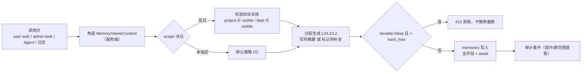
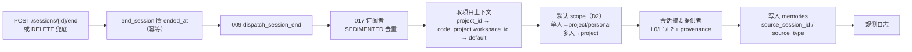
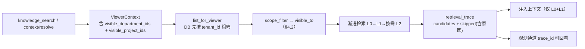
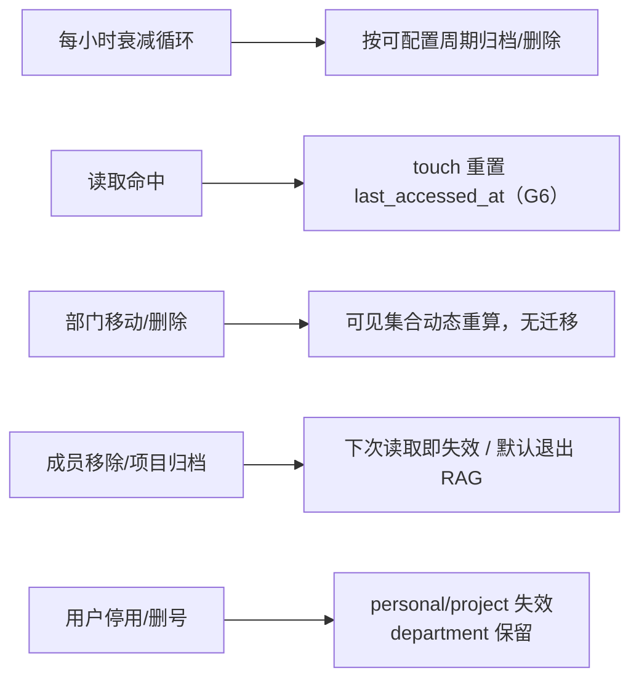
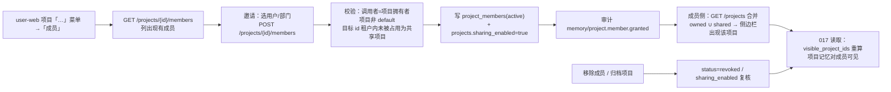
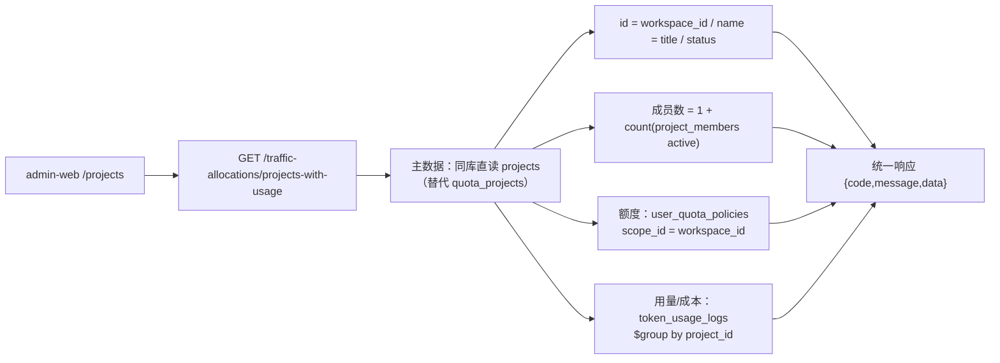

# 017 三范围记忆 · 重规划设计（项目 / 部门 · 双端）

- **状态**：设计提案（Design Draft）· **未落地任何代码**
- **日期**：2026-11-05（含当日 15:58 / 16:00 / 16:03 / 16:05 四条补充口径）
- **输入口径（用户）**：
  1. `workspace` 范围等同于**项目**（`Projects`）；`org` 范围使用**部门**（`org_units`）
  2. 「`projects` 中如果需要可以扩展添加成员」→ **项目可共享**，启用 ADR-8 §4 保留的升级路径
  3. 功能层面**参考插件管理 / Skill 管理，从 admin / user 两端规划**
  4. 成员入口落在 **user-web 项目右侧扩展菜单**（现有「重命名」「删除项目」），并顺带修复 **admin 端「项目管理」页无数据**的问题
- **基线**：`specs/017-three-scope-memory/{spec,plan,tasks,quickstart}.md`、`checklists/requirements.md`、`contracts/memory-context-contract.md`
- **本文不修改**现有 SDD 工件（spec / plan / tasks / checklist / quickstart / contracts），仅给出目标态设计；裁决后另起一轮按 SDD 流程修订
- **本文需触发的上游修订**：`Decisions/ADR-8` D1 + 046 Non-Goals（因「项目可共享」）

---

## 0. 摘要与决策请求

把 017 的第二、三级范围绑定到仓库里真实存在的实体，方向正确且必要：017 现有 `workspace_id` / `org_id` 是**没有主数据来源的字符串**，写入靠客户端自报、判定靠调用方传 bool，这正是上一轮检查中「三级隔离形同虚设」的根因。

用户已授权给 `projects` 扩展成员，因此原「项目是个人所有 vs workspace 是多成员共享」的冲突**已解除**：`project` 范围回归 017 原 workspace 的共享语义，不需要绕道把共享推给部门。代价是必须修订 ADR-8 D1 与 046「不做多人共享项目」的约定，并补齐项目成员的数据模型与两端入口。

调研另发现一个必须一并设计的事实：**admin-web「项目管理」页当前无数据，不是前端空态问题，而是四段数据流断点**（§1.6）。它与「成员数」列、017 项目范围共用同一份项目主数据，不属于可延后的独立缺陷，本文一并规划。

| # | 问题 | 状态 / 推荐值 | 若改选的影响 |
|---|---|---|---|
| **D1** | 项目是否多人共享 | ✅ **已裁决：是**（用户授权扩展成员） | 需修订 ADR-8 D1、046 Non-Goals / FR-012 措辞 |
| **D2** | 单人 / 多人会话默认范围 | ✅ **回归 017 原口径**：单人（有非空项目）→ `project`，否则 `personal`；多人 co-presence → `project` | 与 017 FR-3/FR-5 一致，无需再靠 `department` 兜共享 |
| **D3** | 部门可见性是否含下级 | 待确认，**推荐含后代**（与 030 一致）、不含祖先、跨租户 fail-closed | 选「精确同部门」会与 030 本体权限、035 成本归集分叉 |
| **D4** | 机器标识符改名节奏 | 待确认，**推荐目标态用 `project`/`department` + 一个发布周期只读别名** | 立即全量改名会破坏 `mogo://` 地址往返与存量 `memories` |
| **D5** | 项目成员模型形态 | 待确认，**推荐 M1**：独立 `project_members` 集合 + 共享项目 id 租户内唯一 + 默认项目不可共享 | 选 M2（`(owner, project_id)` 二元组）需改 046 全链路 `project_id` 语义 |
| **D6** | 管理端项目列表取数方式 | 待确认，**推荐同库直读 `projects`**（有先例、无跨服务调用），写入边界仍归 chat-api | 选 HTTP 代理需 chat-api 新增「按租户全量」项目端点 |

> 另有一项**不需要裁决、必须先行**的前置修复：统一身份解析上下文（§3.5）。上一轮检查发现的 P0 缺陷（`resolve_session_user` 返回 4 个键，端点却取 `user_id` / `role` / `is_workspace_member`）会让任何范围模型都失效。

---

## 1. 事实基线

### 1.1 项目实体（`Projects` 的真实形态）

| 项 | 事实 | 证据 |
|---|---|---|
| 集合 | chat-api Mongo 集合 `projects`（046 D6 由 `desktop_projects` 改名）；**不存在大写 `Projects` 的 ORM/表定义** | `chat-api/app/api/endpoints/projects.py:7`；`main.py:502`；`scripts/migrate_046_project_dimension.py:91,118` |
| 主键 | `_id = workspace_id`（客户端生成），默认项目保留值 `"default"` | `projects.py:31,115`；ADR-8 D2 |
| 字段 | `_id / tenant_id / user_id / workspace_id / title / worktree / status(active\|archived) / created_at / updated_at` | `projects.py:56-67,110-124` |
| 归属 | `tenant_id + user_id`，unique 索引 `{tenant_id, user_id, workspace_id}`；默认项目**每用户一条** | `main.py:502-505`；`projects.py:75-100` |
| 成员（现状） | **无成员表、无 `is_project_member`**；ADR-8 D1「不要求成员、不要求共享」，046 Non-Goals「不做多人共享项目」 | ADR-8:21；046 spec.md:145,151 |
| 升级路径 | ADR-8 §4 明确保留：「将来真要做团队共享项目，再加 `project_workspaces`（项目 × 用户 × 设备）……现有主键不用推翻」 | ADR-8:41-46 |
| 会话关联 | `chat_sessions.project_id`（新会话必填，web 会话 `"default"`）；**顶层无 `workspace_id` 写入路径** | `dsh_runtime/conversation/repository.py:30-44`；046 FR-004 |
| 生命周期 | 客户端对账 / 菜单「删除项目」→ PATCH `status=archived`，**软归档非物理删除** | `projects.py:138-164`；`user-web/App.vue:651-668`；ADR-8:37 |
| 归档约束 | `_id="default"` 不可归档 / 删除 / 重命名 | `projects.py:144-147`；`App.vue:652` |

**与 017 的现存断点**：会话沉淀链路读 `session_doc.get("workspace_id")`（`session_persistence_service.py:633`、`sessions.py:1372`），该字段恒空 → 017 记忆拿不到项目归属；017 的 `Memory.workspace_id` 也未随 046 改名。

### 1.2 部门实体（`org_units` 的真实形态）

| 项 | 事实 | 证据 |
|---|---|---|
| 集合 | `org_units`（常量 `DEPARTMENT_COLLECTION`），旧名 `departments` 已废弃；**不是** `organizations` / `tenants` | `admin-api/app/repositories/directory_repository.py:9`；`chat-api/app/api/endpoints/auth.py:61-68` |
| 节点含义 | 部门树节点，每租户一棵树，根 `code="root"` / `name="企业总部"`，不可删除 | `directory_repository.py:78-99`；`directory.py:410-411` |
| 字段（实际写入） | `_id / tenant_id / name / code / parent_id / path_ids / path_names / status / source / source_dept_id / created_at / updated_at` | `directory.py:284-298` |
| 层级 | `path_ids` 为祖先 id 数组；改名 / 移动级联刷新后代 | `directory.py:121-124,330-399` |
| 用户关联 | `end_users.primary_org_id`（单值） + `end_user_org_relations`（多部门：`org_id` / `is_primary`） | `directory.py:507-524`；`auth.py:900-917` |
| 口径差异 | chat-api 注册只写主部门一行；admin 端 `create_user`/`update_user` 才写多部门 | `auth.py:907-917`；`directory.py:574,653` |
| 含下级展开 | 030 已实现：`unit.path_ids` 经过用户部门的节点并入主体集合 | `admin-api/app/ontology_permission/subjects.py:69-77`；`chat-api/app/services/ontology_permission.py:177-185` |
| 祖先推导 | **全仓未找到**，现有展开单向向下 | 调研结论 |
| 配额口径 | 042 用「直接成员，不做子树聚合」——与 030「含下级」**不一致** | 042 spec.md:156 FR-002 |
| 角色体系 | `full_access_admin` 纯按 `position_roles.system_key` 判定，不读部门 | `admin-api/app/position_roles/constants.py:9-10`；006 spec.md:72 |
| 离职/删号 | `DELETE /directory/users/{id}` 删 `end_users` 整行 + 关系行；停用仅置 `status=disabled`；**无专门离职端点** | `directory.py:697-739` |
| 租户隔离 | 所有部门查询显式带 `tenant_id`，**不用** `add_tenant_scope`（default 租户宽 `$or` 会放宽边界） | `directory.py:94,273,...`；`chat-api/app/core/tenant.py:16-34` |

**已知数据契约风险（前置依赖）**：`end_user_org_relations` 三处写入方（`directory.py:513-523`、`auth.py:908-916`、`tenant_provisioning.py:192-201`）都**不写 `status`**，而 030 读取带 `{"status":"active"}`。017 若直接复用 030 展开函数会拿到空部门集合。

### 1.3 不参与本次重定义的实体（防混淆）

| 实体 | 是什么 | 本文处置 |
|---|---|---|
| `quota_projects`（admin-api） | 042 配额分组，内嵌 `member_user_ids`；046 FR-012 已下线其成员语义 | 降级为**纯策略容器**，不再作为项目主数据 / 成员来源（§5.7） |
| `project_memories`（`context_engine`） | 上下文压缩缓存，按 `tenant_id+user_id+project_id+key` | **不合并**，用途与生命周期均不同；仅统一 `project_id` 命名 |
| `organizations` / `tenants` | 组织 / 租户（计费主体） | `department` 范围不绑定它们 |
| `mogo://skill/<orgId>` 的 `orgId` | 租户标识（`resolve_tenant_id(org_id)`） | 不改，与部门无关 |
| `knowledge_directories.path_ids` | 知识目录树 | 与 `org_units.path_ids` 同名不同物 |

### 1.4 017 现状缺口（本设计一并吞掉）

| 编号 | 缺口 | 处置 |
|---|---|---|
| G1 | 身份解析契约不一致，`user_id`/`role`/`is_workspace_member` 恒空 → personal 互相可见、其余范围不可用 | §3 统一 `MemoryViewerContext` |
| G2 | RAG 注入未传 `viewer_org_id` → 部门记忆进不了检索 | §5.3 |
| G3 | 会话沉淀 `summarizer` 未注入 → L0/L1 恒空，渐进检索退化为灌全文 | §5.2 |
| G4 | promote 用 `replace_one` 全量覆盖 → 清空分层字段与 provenance | §5.1 / §8-F |
| G5 | 写时 `NoopSummarizer()`、读时不调 `tier_content` → FR-15 双路径仅纯函数支持 | §5.1 |
| G6 | 衰减硬编码 30 天、`touch()` 无调用方 | §5.5 / §8-G |
| G7 | `retrieval_trace` 只塞 payload、`skipped` 恒空 | §5.3 / §9.4 |
| G8 | 无用户离职时 personal/project 记忆失效逻辑（FR-10 未实现） | §6 / §8-G |
| G9 | 沉淀链路读 `session_doc.workspace_id` 恒空 | §5.2 |
| G10 | **017 前端完全空白**：`apps/` 下无任何记忆页面 / 菜单 / API 客户端 | §7 双端规划 |

### 1.5 双端范式现状（插件管理 / Skill 管理）

用户指定的参考对象，其真实形态（调研结论）：

| 维度 | 插件管理（DSH 插件） | Skill 管理 |
|---|---|---|
| admin 页面 | `/dsh-plugins` → `DshPluginsPage.vue` | `/skills` → `SkillsPage.vue`；配套发布 / 版本 / 灰度 / 评测 |
| user 页面 | `/plugins` → `MyPluginsPage.vue` | `/skills` → `MySkillsPage.vue`；「我的技能 / 共享给我」Tab |
| 范围字段 | `scope: organization \| personal`，`_owner()` 按端判定 | `scope: all \| user \| organization`（`/skills/selectable`） |
| 授权给谁 | `ResourceAccessExtensionPanel.vue`「使用权限」：`filter_allowed_resource_ids()` / `resource_is_allowed()`；**部门 / 岗位角色 / 指定员工或关系 + 包含下级** | `MongoEmployeePolicyResolver` → `EffectiveEmployeePolicy.allows_skill()` |
| 状态机 | `enabled` / `availability` / 校验 / 启停 / 删除 | `publication_status`、版本快照、上架 `portal_requests`（applied→approved→granted→revoked） |
| 审计 | 001 `position_role_audit_logs`；017 已登记在 `feature_audit.py:27` 的 `FEATURE_AUDIT_EVENTS` | `record_skill_event()`（004 FR-8）+ `feature_audit_bridge` |
| 治理纪律 | 管理端统一审计视图 `/audit`（`SystemAuditPage.vue` 指标卡 + 筛选 + 表格 + 详情抽屉） | L1 资产 owner-only：不可见**统一返回 404**，不泄露存在性 |

**可直接移植的四条纪律**：① 同一集合按 scope 分端、admin 治理 / user 使用；② 可见范围支持「部门 / 岗位 / 指定员工 + 含下级」；③ 治理动作统一落 `feature_audit_bridge → position_role_audit_logs`；④ 不可见即 404。

**必须遵守的排除项**：`specs/045-asset-center/spec.md:106` 明确「**会话 / 记忆 / 模型不纳入资产中心**（运行时态，归外）」→ 017 记忆管理**不得挂 `/assets`**，需独立菜单。另：插件 / Skill 列表页**没有**批量操作与配额控件，「收藏」「工具市场」也未找到，规划时不得假定已有范式。

### 1.6 管理端「项目管理」页的数据流断点（用户截图）

用户截图（admin-web `/projects`，列：项目名称 / 状态 / **成员数** / 额度 / 用量(tokens) / 成本(USD) / 操作，空态「暂无项目 / 项目在 user-web 里选本地目录创建」）。调研确认这不是空态文案问题，而是**四段断点**：

| # | 断点 | 证据 |
|---|---|---|
| **A** | 列表主数据源读的是 `quota_projects`（空的），**从不读 `projects`** | `admin-web/src/api/projects.ts:23-28` → `admin-api/app/api/routes/traffic_allocations.py:627-666` → `quota_projects.py:78-84`；全量检索 `services/admin-api/app` 无任何读 `projects` 集合的代码 |
| **B** | `quota_projects` 无写入源：ADR-8:36 移除管理端「新建项目」，046 迁移脚本未同步 `projects` → `quota_projects` | ADR-8:35-36；`migrate_046_project_dimension.py` 全文无 `quota_projects` 命中；042 审计文档记「无种子数据」 |
| **C** | **join key 不匹配**：`by_scope.get(item["id"])` / `usage_by_project.get(item["id"])` 用 `quota_projects._id`（`uuid4().hex`），而 `user_quota_policies.scope_id` 与 `token_usage_logs.project_id` 是 `workspace_id` | `traffic_allocations.py:661,665`；`quota_projects.py:114`；`instrumented_client.py:220-222` |
| **D** | 「成员数」取已下线的 `quota_projects.member_user_ids` 数组长度；046 FR-012 后该语义废弃，**无有效数据源** | `quota_projects.py:70-71`；046 spec.md:120；配额引擎已改从 `chat_sessions` 反查（`quota_policy.py:233-249`） |

**有利事实**：两服务共用同一 MongoDB 库（`docker-compose.yml:671-672 / 865-866` 均 `mogo_dev`），admin-api 已有直读 chat-api 侧集合的先例（`tenant_purge.py:59-60,472`、`analytics.py:538,556`、`quota_policy.py:221,240`），且 `token_usage_logs` 的 `project_id` 埋点与 `$group by project_id` 聚合都现成（`traffic_allocations.py:640-649`、`dashboard.py:803-807`）。即**用量 / 成本列技术上能取到数**，只差列表主体与 join key。

**user-web 侧菜单落点**（用户截图）：项目分组标题行的「…」下拉，内联在 `apps/user-web/src/App.vue:2780-2804`，现有两项「重命名」「删除项目」为内联三元文案（非 i18n key），默认项目不渲染菜单（`:2771`）。**注意不是右键菜单**（全仓无 `@contextmenu`）。项目数据来自 `useUserBoundProjects`（本地 `DshWorkspace` + chat-api `GET /askai-api/api/projects`），见 `userBoundProjects.ts:83-114`。项目维度**当前完全不存在**成员 / 共享 API 或组件；最接近的可参考会话分享 `SessionShareDialog.vue:23-36` + `session_shares.py:164,221,241` 的 participants 模式。

---

## 2. 目标态：术语、模型与原则

### 2.1 术语映射

| 017 旧术语 | 目标术语 | 绑定实体 | 存储字段 | 备注 |
|---|---|---|---|---|
| `workspace` 范围 | **`project` 范围** | `projects._id` | `project_id` | 旧值只读别名；语义为**项目成员共享** |
| `workspace_id` | `project_id` | 同上 | 同上 | 兼容期双写 + 三级回退 |
| `is_workspace_member` | `is_project_member` / `visible_project_ids` | `projects` + **`project_members`** | 上下文集合 | 服务端解析，不再由调用方传 bool |
| `org` 范围 | **`department` 范围** | `org_units._id` | `department_id` | 旧值只读别名 |
| `org_id` | `department_id` | 同上 | 同上 | 与 `mogo://skill/<orgId>` 租户含义彻底区分 |
| `viewer_org_id` | `visible_department_ids` | 关系表 + `path_ids` | 上下文集合 | 由单值改为集合（多部门 + 后代） |
| `personal` 范围 | 不变 | `end_users._id` | `owner_id` | 跨项目生效 |
| 密度轴 `L0/L1/L2` | 不变 | — | 不变 | 与范围轴正交 |

> `mogo://memory/<scope>/<owner>/<id>/[tier]` 中 `<owner>` 段仍是「归属人 id」，不改成项目 / 部门 id；范围实体 id 走文档字段，避免地址变成凭证（§2.3 P4）。

### 2.2 记忆文档模型（`memories` 集合，目标态）

| 字段 | 类型 | 说明 |
|---|---|---|
| `memory_id` / `tenant_id` | str | 主键 / 租户锚点，所有查询必带 |
| `scope` | enum | `personal \| project \| department` |
| `owner_id` | str | 创建人 `end_users._id` |
| `project_id` | str | `scope=project` 时为判定依据，其余 scope 作检索标签 |
| `department_id` | str | `scope=department` 时为目标 `org_units._id` |
| `content` / `l0_summary` / `l1_overview` / `l2_raw` | str | 密度轴 |
| `tierable` / `summary_generated_at` / `summary_refresh_days` | bool/float/int | FR-13/15 |
| `source_session_id` / `source_type` | str | provenance（FR-18/20） |
| `created_at` / `last_accessed_at` / `archived` | float/bool | 生命周期 |
| `visibility_snapshot` | 不使用 | **禁止**写入时固化成员名单（P2） |

索引建议：
```
{tenant_id:1, scope:1, owner_id:1, last_accessed_at:-1}
{tenant_id:1, scope:1, project_id:1}
{tenant_id:1, scope:1, department_id:1}
{tenant_id:1, last_accessed_at:1}       # 衰减扫描
```

### 2.3 五条设计原则

- **P1 范围与上下文标签分离**。一条记忆只有一个 `scope`（决定谁可见），但可同时带 `project_id` / `department_id` 作检索与追溯标签。多人会话属于某项目但要部门共享时：`scope=department` + `project_id` 标签。
- **P2 归属与成员判定动态解析，不固化名单**。项目成员查 `project_members`，部门集合查关系表 + `path_ids`，都在**读取时**算；组织调整、成员变更后可见性自动跟随。
- **P3 服务端解析，客户端不得自报**。沿用 046 FR-006：`scope` 目标实体由服务端从会话上下文与主数据反查校验；请求体只接受「意图」。
- **P4 地址是定位符，不是凭证**。021 继续委托 017 `visible_to`，且必须基于**已加载的存储记录**判定（`context_space/visibility.py:51-83` 的 fail-closed 保留）。
- **P5 空上下文 fail-closed**，管理员特权必须显式、可审计；不可见统一 404，不泄露存在性。

### 2.4 项目成员模型（M1 推荐方案）

**约束来源**：`projects` 的 unique 索引是 `{tenant_id, user_id, workspace_id}`，且默认项目 `"default"` 每用户一条 —— 因此单个 `project_id` 在租户内**不保证唯一**，直接改成租户级实体会撞默认项目。

**M1 设计（推荐）**：新增独立关系集合，不动 `projects` 主键与默认项目语义。

```
project_members
  tenant_id
  project_id          # = projects._id = workspace_id
  project_owner_id    # 冗余项目归属人，便于反查与审计
  member_user_id
  role                # owner | editor | viewer（首期只需 member）
  status              # active | revoked
  invited_by / created_at / updated_at
索引：{tenant_id, project_id, member_user_id} unique
      {tenant_id, member_user_id, status}
      {tenant_id, project_owner_id, project_id}
```

配套三条约束：

1. `projects` 新增 `sharing_enabled: bool = false`；有 active 成员即为共享项目。
2. **共享项目的 `project_id` 在租户内必须唯一**：建稀疏唯一索引 `{tenant_id, workspace_id}`（`partialFilterExpression: {sharing_enabled: true}`）；邀请时若该 id 已被他人占用为共享项目，拒绝并提示。之所以用稀疏索引，是为了不与「每用户一条 `default`」冲突。
3. **`_id="default"` 默认项目不可共享**（与「不可归档 / 删除 / 重命名」一致），成员邀请入口对其隐藏。

**为什么不用 M2（二元组 `(project_owner_id, project_id)`）**：语义最严谨，但要把 `project_id` 二元组贯穿 `chat_sessions` / `token_usage_logs` / `user_quota_policies` / `memories` / 前端分组 / 管理端聚合，与 046 已落地的单一 `project_id` 口径全面冲突，改造面远大于收益。M1 把唯一性约束收窄到「开启共享的项目」，成本可控。若后续真出现 id 冲突刚需，再按 ADR-8:46 引入 `project_workspaces` 升级。

**成员判定接口**（唯一扩展点，与 §3.3 一致）：
```
ProjectMembershipProvider.visible_project_ids(ctx)
    = {p._id | projects.find({tenant_id, user_id: ctx.user_id})}          # 我拥有的
    ∪ {m.project_id | project_members.find({tenant_id, member_user_id: ctx.user_id, status: active})}  # 被邀请的
is_project_member(pid) = pid in visible_project_ids
```

**两端入口**（用户截图指定）：
- user-web：在 `App.vue:2789-2803` 的 `data-project-menu` 增加第三项「成员 / Members」，打开 `ProjectMembersDialog`（参考 `SessionShareDialog.vue:23-36` 的成员列表 + 移除），文案统一收进 i18n（现有两项是内联三元，建议同批收敛）。
- admin-web：`ProjectsPage.vue` 的「成员数」列改读 `1 + count(project_members active)`；详情抽屉可查看 / 撤销成员（治理动作落审计）。

---

## 3. 身份与授权上下文

### 3.1 统一上下文对象

所有 017 入口（HTTP、RAG 适配器、021 地址解析、会话沉淀、双端管理接口）只接受一个服务端构造的不可变上下文，**替换**现有散落的四参数。

```
MemoryViewerContext
├── tenant_id / user_id                : str        # 必填，空 → fail-closed
├── role_keys                          : frozenset  # 006 position_roles.system_key
├── is_full_access_admin               : bool
├── primary_department_id              : str        # end_users.primary_org_id
├── visible_department_ids             : frozenset  # 直接所属 ∪ 后代（§3.2）
├── visible_project_ids                : frozenset  # 拥有 ∪ 被授权（§2.4）
├── active_project_id                  : str        # 当前会话 project_id，默认 "default"
└── session_participants               : frozenset  # 002 co-presence 参与者
```

### 3.2 部门集合展开

```
1. relations = end_user_org_relations.find({tenant_id, user_id})
   ⚠ 不得带 {"status":"active"} 过滤（写入方未落该字段，§1.2）
2. direct = {r.org_id} ∪ ({primary_org_id} if present)
3. direct 为空 → 回落根部门（code="root"）；仍找不到 → 空集（fail-closed）
4. units = org_units.find({tenant_id, status:"active"})
   descendants = {u._id for u in units if set(u.path_ids) ∩ direct}
5. return direct ∪ descendants
```

口径：所在部门**及其下级**（与 030 一致），**不含祖先**。042 配额「直接成员」用于计量，用途不同，本次不改，但需文档标注差异。

### 3.3 项目集合解析

按 §2.4 `ProjectMembershipProvider.visible_project_ids(ctx)`：拥有 ∪ 被邀请。写 `project` 范围记忆时，目标 `project_id` 必须在此集合内；被邀请成员与项目拥有者拥有同等的**读取**权，`owner_id` 仍记录创建人用于审计与「我的记忆」筛选。

### 3.4 角色解析

`role_keys` 从 `end_user_position_roles` → `position_roles.system_key` 取得（006），**不从 `resolve_session_user` 返回字典取 `role`**。该字典当前只返回 `{session, user, tenant_id, org_id}`（`end_user_session.py:137`），任何 `.get("role")` 恒空 —— 这是 G1 与现有 `promote_to_org` 恒 403 的直接原因。

### 3.5 前置依赖（必须先于本设计落地）

| 依赖 | 内容 | 验收 |
|---|---|---|
| **DEP-1** | 统一 `MemoryViewerContext` 构造入口，替换四端点 / 适配器 / 021 的取值方式 | 用**真实** `resolve_session_user` 返回结构跑端点测试，不得 monkeypatch 出契约外字段 |
| **DEP-2** | 修正 `end_user_org_relations.status` 写入/读取不一致 | 多部门用户解析出非空 `visible_department_ids` |
| **DEP-3** | 回归测试改用真实 auth 契约 + 真实 `projects` / `org_units` / `project_members` fixture | 跨用户 personal / 跨项目 / 跨部门三类越权用例必须失败 |

> DEP-1 是上一轮检查中的 P0 缺陷。跳过它直接改范围命名，会把旧缺陷带进新模型。

---

## 4. 可见性规则

### 4.1 可见性矩阵

| scope | 谁能读 | 判定依据（全部服务端解析） | 谁能写 |
|---|---|---|---|
| `personal` | 仅 `owner_id == ctx.user_id` | `owner_id` | 本人 |
| `project` | **项目拥有者 + 被邀请成员**：`ctx.is_project_member(memory.project_id)` | `projects` + `project_members` | 上述成员，且目标 `project_id ∈ ctx.visible_project_ids` |
| `department` | `memory.department_id ∈ ctx.visible_department_ids` | 关系表 + `org_units.path_ids` | 本人，且目标部门 `∈ ctx.visible_department_ids` |
| 任意 | `ctx.is_full_access_admin == True` | 006 角色 | 提升 / 治理另需 §6 授权 |

跨租户一律 `memory.tenant_id == ctx.tenant_id`；成员被移除 / 关系撤销后，因判定动态解析，**下次读取即失效**，无需改写记忆。

### 4.2 判定算法（替换现有 `visible_to`）

```
def visible_to(memory, ctx):
    if not ctx.tenant_id or not ctx.user_id:        return False
    if memory.tenant_id != ctx.tenant_id:           return False
    if memory.archived:                             return False
    if ctx.is_full_access_admin:                    return True     # 显式特权，记审计
    scope = normalize_scope(memory.scope)                        # 兼容别名
    if scope == "personal":
        return memory.owner_id == ctx.user_id and memory.owner_id != ""
    if scope == "project":
        return bool(memory.project_id) and ctx.is_project_member(memory.project_id)
    if scope == "department":
        return bool(memory.department_id) and memory.department_id in ctx.visible_department_ids
    return False                                                   # 未知 scope fail-closed
```

`normalize_scope`: `workspace→project`、`org→department`，**仅用于读历史数据**；新写入只落目标值。

### 4.3 边界

- 空 `owner_id` / `project_id` / `department_id` → 一律不可见（现状 `"" == ""` 导致 personal 越权）。
- 归档项目：`project` 记忆保留、历史可查，默认不进 RAG（与 ADR-8:37 一致），可配置。
- 部门删除 / 停用：该 id 退出 `visible_department_ids` → 记忆自动不可见，衰减循环归档，**不级联删除**。
- 部门移动：记忆存节点 `_id`，`path_ids` 变化后可见集合自动重算，无需迁移。
- 多部门用户：写入需显式指定 `department_id`，否则回落 `primary_department_id` 并在响应回显实际落点。
- 两端管理接口：不可见一律 `404`（P5），管理员跨范围查看走治理接口并落审计，不复用普通读取路径。

---

## 5. 数据流

### 5.1 写入流



关键约束：`project_id` / `department_id` 由上下文与实体校验得出（P3）；写时摘要必须带新鲜 `summary_generated_at`，未提供则标 `0` 交给读时兜底，不得用 `NoopSummarizer` 产出空层伪装完成（G5）；更新走增量 `$set`，保留分层字段、provenance、`archived`（G4）。

### 5.2 会话沉淀流（002 → 009 → 017）



- **G9 修复**：改读 `session_doc.project_id`，沿用 046 FR-011 三级回退；删除路径同样修正。
- **多人会话（D2）**：项目已可共享，co-presence 默认 `project` 回归 017 原 FR-5；若会话无项目上下文（`default`）则回落 `department`（发起人主部门），避免落进不可共享的默认项目。
- `SessionSummarizer.session_tiers(snapshot)` 必须由生产链路注入（可复用会话 `title` / `summary` 作 L0 兜底）；注入缺失必须落观测告警，不得静默产出空 L0/L1（G3）。
- `_SEDIMENTED` 是进程内 set，多副本会重复沉淀；以 002 `ended_at` 幂等为唯一强判据，账本降级为本地优化。

### 5.3 检索流（RAG / 地址解析）



- **G2 修复**：`adapters.knowledge_search` 必须携带完整上下文（当前漏 `viewer_org_id`）。
- **G7 修复**：`skipped` 记录 `scope_invisible` / `relevance_low` / `l2_not_requested` / `archived`；轨迹除随响应返回外必须落观测通道，支持按 `trace_id` 回看；高价值命中抽样进 001 审计，轨迹本身不进审计流。
- 默认 `include_tier="L1"`，L2 仅显式请求；`_select_tier` 降级链保留但需在轨迹标注「降级命中」，避免把空摘要灌全文伪装成正常行为（G3/G5）。
- 021 `check_memory_visibility` 继续基于已加载记录判定，地址段不参与授权（P4）。

### 5.4 地址解析流

`mogo://memory/<scope>/<owner>/<id>/[L0|L1|L2]`，目标态 scope = `personal | project | department`。兼容期解析接受 `workspace` / `org` 别名，**但 `MemoryAddress.uri()` 原样回显请求中的 scope 段**，保证「地址可逆」不变量；归一化只在 `visible_to` 内发生。021 `skill` 根 `<orgId>` 语义不变。

### 5.5 生命周期与组织变更流



衰减周期从配置读取（G6）；组织变更不改写记忆文档（P2）；`department` 记忆可见性不得依赖 `owner_id` 是否存在（FR-10 / G8）。

### 5.6 项目成员管理数据流（新增）



- 成员列表与邀请的**写入方唯一为 chat-api**（`projects` 的单一写入方原则）；admin-api 只读。
- 成员侧项目发现：`GET /api/v1/projects` 返回「我拥有的 ∪ 被邀请的」，前端 `useUserBoundProjects.refresh()`（`userBoundProjects.ts:83-114`）合并后侧边栏分组自动出现共享项目。
- 成员在该项目下发起的会话写 `chat_sessions.project_id = workspace_id`；因 M1 保证共享项目 id 租户内唯一，无需二元组。
- 移除成员后 `visible_project_ids` 动态收缩，历史项目记忆立即不可见（P2），无需清洗数据。

### 5.7 管理端「项目管理」页数据流修复（新增）



**四段修复对应 §1.6 的 A–D**：

| 断点 | 修复 |
|---|---|
| A 主数据源 | `list_projects_with_usage` 改读同库 `db["projects"]`（admin-api 直读 chat-api 侧集合已有先例）；字段映射 `id=workspace_id` / `name=title` / `status`；**admin-api 只读，不写** |
| B 空集合 | 不再依赖 `quota_projects` 有数据；`quota_projects` 降级为「纯配额策略容器」，管理端「新建项目」继续不提供（ADR-8:36）；清理 `TrafficAllocationsPage.vue:613-636` 等 042 死代码 |
| C join key | `by_scope.get(...)` / `usage_by_project.get(...)` 统一改用 `workspace_id`，与 `user_quota_policies.scope_id`、`token_usage_logs.project_id` 对齐 |
| D 成员数 | 改读 `project_members` active 计数；移除对已下线的 `quota_projects.member_user_ids` 的依赖 |

连带修复：`/projects/{id}/policy`（`traffic_allocations.py:764-803`）的 `_require_project` 当前按 `quota_projects` 校验，改主数据源后会 404 → 需同步改为按 `projects` 校验，否则「编辑额度」不可用。空态文案保留（项目确实由 user-web 创建），但补「如何产生数据」的引导；标题/列名当前无 i18n 词条（`ProjectsPage.vue:163` 等均中文回退），同批补登记。

---

## 6. 业务流

| # | 场景 | 流程要点 | 验收要点 |
|---|---|---|---|
| **B1** | 记录个人偏好 | 写 `scope=personal` → 跨所有项目可见，仅本人 | 换项目仍可召回；他人不可见 |
| **B2** | 记录项目上下文 | 在 `project_id=P1` 写入 / 沉淀 `scope=project` | P1 拥有者与被邀请成员可见；非成员不可见；切到 P2 不召回 |
| **B3** | 邀请项目成员 | 项目「…」→「成员」→ 选人 → 校验唯一性 → 写 `project_members` → 审计 | 成员侧边栏出现该项目；`成员数` 列 +1；默认项目无此入口 |
| **B4** | 移除成员 / 项目归档 | `status=revoked` / `status=archived` → 可见集合动态收缩 | 下次读取即失效；历史记忆不物理删；归档项目默认退出 RAG |
| **B5** | 记录部门规范 | 写 `scope=department, department_id=D1` | D1 及下级可见；下级不可读上级；跨部门写入 403 |
| **B6** | 跨范围提升审批 | `personal`/`project` → `department` 需 `full_access_admin` + 目标部门在可见集合内 + 001 审计 | 非管理员 403；提升后分层字段 / provenance 不丢失（G4） |
| **B7** | 单人会话沉淀 | `end_session` → 009 → 017；非空项目 → `project`，否则 `personal` | 一次会话至多一条；`source_session_id` 可回查；L0/L1 非空 |
| **B8** | 多人协同会话沉淀 | co-presence → `project`（无项目上下文时回落 `department`） | 项目成员可召回；`project_id` 标签保留 |
| **B9** | 管理员查看与治理 | admin `/memories` 列表 → 详情抽屉 → 归档 / 恢复 / 审批提升 / 批量归档 | 跨范围查看走治理接口并落审计；不可见普通路径 404 |
| **B10** | 用户查看「我的记忆」 | user「我的记忆 / 共享给我」Tab → 搜索 / 范围筛选 → 详情 | 「共享给我」= project/department 范围内他人创建的记忆 |
| **B11** | 部门调整 / 调岗 / 离职 | 关系表变更 → 可见集合重算；删号 → personal/project 失效，department 保留 | 无需数据迁移；部门记忆不因创建者离职消失 |
| **B12** | 管理端项目用量对账 | 项目列表显示成员数 / 额度 / 用量 / 成本，四列均来自同一 `workspace_id` | 有真实项目时四列有数；join 不丢行 |
| **B13** | 审计与排障 | 按 `trace_id` 回看检索轨迹；治理动作在 `/audit` 可查 | 轨迹落观测通道，不污染 001 审计流 |

---

## 7. 双端功能规划（参考插件 / Skill 管理）

### 7.1 总体形态

**照搬主线**：同一 `memories` 集合按 `scope` 分端 —— **admin 治理 / user 使用**，治理动作统一落 `feature_audit_bridge → position_role_audit_logs`，不可见即 404。

**不照搬**：不挂 `/assets`（045 明确排除记忆）；不假定已有批量 / 配额 / 收藏控件（插件与 Skill 列表页均无）；不新增移动端（ADR-7）。

**前端起点为空**（G10），需新建 admin `/memories` 与 user「我的记忆」两个入口。

### 7.2 admin 端（治理）— 新增一级菜单「记忆管理」`/memories`

| 区块 | 功能 | 参考范式 |
|---|---|---|
| 指标卡 | 记忆总量、按 `personal/project/department` 分布、部门覆盖率、近 7 天新增、待衰减归档数 | `SkillsPage.vue:3-14` 四指标卡 |
| 统一列表 | 跨三范围列表；筛选：关键词 / scope / 部门树 / 项目 / 状态(active·archived) / 来源(手动·会话沉淀) / 时间；分页 | `SystemAuditPage.vue:96-111` 筛选 + `n-data-table` |
| 状态标签 | 范围、密度层完整度、归档、provenance 类型 | `SkillsPage.vue:49-128` n-tag |
| 详情抽屉 | L0/L1/L2 全文、owner / project / department 归属、`source_session_id`、命中轨迹、审计记录 | `AuditDetailDrawer.vue` |
| 治理动作 | 归档 / 恢复、删除（需 `full_access_admin` + 审计）、范围提升审批、批量归档（新增能力） | `PortalApprovalPage.vue:39-70` 状态机 + reason 弹层 |
| 可见范围配置 | 按部门 / 岗位角色 / 指定员工授权（或关系 + 包含下级） | `ResourceAccessExtensionPanel.vue` + `filter_allowed_resource_ids()` |
| 策略配置 | 衰减周期、清理方式、摘要刷新窗口、L2 硬上限、归档项目是否可检索 | 新增（现无范式） |
| 配额 | 每用户 / 每项目 / 每部门记忆条数与容量上限 | 042 三层配额引擎（插件/Skill 页无控件，属新增） |
| 项目成员治理 | 查看 / 撤销成员、共享项目列表 | 与 §5.7 项目管理页联动 |
| 独立审计视图 | 复用 `/audit` + `SystemAuditPage.vue`，新增「记忆管理」module 过滤；事件 `memory.*` / `project.member.*` | `system_audit/query.py:86-103` |

权限：`get_current_admin_user` + 权限码（建议 `memory:read` / `memory:manage` / `memory:approve`，参考 `portal_admin.py:68-100`）。

### 7.3 user 端（使用）— 侧栏「我的记忆」

| 区块 | 功能 | 参考范式 |
|---|---|---|
| 指标卡 | 我的记忆数、共享给我的数、本月沉淀数、即将衰减数 | `MySkillsPage.vue:3-14` |
| 双 Tab | 「我的记忆 / 共享给我」（后者 = project/department 范围内他人创建） | `SkillViewTabs.vue:3-9` + 待处理徽标 |
| 筛选与卡片 | 搜索、范围 / 项目 / 部门筛选、L0 摘要卡片、状态标签 | `MySkillsPage.vue:17-121` |
| 记忆操作 | 新建（范围由服务端解析，客户端只给意图）、编辑、删除自己的、请求提升为部门级、查看检索轨迹 | `MySkillsPage.vue:52-121` 卡片操作 + 弹窗 |
| 会话内入口 | Agent 自动沉淀（无感）+ 显式「记住这条」 | 新增（接入 §5.2） |
| **项目菜单「成员」** | `App.vue:2789-2803` 增加第三项 → `ProjectMembersDialog`：成员列表、邀请（选用户/部门）、移除；默认项目隐藏 | `SessionShareDialog.vue:23-36` + `session_shares.py` participants 模式 |
| 通知与反馈 | 被邀请加入项目、记忆被提升 / 被共享、即将衰减 | `SkillUpdatesPanel.vue` / `resource_feedback.py:25-71` |
| 记录视图 | 版本 / 提升记录（轻量，非审计日志） | `SkillVersionHistory.vue` / `SkillFeedbackPanel.vue` |

权限：`require_end_user_principal()` + `_assert_end_user_scope()`（`chat-api/app/api/principal.py:29-60,104-165`），防止 query/body 里的 `userId` / `tenantId` 越权。

### 7.4 两端共用契约

| 项 | 约定 |
|---|---|
| 数据 | `memories` / `project_members` / `projects` / `org_units`；admin-api 对 `projects`、`memories` **只读**，写入唯一归 chat-api |
| 响应 | `{code, message, data}`；错误遵循 025 `ErrorResponse`（含 `trace_id` / `detail`） |
| 分页 | admin 用 `PageParams`（`page` / `page_size` / `total`），user 用 `cursor` / `limit`；与 `pagination.py:3-15` 及 `/skills/selectable` 对齐 |
| 可见性 | **唯一判据** `visible_to(MemoryViewerContext)`，两端与 021 均不得各写一套 |
| 审计 | `emit_feature_event("017", action, payload)` → `feature.audit` → `position_role_audit_logs`；失败只留日志不阻断（现 `memory/scope.py:143-166` 同款纪律） |
| 前端组件 | 指标卡 + 筛选行 + 卡片/表格 + n-tag + 抽屉/弹窗，两端同构 |

### 7.5 页面与路由清单（目标态，均未落地）

| 端 | 路由 / 位置 | 组件 | 状态 |
|---|---|---|---|
| admin | `/memories` | `views/memories/MemoriesPage.vue` + `MemoryDetailDrawer.vue` + `MemoryApprovalDialog.vue` | 新建 |
| admin | `/audit`（复用） | `SystemAuditPage.vue` 增加「记忆管理」module | 扩展 |
| admin | `/projects`（复用） | `ProjectsPage.vue` 主数据源 + 成员数 + 成员抽屉 | 修复 + 扩展 |
| user | 侧栏「我的记忆」 | `components/MyMemoriesPage.vue` + `MemoryViewTabs.vue` + `MemoryDetailDialog.vue` | 新建 |
| user | 项目「…」菜单 | `ProjectMembersDialog.vue`（挂在 `App.vue:2789-2803`） | 新建 |

---

## 8. 功能点清单（FR 重编号）

优先级 P0 = 前置 / 不修不可用；P1 = 目标态核心；P2 = 治理增强。「来源」标注与 017 原 FR 的关系。

### A. 身份与上下文（P0）

| FR | 内容 | 来源 |
|---|---|---|
| A-1 ~ A-6 | 唯一 `MemoryViewerContext`（§3.1）、服务端解析身份、006 角色解析、部门集合展开、项目集合解析（含成员）、空上下文 fail-closed | 新增（修 G1/DEP-2）；A-5 改写 FR-1 |

### B. 范围模型与可见性（P0/P1）

| FR | 内容 | 来源 |
|---|---|---|
| B-1 | 范围轴 `personal / project / department`，拒绝其他值 | 改写 FR-1 |
| B-2 | `project` 绑定 `projects._id`，可见性 = 拥有者 ∪ 被邀请成员 | 改写 FR-1/FR-2 |
| B-3 | `department` 绑定 `org_units._id`，可见性 = 所在部门 + 后代 | 改写 FR-1/FR-2/FR-7 |
| B-4 | `visible_to` 唯一判据，021 只委托不重写，基于存储记录 | 保留 FR-2 / OQ-10 |
| B-5 | 范围与上下文标签分离 | 新增 |
| B-6 | 兼容期 `workspace`/`org` 只读别名，归一化只在 `visible_to` | 新增 |
| B-7 | 跨租户 / 空归属 id / 未知 scope / 已归档一律不可见，统一 404 | 改写 FR-2 |

### C. 项目成员与管理端数据流（P0/P1，新增组）

| FR | 内容 | 来源 |
|---|---|---|
| C-1 | 新增 `project_members` 集合与 `ProjectMembershipProvider`（§2.4） | 新增 |
| C-2 | 共享项目 `project_id` 租户内唯一（稀疏唯一索引）；邀请时校验冲突 | 新增 |
| C-3 | 默认项目 `"default"` 不可共享；菜单与 API 双端拦截 | 新增 |
| C-4 | user-web 项目「…」菜单增加「成员」，支持列表 / 邀请 / 移除 | 新增（用户截图） |
| C-5 | `GET /projects` 返回「拥有 ∪ 被邀请」，共享项目出现在成员侧边栏 | 新增 |
| C-6 | 管理端项目列表主数据改读 `projects`，join key 统一 `workspace_id` | 新增（修 §1.6 A/C） |
| C-7 | 「成员数」= 1 + `project_members` active 计数；`/projects/{id}/policy` 校验同步 | 新增（修 §1.6 D） |
| C-8 | `quota_projects` 降级为纯策略容器；清理 042 死代码；管理端保持只读 | 新增（修 §1.6 B） |
| C-9 | 成员邀请 / 移除落 `project.member.granted/revoked` 审计 | 新增 |

### D. 写入与分层（P1）

| FR | 内容 | 来源 |
|---|---|---|
| D-1 ~ D-3 | 显式 scope + 服务端校验；默认策略 D2；多范围各存独立副本 | 改写 FR-3/FR-5；保留 FR-12 |
| D-4 | 超长优先分层，仅 `tierable=false` 且超硬上限拒绝 | 保留 FR-11 |
| D-5 | 写时摘要 + 读时懒兜底两条路径都有生产注入点，缺摘要须告警 | 改写 FR-15（修 G3/G5） |
| D-6 | 更新走增量 `$set`，保留分层 / provenance / archived | 新增（修 G4） |
| D-7 | 写入必须 `await` motor | 保留契约不变量 |

### E. 会话沉淀（P1）

| FR | 内容 | 来源 |
|---|---|---|
| E-1 | 002 `SessionEnd` → 009 → 017 链路保持，`ended_at` 幂等为唯一去重判据 | 改写 FR-20 |
| E-2 | 项目上下文从 `session_doc.project_id` 取，三级回退 | 新增（修 G9） |
| E-3 | 沉淀产 L0/L1/L2 + `source_session_id` / `source_type` | 保留 FR-18/FR-20 |
| E-4 | 多人会话默认 `project`，无项目上下文回落 `department` | 改写 FR-5/FR-19（D2） |
| E-5 | 沉淀失败不阻塞会话结束，但必须落观测日志 | 保留 |

### F. 检索与轨迹（P1）

| FR | 内容 | 来源 |
|---|---|---|
| F-1 | 记忆进 RAG（005），检索前按 scope 过滤 | 保留 FR-9（修 G2） |
| F-2 | 默认只注入 L0+L1，L2 仅显式请求；降级命中需标注 | 改写 FR-14 |
| F-3 | `retrieval_trace` 含 candidates + skipped（含原因） | 改写 FR-16（修 G7） |
| F-4 | 轨迹落观测通道，按 `trace_id` 回看；高价值命中抽样进 001 | 保留 FR-16 |
| F-5 | 地址往返一致，兼容期别名不破坏可逆性 | 保留 FR-17/FR-18 |

### G. 提升与治理（P1）

| FR | 内容 | 来源 |
|---|---|---|
| G-1 | 提升到 `department` 需 `full_access_admin` + 目标部门在可见集合内 | 改写 FR-4/FR-7 |
| G-2 | 提升 / 部门范围写入进 001 审计，失败留痕不阻塞 | 保留 FR-7/T999 |
| G-3 | 普通用户提升需审批（与 001 审批联动，参考 portal_requests 状态机） | 保留 OQ-3 |

### H. 生命周期与组织变更（P1/P2）

| FR | 内容 | 来源 |
|---|---|---|
| H-1 / H-2 | 衰减周期可配置；读取命中 `touch` 重置 | 改写 FR-8（修 G6） |
| H-3 | 离职 / 删号：personal/project 失效，department 保留且不依赖创建者 | 改写 FR-10（修 G8） |
| H-4 ~ H-6 | 部门移动 / 成员移除动态重算；项目归档保留历史、默认退出 RAG；不固化成员名单 | 新增 |

### I. 双端功能（P1/P2，新增组）

| FR | 内容 | 来源 |
|---|---|---|
| I-1 | admin `/memories`：指标卡 / 跨范围列表 / 筛选 / 详情抽屉 / 治理动作 | 新增（§7.2） |
| I-2 | admin 可见范围配置（部门 / 岗位 / 指定员工 + 含下级）、策略配置、配额 | 新增（§7.2） |
| I-3 | admin 独立审计视图复用 `/audit`，新增记忆 module | 新增 |
| I-4 | user「我的记忆」：双 Tab / 搜索 / 卡片 / 增删改 / 提升申请 / 通知 | 新增（§7.3） |
| I-5 | 两端共用响应契约、分页、唯一可见性判据、审计桥 | 新增（§7.4） |
| I-6 | 权限：admin `get_current_admin_user` + 权限码；user `require_end_user_principal` + scope 断言 | 新增 |

### J. 契约与兼容（P1/P2）

| FR | 内容 | 来源 |
|---|---|---|
| J-1 | `/api/v1/memories` 路径不变，新增 `project_id` / `department_id`；响应回显实际落点与 `resolved_from` | 新增 |
| J-2 | `memories` schema 按 §2.2，幂等迁移脚本（dry-run + `--apply`） | 新增 |
| J-3 | 不引用 `quota_projects` / `project_memories` / `organizations` 作范围主数据 | 新增 |
| J-4 | 全部对外文档同步新口径（§14 清单） | 新增 |

---

## 9. 接口与契约变更

### 9.1 HTTP

```
# 既有（chat-api，路径不变）
POST   /api/v1/memories                 创建：{content, scope?, project_id?, department_id?,
                                              l0_summary?, l1_overview?, tierable?, ...}
GET    /api/v1/memories                 列表（scope 支持新值 + 旧别名）
PATCH  /api/v1/memories/{id}/promote   提升：{target_scope:"department", department_id}
DELETE /api/v1/memories/{id}           删除

# 项目成员（chat-api，新增，唯一写入方）
GET/POST/DELETE /api/v1/projects/{id}/members
GET    /api/v1/projects                返回 拥有 ∪ 被邀请

# 管理端治理（admin-api，新增，只读 + 治理动作）
GET    /api/v1/memories/admin/list · /{id} · /stats
POST   /api/v1/memories/admin/{id}/archive · /restore · /delete
POST   /api/v1/memories/admin/approvals
GET    /api/v1/memories/admin/policies   PUT 同路径

# 管理端项目列表（修复）
GET    /api/v1/traffic-allocations/projects-with-usage
```

响应回显 `actual_scope` / `resolved_from`（`explicit | default | sediment | legacy_alias`）便于排障。客户端自报 `project_id` 不在 `visible_project_ids` → `403 project_not_member`；`department_id` 不在 `visible_department_ids` → `403 department_not_visible`。

### 9.2 地址空间（`contracts/memory-context-contract.md` 需同步）

```
mogo://memory/personal/<owner>/<id>/[L0|L1|L2]
mogo://memory/project/<owner>/<id>/[L0|L1|L2]       ← 原 workspace
mogo://memory/department/<owner>/<id>/[L0|L1|L2]    ← 原 org
```

可见性委托矩阵 `memory` 行改为委托「017 `visible_to(MemoryViewerContext)`」；其余 root 不动。

### 9.3 存储

`memories` 按 §2.2；新增 `project_members` 按 §2.4；`projects` 新增 `sharing_enabled`。兼容期 `memories` 双写 `workspace_id`（= `project_id`）与 `org_id`（= `department_id`），读取三级回退。

### 9.4 事件与审计

| 通道 | 事件 |
|---|---|
| 001 审计（`feature_audit_bridge`） | `memory.promoted` / `memory.department_write` / `memory.scope_demoted` / `memory.archived` / `memory.deleted` / `project.member.granted` / `project.member.revoked` / `memory.policy.updated` |
| 观测日志 | `memory.sediment_skipped` / `memory.summary_missing` / `memory.visibility_ctx_failed` / `retrieval_trace` |
| 009 事件 | `SessionEnd` payload 补 `project_id` / `department_id` / `participants` |

`services/chat-api/app/services/feature_audit.py:27` 的 `"017"` 事件白名单需扩充；`SystemAuditQuery`（`admin-api/app/system_audit/query.py:86-103`）已能汇总 `position_role_audit_logs`，无需新建通道。

### 9.5 配置

| 配置 | 默认 | 说明 |
|---|---|---|
| `MEMORY_DECAY_DAYS` / `MEMORY_CLEANUP_POLICY` | 30 / `archive` | H-1 |
| `MEMORY_SUMMARY_REFRESH_DAYS` / `MEMORY_L2_HARD_MAX_BYTES` | 30 / 既有 | 既有 |
| `MEMORY_DEFAULT_SCOPE_SINGLE` / `MEMORY_DEFAULT_SCOPE_MULTI` | `project_if_any` / `project` | D2 |
| `MEMORY_ARCHIVED_PROJECT_RETRIEVABLE` | `false` | 归档项目是否进 RAG |
| `MEMORY_QUOTA_PER_USER/PROJECT/DEPARTMENT` | 待定 | I-2 配额 |

---

## 10. 数据迁移与兼容

| 阶段 | 动作 | 回滚 |
|---|---|---|
| **M0 前置** | DEP-1/2/3（身份解析、关系表 status、回归测试） | 独立提交，可单独回滚 |
| **M1 成员模型** | 建 `project_members` 集合与稀疏唯一索引；`projects` 加 `sharing_enabled=false`；存量项目默认不共享 | 删集合 / 撤字段即可 |
| **M2 双写** | 新写入落 `project`/`department` + 新字段，兼容写旧字段；`MemoryScope` 接受别名 | 关闭双写开关 |
| **M3 存量回填** | 幂等脚本：`scope workspace→project, org→department`；`workspace_id→project_id`；`org_id→department_id`；校验 `org_id` 为真实 `org_units` 节点，孤儿标 `archived` 并出清单 | 保留原字段不删，可反向执行 |
| **M4 切读** | 全部读路径改新字段 + 三级回退；`visible_to` 换 `MemoryViewerContext`；管理端项目列表切主数据源 | 回退到 M3 读旧字段 |
| **M5 清理** | 移除别名与双写；清理 `quota_projects` 死代码；同步 SDD 文档 | — |

- 迁移脚本纪律与 `scripts/migrate_046_project_dimension.py` 同款：默认 dry-run、`--apply` 才落盘、可重入（第二次 0 条）、产出失败清单。
- **地址兼容**：旧地址可解析，`uri()` 原样回显，不破坏可逆性（§5.4）。
- **历史 org 记忆**：原 `org_id` 已是部门节点 id，可直接映射 `department_id`；需校验节点存在且 `tenant_id` 匹配。
- **历史 workspace 记忆**：原 `workspace_id` 多为空（G9），无法可靠回填 `project_id` → 统一标 `archived` 进失败清单，由管理员决定重建，**禁止猜测性归属**。
- **成员数据**：无存量（新集合），无需迁移；但需一次性校验「共享项目 id 唯一」约束不会与现有 `projects` 冲突（默认项目除外）。

### 兼容矩阵

| 输入 | 兼容期 | M5 后 |
|---|---|---|
| `scope=workspace` / `org` 写入 | 接受，实际落新值，响应回显 | 400 |
| `workspace_id` / `org_id` 请求字段 | 作为提示并校验 | 忽略 / 400 |
| `mogo://memory/workspace/...` / `.../org/...` | 可解析，不改写回显 | 400 或迁移提示 |

---

## 11. 验收口径（SC）

| # | 可测标准 |
|---|---|
| SC-1 | 用**真实** auth 契约与真实 `projects` / `org_units` / `project_members` fixture 跑端点测试；跨用户 personal、非成员 project、跨部门 department 三类越权全部失败且返回 404 |
| SC-2 | 邀请成员后，成员可见该项目记忆；移除后下次读取即失效，无需改数据 |
| SC-3 | 默认项目无「成员」入口且 API 拒绝共享；共享项目 id 冲突被拒绝 |
| SC-4 | 部门可见性：上级可读下级，下级不可读上级；部门移动后集合自动变化 |
| SC-5 | 多人会话沉淀落 `project`，单人按 D2；L0/L1 非空，`source_session_id` 可回查 |
| SC-6 | 提升后分层字段 / provenance / `archived` 全保持；审计事件可查 |
| SC-7 | RAG 默认只注入 L0+L1；`skipped` 非空且原因可归类；按 `trace_id` 可回看 |
| SC-8 | 用户停用/删号后 personal/project 不可见，department 仍对部门可见 |
| SC-9 | **管理端 `/projects` 在有真实项目时显示数据**：四列（成员数/额度/用量/成本）均有值且 join 不丢行；`/projects/{id}/policy` 可用 |
| SC-10 | 迁移脚本连续两次执行，第二次 0 条写入；孤儿记录全部进清单且无猜测性归属 |
| SC-11 | admin `/memories` 与 user「我的记忆」两端可见性结果一致（同一 `visible_to`）；治理动作在 `/audit` 可查 |
| SC-12 | 017 + 021 相关单测全绿，无依赖 monkeypatch 出契约外字段的用例 |

---

## 12. 风险与未决

| 风险 | 影响 | 缓解 |
|---|---|---|
| **R1（高）** 项目可共享推翻 ADR-8 D1 与 046 Non-Goals | 046 / 035 / 042 的「项目无成员」表述、配额成员口径需同步修订 | 先出 ADR 修订记录；成员判定收敛到 `ProjectMembershipProvider` 单点；`quota_projects` 定位明确为策略容器 |
| **R2（高）** `end_user_org_relations` 写入无 `status`，030 读取带过滤 | 部门集合为空 → 部门记忆全不可见 | DEP-2 前置；读取侧不依赖该字段 |
| **R3（中）** M1 的「共享项目 id 租户内唯一」是新约束 | 若两个用户已有同名 `workspace_id` 且都要共享，后者被拒 | 稀疏唯一索引 + 邀请时明确报错；必要时按 ADR-8:46 升级 `project_workspaces`（M2） |
| **R4（中）** 「含后代」（030/本文）与「直接成员」（042）口径分叉 | 不同模块部门范围不一致 | 文档标注用途差异，不擅改配额口径 |
| **R5（中）** admin-api 直读 chat-api 侧集合 | 跨服务写边界若被破坏会产生双写 | 明确 admin-api 只读；`projects` 写入唯一归 chat-api；代码评审清单加约束 |
| **R6（中）** 管理端项目列表改主数据源后，`/projects/{id}/policy` 校验失效 | 编辑额度 404 | §5.7 连带修复，纳入 SC-9 |
| **R7（中）** 自助注册只写主部门一行，admin 端可写多行 | 同类用户部门集合形态不一致 | 展开算法兼容两种形态 |
| **R8（低）** 历史 `workspace_id` 大量为空，无法回填项目归属 | 部分历史 project 记忆丢上下文 | 归档 + 失败清单，禁止猜测归属 |
| **R9（低）** 兼容期双写与别名增加分支复杂度 | 判定路径变多 | M5 明确清理时点；归一化只放 `visible_to` 一处 |
| **R10（低）** `projects` PG 侧表名 / `column_map` 仍为 `desktop_projects` | 027 迁移期残留 | 本文只依赖 Mongo 集合 `projects`；PG 残留由 027 处理 |

**仍需确认**：D3（部门含下级）、D4（改名节奏）、D5（M1 vs M2 成员模型）、D6（管理端取数方式）。本文均按推荐值设计；D1 / D2 已按用户补充裁决。

---

## 13. 落地节奏（仅规划，不含代码）

| 批次 | 内容 | 依赖 | 产出 |
|---|---|---|---|
| **B0** | 确认 D3–D6；**修订 ADR-8 D1**（项目可共享）；登记新决策记录 | 用户 | 决策记录 / ADR 修订 |
| **B1** | DEP-1/2/3：统一 `MemoryViewerContext` + 修关系表 + 回归测试 | B0 | 可独立提交的 P0 修复 |
| **B2** | 项目成员模型 M1：`project_members` / 稀疏唯一索引 / 成员 API / user-web「成员」菜单 | B1 | 成员功能 + 单测 |
| **B3** | 目标态范围模型、可见性算法、归属解析（§3/§4/§8-A/B） | B1 | 纯逻辑 + 单测 |
| **B4** | 写入 / 沉淀 / 检索三条链路改造（§5.1–5.4/§8-D/E/F） | B3 | 生产接线 + 集成测试 |
| **B5** | **管理端项目列表数据流修复**（§5.7/§8-C-6~C-8），与 B2 成员数联动 | B2 | 四列有数 + 策略端点可用 |
| **B6** | **双端页面**：admin `/memories` + user「我的记忆」+ 审计视图（§7/§8-I） | B4, B5 | 两端可操作 + E2E |
| **B7** | 治理、生命周期、组织变更（§8-G/H） | B4 | 审计与离职/调岗用例 |
| **B8** | 迁移 M2–M4 + 兼容开关 | B4 | 幂等脚本 + dry-run 报告 |
| **B9** | 文档同步 + M5 清理 | B8 | 全量 SDD 对齐 |

> B1 不依赖范围改名，建议先行；B5 可独立提前，因它是既有页面缺陷，不需要等 017 新功能。

---

## 14. 后续需同步的工件清单

裁决通过后需按 SDD 流程修订（**本轮均未改动**）：

- **决策层**：`Decisions/ADR-8-统一项目概念-项目即工作目录.md`（D1 / §3 / §4）、新增 D1–D6 裁决记录
- **上游规格**：`specs/046-project-dimension/{spec,tasks,checklists}.md`（Non-Goals「不做多人共享项目」、FR-012 措辞）、`specs/042-three-level-quota/spec.md`（项目成员口径）、`specs/035-cost-attribution/*`（项目维度说明）
- **017 本体**：`spec.md`（FR-1/2/3/4/5/7/8/9/10/11/14/15/16/17/18/19/20 改写 + Status）、`plan.md`（Project Structure、OQ-1/3/10）、`tasks.md`（开头残留、T016 行号、按 B1–B9 重排）、`quickstart.md`、`checklists/requirements.md`
- **契约**：`contracts/memory-context-contract.md`（两轴取值、地址语法、委托矩阵、不变量）
- **索引与邻特性**：`specs/INDEX.md`、`specs/021-unified-context-address/*`（`ViewerContext` 字段）
- **前端**：`apps/admin-web/src/router/routes.ts`（新增 `/memories`）、`apps/user-web/src/App.vue:2780-2804`（第三菜单项 + 项目成员弹窗）、`ProjectsPage.vue`（主数据源 / 成员数 / i18n 词条登记）
- **审计白名单**：`services/chat-api/app/services/feature_audit.py:27`

---

## 附录 A · 证据索引

| 主题 | 位置 |
|---|---|
| 项目集合 / 字段 / 索引 / 默认项目 | `chat-api/app/api/endpoints/projects.py:56-67,75-100,110-124`；`chat-api/app/main.py:502-505` |
| 项目无成员 / 升级路径 | `Decisions/ADR-8-统一项目概念-项目即工作目录.md:21,35-36,41-46`；046 spec.md:120,145,151 |
| 会话 `project_id` / 沉淀读错字段 | `chat-api/app/dsh_runtime/conversation/repository.py:30-44`；`session_persistence_service.py:625-635`；`sessions.py:1362-1373` |
| 部门集合 / 树 / 关系表 | `admin-api/app/repositories/directory_repository.py:9-28,78-99`；`directory.py:284-298,330-399,507-524,697-739` |
| 含下级展开 / 关系表 status 不一致 | `admin-api/app/ontology_permission/subjects.py:59-91`；`chat-api/app/services/ontology_permission.py:165-199` |
| 身份解析契约 | `chat-api/app/services/end_user_session.py:137`；`memory.py:35-37,119-121` |
| 017 可见性 / RAG 注入 | `chat-api/app/memory/scope.py:94-140`；`retrieval.py:18-43`；`adapters.py:79-103` |
| 021 委托 fail-closed | `chat-api/app/context_space/visibility.py:41-83` |
| **管理端项目列表断点** | `admin-web/src/api/projects.ts:23-28`；`admin-web/src/views/projects/ProjectsPage.vue:102-128,163-181`；`admin-api/app/api/routes/traffic_allocations.py:627-666`；`admin-api/app/services/quota_projects.py:21,59-84` |
| 用量/成本埋点与聚合 | `chat-api/app/llm/instrumented_client.py:206-224`；`admin-api/app/api/routes/dashboard.py:803-807` |
| 同库直读先例 | `docker-compose.yml:671-672,865-866`；`admin-api/app/services/tenant_purge.py:59-60,472`；`analytics.py:538,556` |
| **user-web 项目菜单** | `apps/user-web/src/App.vue:2742-2806,651-718`；`composables/code/userBoundProjects.ts:83-114`；`api/sessions.ts:129-155` |
| **双端范式** | `admin-web/src/router/routes.ts:79-119,198-202,271-295`；`views/skills/SkillsPage.vue:3-14,49-128`；`user-web/src/components/MySkillsPage.vue:3-14`；`components/skills/SkillViewTabs.vue:3-9` |
| 可见范围授权范式 | `chat-api/app/product/resource_access.py:8-55`；`admin-web/src/components/resources/ResourceAccessExtensionPanel.vue:17-41`；`chat-api/app/governance/position_policy.py:29-60,86-195` |
| 门户状态机 / 审计 | `admin-api/app/api/routes/portal_admin.py:56-64,202-217,433-606`；`chat-api/app/services/feature_audit.py:17-28`；`feature_audit_bridge.py:82-125` |
| 045 排除记忆 | `specs/045-asset-center/spec.md:102-106` |
| 会话分享（成员 UI 参考） | `user-web/src/components/session/SessionShareDialog.vue:23-36`；`chat-api/app/api/endpoints/session_shares.py:164,221,241` |
| API 契约风格 / 权限 | `admin-api/app/api/pagination.py:3-15`；`admin-api/app/api/deps.py:12-94`；`chat-api/app/api/principal.py:29-60,104-165`；025 spec.md:67-73 |
| 017 现有 FR 全集 / 契约 | `specs/017-three-scope-memory/spec.md:55-77`；`contracts/memory-context-contract.md:8-39` |
