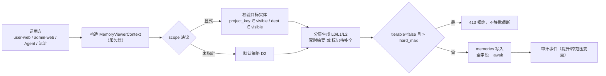
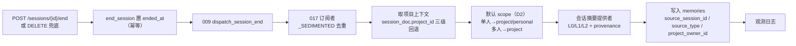
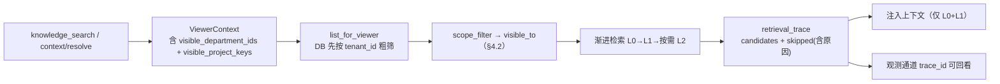
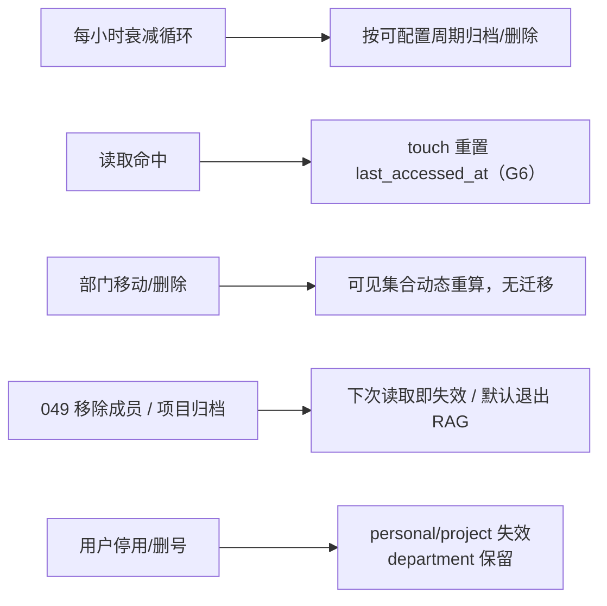
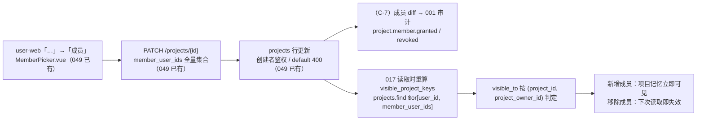

# 017 三范围记忆 · 重规划设计（项目 / 部门 · 双端）· v3

- **状态**：**决策已闭环 · 准实施基线**（Design Baseline）· **未落地任何代码**
- **v1 日期**：2026-11-05（含当日 15:58 / 16:00 / 16:03 / 16:05 四条补充口径）
- **v2 日期**：2026-11-06 —— 依据 `specs/049-project-members/` 五件套 + `Decisions/ADR-9` + 代码实测复核，调整设计方案
- **v3 日期**：2026-11-06 —— 用户裁决 D3 / D4 / D7 / D8 / C-7，全部待定项闭环；D4 改为「直接改名、不设兼容过渡」，§10 迁移方案因此重写
- **输入口径（用户）**：
  1. `workspace` 范围等同于**项目**（`Projects`）；`org` 范围使用**部门**（`org_units`）
  2. 「`projects` 中如果需要可以扩展添加成员」→ 项目可共享
  3. 功能层面**参考插件管理 / Skill 管理，从 admin / user 两端规划**
  4. 成员入口落在 **user-web 项目右侧扩展菜单**，并顺带修复 **admin 端「项目管理」页无数据**
  5. **（v2）** 「项目成员和管理端项目管理我已经在 specs/049 中完成了，你检查一下，调整一下设计方案」
  6. **（v3 裁决）** D3 按推荐（部门含后代）、**D4 直接修改不用过渡**、D7/D8 安全必项按设计执行、**C-7 成员变更审计补上**
- **基线**：`specs/017-three-scope-memory/{spec,plan,tasks,quickstart}.md`、`checklists/requirements.md`、`contracts/memory-context-contract.md`
- **本文不修改**现有 SDD 工件（spec / plan / tasks / checklist / quickstart / contracts），仅给出目标态设计；裁决后另起一轮按 SDD 流程修订

---

## v3 裁决说明（四项决策闭环 · 2026-11-06）

用户已对 v2 遗留的全部待定项拍板。**本文由「设计提案」转为准实施基线**：D1–D8 与 C-7 全部闭环，无待确认项。

| 决策 | v2 状态 | **v3 裁决** | 对本文的影响 |
|---|---|---|---|
| **D3** 部门可见性是否含下级 | 待确认，推荐含后代 | ✅ **采纳推荐：含后代、不含祖先、跨租户 fail-closed**，与 030 `subjects.py:69-77` 及 049 `member-candidates` 子树过滤一致 | §3.2 的口径从「描述」升格为「裁决值」；R4 保留 042「直接成员」计量口径的分叉说明 |
| **D4** `workspace/org → project/department` 改名节奏 | 待确认，推荐「新名 + 一个发布周期只读别名」 | ✅ **改为直接全量改名，不设兼容过渡**（**偏离推荐**）：运行时不接受旧 scope / 旧字段 / 旧地址；代码与契约一次性替换，存量数据由离线迁移脚本一次性转换 | 删除别名、双写、三级回退、`normalize_scope`、兼容矩阵；**§10 整章重写**为「先迁数据 → 后切代码」的一次性切换；新增 R9/R15、SC-15，并同步 §2/§4/§5.4/§8/§9/§13/§14 |
| **D7 / D8** 安全必项 | 标注「不待拍板」 | ✅ **确认按 N2 / N1 执行**：`default` 隔离与 `project_owner_id` 消歧是 B2/B3 的强制验收项，**不得因排期裁剪** | §0 决策表状态改为已确认；B0 登记完成 |
| **C-7** 成员变更审计 | P2 可选项，待用户决定 | ✅ **纳入首期必做**：在 049 `PATCH /projects/{id}` 挂钩 `project.member.granted` / `project.member.revoked`，新增 `"049"` 审计事件分组 | §1.1 / §5.6 / §7.2 / §8-C7 / §9.4 / §11 SC-14 / §13 B5 / §14 同步；新增 R16 |

**v3 的两条实施纪律**：

1. **D4 取消的是「运行时兼容层」，不是数据迁移**。历史 `memories` 仍须经幂等脚本转换（`scope` 值替换、字段 `$rename`、`project_owner_id` 回填、孤儿归档、旧地址重写），并严守「先迁数据、后切代码」顺序。因无别名兜底，**切换需要短维护窗口，回滚必须连数据一起反向迁移**（§10）。
2. **C-7 是跨特性改动，归属仍是 049**。钩子落在 049 的端点上、事件走 `feature="049"`；017 不新建成员端点、不改 049 的鉴权 / 去重 / 上限 / `default` 400 语义；须同步 049 的 spec/tasks 与 `FEATURE_AUDIT_EVENTS` 白名单，防止后续 049 迭代覆盖钩子（R16）。

---

## v2 修订说明（相对 v1 的变化）

**检查结论**：049 不是「只写了文档」，`spec/plan/tasks/checklist/quickstart` + ADR-9 五件套齐全，代码亦已落地并经实测复核。但它采用的成员模型与 v1 推荐的 M1（独立 `project_members` 集合）**不同**：049 用 `projects.member_user_ids` 内嵌数组；管理端数据流也**已经修完**，不再是待办。因此 v1 中约三分之一的规划内容（C 组 FR、§5.6/§5.7、B2/B5 批次）从「017 要新建」改为「017 直接消费 049」。

| v1 的说法 | 049 的实际落地 | v2 的调整 |
|---|---|---|
| D1「项目可共享 → 需修订 ADR-8 D1 / 046 Non-Goals」 | **ADR-9 已裁决并落地**：046 D1「纯个人」扩展为「个人 + 可协作」 | D1 关闭；不再列为 017 的上游修订项，改为引用 ADR-9 |
| D5 待拍板「推荐 M1 独立 `project_members` 集合 + 稀疏唯一索引」 | **049 = 内嵌数组方案**：`projects.member_user_ids: [str]`，创建者不落库、上限 500、仅创建者可写（403）、默认项目 400 | D5 关闭（**按 049 形态，非 M1**）；§2.4 重写；M1 方案整体废弃 |
| D6 待拍板「推荐 admin-api 同库直读 `projects`」 | **049 Phase 1 已落地**：`PROJECT_COLLECTION = "projects"`、`_require_project` 改查 `projects`、三个写端点下线、`quota_projects` 退役 | D6 关闭；§5.7 从「修复设计」改为「已修复事实 + 017 回归项」 |
| §1.6「管理端项目管理页无数据，四段断点待修」 | 049 T004–T008 已修：`projects-with-usage` 读 `projects`、join key 用 `_id = workspace_id`、`memberCount` 来自 `member_user_ids`、`/policy` 不再 404 | §1.6 改为**已修复记录**；四段断点转为 049 的验收证据 |
| §7 / §8-C「user-web 项目菜单加成员弹窗」「admin 项目成员治理」 | `MemberPicker.vue`（部门树 + 多选 + 非创建者只读）+ `App.vue:2833-2836` 菜单项 + `ProjectsPage.vue` 零改动分组均已落地 | 从「新建」改为「复用」；§7.5 页面清单标注为已存在 |
| C 组 9 条 FR（新增成员集合 / API / 菜单 / 管理端修复） | 全部已有对应实现或已退役 | C 组重写为「**017 对 049 的消费契约**」+ 049 未覆盖的增量（消歧、审计、default 隔离） |
| M1 迁移阶段「建 `project_members` + `sharing_enabled`」 | 无此集合、无此字段 | 删除该阶段；迁移从 M0 直接进 M2 |

**v2 新增的三条设计约束**（由 049 的真实形态推导出，v1 未覆盖，**属安全必项、不待拍板**）：

| # | 新约束 | 起因 | 落点 |
|---|---|---|---|
| **N1** | `project_id` 必须配 `project_owner_id` 才能判定可见性 | `projects` 唯一索引仍是 `{tenant_id,user_id,workspace_id}`（`main.py:502`），`_id = workspace_id` 在租户内**不保证唯一**；049 的 D-2 豁免说明「pg_compat 把 `id` 设为全局主键」只是**当前存储实现**的隐含唯一性，Mongo 后端不成立 | §2.2 / §2.4 / §4.2 |
| **N2** | 默认项目 `"default"` **不得承载 `project` 范围记忆**，必须回落 `personal` | 049 FR-003 实现豁免（D-2）：`GET /projects` 的 `$or` 额外纳入 `{_id:"default"}`，使该行**同租户所有用户可见**。若 017 照搬该可见性，`project_id="default"` 的记忆会全租户泄露 | §4.3 / §5.2 / §8-B |
| **N3** | 部门集合展开复用 049 已验证写法（关系表**不带** `status` 过滤、`add_tenant_scope`） | 049 `member-candidates` 实测可用；v1 的 DEP-2「先修 `end_user_org_relations.status`」因此**降级**为「读取侧绕过 + 可选数据修复」 | §1.2 / §3.2 / §3.5 |

> **一句话**：049 把「项目成员」和「管理端项目管理」从 017 的前置待办变成了现成依赖；017 的工作量显著下降，但必须补上 N1/N2 两个由 049 形态引入的越权缺口。

---

## 0. 摘要与决策（全部闭环）

把 017 的第二、三级范围绑定到仓库里真实存在的实体，方向正确且必要：017 现有 `workspace_id` / `org_id` 是**没有主数据来源的字符串**，写入靠客户端自报、判定靠调用方传 bool，这正是上一轮检查中「三级隔离形同虚设」的根因。

049（ADR-9）已经把 `projects` 从「纯个人」推进到「个人 + 可协作」，并把成员落在 `projects.member_user_ids`；admin「项目管理」页也已切到 `projects` 主数据。因此 `project` 范围回归 017 原 workspace 的共享语义**不再需要 017 自己造轮子**：成员判定、成员 UI、管理端项目列表全部读 049 的既有契约即可。

017 剩下的核心工作是四件：① 统一身份/授权上下文（修 P0）；② 把 `scope` 从 `workspace/org` **一次性直接改名**为 `project/department`（**D4 无兼容层**），接到 049 的项目成员与 030 的部门树上；③ 双端记忆管理页面（目前前端完全空白）；④ **（C-7）补 049 成员变更审计**。外加 N1/N2 两个由 049 形态引入的安全约束（D7/D8 已确认强制执行）。D3 已锁定「部门含后代」，D4 的代价是 §10 的一次性切换与成对回滚 SOP。

| # | 问题 | 状态 / 推荐值 | 若改选的影响 |
|---|---|---|---|
| **D1** | 项目是否多人共享 | ✅ **已由 049 / ADR-9 裁决并落地**：是（`member_user_ids`） | 无；017 直接消费 |
| **D2** | 单人 / 多人会话默认范围 | ✅ **回归 017 原口径**：单人（有非空项目）→ `project`，否则 `personal`；多人 co-presence → `project` | 与 017 FR-3/FR-5 一致 |
| **D3** | 部门可见性是否含下级 | ✅ **（v3）已裁决：含后代、不含祖先、跨租户 fail-closed**（与 030 / 049 一致） | 选「精确同部门」会与 030 本体权限、035 成本归集、049 候选端点的子树过滤分叉 |
| **D4** | 机器标识符改名节奏 | ✅ **（v3）已裁决：直接全量改名，不设兼容过渡**（偏离 v2 推荐） | 运行时不接受旧 scope / 字段 / 地址；历史数据由离线迁移一次性转换，切换需维护窗口、回滚须连数据反向迁移（§10） |
| **D5** | 项目成员模型形态 | ✅ **已由 049 裁决**：内嵌 `projects.member_user_ids`（**非 v1 推荐的 M1**） | 无；M1 独立集合方案废弃 |
| **D6** | 管理端项目列表取数方式 | ✅ **已由 049 Phase 1 落地**：admin-api 同库直读 `projects`，写入仍唯一归 chat-api | 无 |
| **D7** | 默认项目记忆如何处置 | ✅ **（v3）确认执行 · 安全必项（N2）**：`"default"` 不作为 `project` 范围归属，显式写入 400、沉淀回落 `personal` | 不处理会导致同租户越权读取 |
| **D8** | `project_id` 同名歧义 | ✅ **（v3）确认执行 · 安全必项（N1）**：记忆文档冗余 `project_owner_id`，按 `(tenant_id, project_id, project_owner_id)` 判定 | 不处理会在 Mongo 后端把两个用户的同名项目记忆串起来 |
| **C-7** | 049 成员变更未落审计 | ✅ **（v3）纳入首期必做**：`project.member.granted/revoked` 挂到 049 `PATCH /projects/{id}`，`feature="049"` | 不补则「谁在何时把谁加入/移出项目」不可追溯，而该动作直接改变记忆可见面 |

> **（v3）D1–D8 全部闭环、C-7 已纳入首期，本文无待拍板项。** 另有**不需要裁决、必须先行**的前置修复：统一身份解析上下文（§3.5）。上一轮检查发现的 P0 缺陷（`resolve_session_user` 返回 4 个键，端点却取 `user_id` / `role` / `is_workspace_member`）会让任何范围模型都失效。

---

## 1. 事实基线

### 1.1 项目实体（`projects` 的真实形态，含 049 改动）

| 项 | 事实 | 证据 |
|---|---|---|
| 集合 | chat-api Mongo 集合 `projects`（046 D6 由 `desktop_projects` 改名）；**不存在大写 `Projects` 的 ORM/表定义** | `chat-api/app/api/endpoints/projects.py:7`；`main.py:502`；`scripts/migrate_046_project_dimension.py:91,118` |
| 主键 | `_id = workspace_id`（客户端生成），默认项目保留值 `"default"` | `projects.py:31,115`；ADR-8 D2 |
| 字段 | `_id / tenant_id / user_id / workspace_id / title / worktree / status(active\|archived) / created_at / updated_at` **+ `member_user_ids: [str]`（049 FR-001）** | `projects.py:56-67,83,110-124`；049 spec FR-001 |
| 归属 | `tenant_id + user_id`，唯一索引 `{tenant_id, user_id, workspace_id}`；**`_id` 在租户内不保证唯一**（N1） | `main.py:502-505`；049 spec「实现豁免」D-2 |
| 成员（**049 后**） | **内嵌数组 `member_user_ids`**；创建者不落库（计算时并入 `user_id`）；去重去空、上限 500；无独立成员表、无角色字段 | `projects.py:45,69-71,201-210`；ADR-9 Decision 1 / OQ-4 |
| 成员写权限 | 仅创建者（`doc.user_id == me`）可写，其他成员 403；`"default"` 项目一律 400 | `projects.py:177-188,180-181`；049 FR-002 |
| 可见性 | `GET /projects` = `$or [{user_id: me}, {member_user_ids: me}, {_id:"default"}]`；第三分支是**已批准豁免**（默认项目租户共享兜底，N2 起因） | `projects.py:153-165`；049 spec FR-003 实现注 |
| 候选数据源 | `GET /projects/departments`（active `org_units`，扁平 + `depth`）、`GET /projects/member-candidates`（按 `path_ids` 子树 + `end_user_org_relations`，仅 active 用户白名单字段） | `projects.py:220-242,245-316`；049 FR-004 |
| 会话关联 | `chat_sessions.project_id`（新会话必填，web 会话 `"default"`）；**顶层无 `workspace_id` 写入路径** | `dsh_runtime/conversation/repository.py:30-44`；046 FR-004 |
| 生命周期 | 客户端对账 / 菜单「删除项目」→ PATCH `status=archived`，**软归档非物理删除** | `projects.py:138-164`；`user-web/App.vue:651-668`；ADR-8:37 |
| 归档约束 | `_id="default"` 不可归档 / 删除 / 重命名 / 改成员 | `projects.py:144-147,180-181` |

**与 017 的现存断点**：会话沉淀链路读 `session_doc.get("workspace_id")`（`session_persistence_service.py:633`、`sessions.py:1372`），该字段恒空 → 017 记忆拿不到项目归属；017 的 `Memory.workspace_id` 也未随 046 改名。**这两处仍需 017 自己修（G9）**，049 未触及。

**成员审计（v3 C-7 已裁决补上）**：049 的 `PATCH /projects/{id}` **未落审计事件**（`projects.py` 全文无 `feature_audit` 命中）。挂钩点已确认在 `projects.py:168-217` 的 `patch_project`：成员 diff 可在 `set_value["member_user_ids"]` 计算后、`update_one` 成功返回前取得，无需改 049 的鉴权 / 去重 / 上限 / `default` 400 语义。事件走 `emit_feature_event("049", ...)` → `FEATURE_AUDIT_EVENTS` 新增 `"049"` 分组 → 001 `position_role_audit_logs`。详见 §5.6 / §8-C7 / §9.4。

### 1.2 部门实体（`org_units` 的真实形态）

| 项 | 事实 | 证据 |
|---|---|---|
| 集合 | `org_units`（常量 `DEPARTMENT_COLLECTION`），旧名 `departments` 已废弃；**不是** `organizations` / `tenants` | `admin-api/app/repositories/directory_repository.py:9`；`chat-api/app/api/endpoints/projects.py:41` |
| 节点含义 | 部门树节点，每租户一棵树，根 `code="root"` / `name="企业总部"`，不可删除 | `directory_repository.py:78-99`；`directory.py:410-411` |
| 字段（实际写入） | `_id / tenant_id / name / code / parent_id / path_ids / path_names / status / source / source_dept_id / created_at / updated_at` | `directory.py:284-298` |
| 层级 | `path_ids` 为祖先 id 数组；改名 / 移动级联刷新后代 | `directory.py:121-124,330-399` |
| 用户关联 | `end_users.primary_org_id`（单值） + `end_user_org_relations`（多部门：`org_id` / `is_primary`） | `directory.py:507-524`；`auth.py:900-917` |
| 口径差异 | chat-api 注册只写主部门一行；admin 端 `create_user`/`update_user` 才写多部门 | `auth.py:907-917`；`directory.py:574,653` |
| 含下级展开 | 030 已实现；**049 的候选端点也用同款子树**：`org_units.find({path_ids: department_id})` 取后代 → `end_user_org_relations.find({org_id: {"$in": ...}})` | `admin-api/app/ontology_permission/subjects.py:69-77`；`chat-api/app/api/endpoints/projects.py:271-283` |
| 祖先推导 | **全仓未找到**，现有展开单向向下 | 调研结论 |
| 配额口径 | 042 用「直接成员，不做子树聚合」——与 030/049 的「含下级」**不一致**（用途不同：计量 vs 可见） | 042 spec.md:156 FR-002；`quota_policy.py:238-243` |
| 角色体系 | `full_access_admin` 纯按 `position_roles.system_key` 判定，不读部门 | `admin-api/app/position_roles/constants.py:9-10`；006 spec.md:72 |
| 离职/删号 | `DELETE /directory/users/{id}` 删 `end_users` 整行 + 关系行；停用仅置 `status=disabled`；**无专门离职端点** | `directory.py:697-739` |
| 租户隔离 | admin-api 侧目录查询显式带 `tenant_id`；**chat-api 侧 049 用 `add_tenant_scope`**（默认租户兼容历史行） | `directory.py:94,273`；`projects.py:228-229,272-285` |

**关系表 `status` 风险的现状（N3）**：三处写入方（`directory.py:513-523`、`auth.py:908-916`、`tenant_provisioning.py:192-201`）都不写 `status`，而 030 读取带 `{"status":"active"}`。**049 的 `member-candidates` 不带该过滤且实测可用**（`projects.py:277-280`），证明「读取侧绕过」是已被验证的可行解。因此 v1 的 DEP-2 从「必须先修数据」降级为「017 跟随 049 写法；数据修复列为可选」。

### 1.3 不参与本次重定义的实体（防混淆）

| 实体 | 是什么 | 本文处置 |
|---|---|---|
| `quota_projects`（admin-api） | 042 配额分组 | **049 已退役**：`PROJECT_COLLECTION = "projects"`（`quota_projects.py:26`），读/写路径 0 命中，表壳保留不删（0 行、不迁移）。017 **不得**再引用它 |
| `project_members`（v1 的 M1 提案） | **不存在的集合** | 049 未采纳；本 v2 全文删除该概念 |
| `project_memories`（`context_engine`） | 上下文压缩缓存，按 `tenant_id+user_id+project_id+key` | **不合并**，用途与生命周期均不同；仅统一 `project_id` 命名 |
| `organizations` / `tenants` | 组织 / 租户（计费主体） | `department` 范围不绑定它们 |
| `mogo://skill/<orgId>` 的 `orgId` | 租户标识（`resolve_tenant_id(org_id)`） | 不改，与部门无关 |
| `knowledge_directories.path_ids` | 知识目录树 | 与 `org_units.path_ids` 同名不同物 |

### 1.4 017 现状缺口（本设计一并吞掉）

| 编号 | 缺口 | 处置 |
|---|---|---|
| G1 | 身份解析契约不一致，`user_id`/`role`/`is_workspace_member` 恒空 → personal 互相可见、其余范围不可用 | §3 统一 `MemoryViewerContext` |
| G2 | RAG 注入未传 `viewer_org_id` → 部门记忆进不了检索 | §5.3 |
| G3 | 会话沉淀 `summarizer` 未注入 → L0/L1 恒空，渐进检索退化为灌全文 | §5.2 |
| G4 | promote 用 `replace_one` 全量覆盖 → 清空分层字段与 provenance | §5.1 / §8-D |
| G5 | 写时 `NoopSummarizer()`、读时不调 `tier_content` → FR-15 双路径仅纯函数支持 | §5.1 |
| G6 | 衰减硬编码 30 天、`touch()` 无调用方 | §5.5 / §8-H |
| G7 | `retrieval_trace` 只塞 payload、`skipped` 恒空 | §5.3 / §9.4 |
| G8 | 无用户离职时 personal/project 记忆失效逻辑（FR-10 未实现） | §5.5 / §8-H |
| G9 | 沉淀链路读 `session_doc.workspace_id` 恒空（049 未触及） | §5.2 |
| G10 | **017 前端完全空白**：`apps/` 下无任何记忆页面 / 菜单 / API 客户端 | §7 双端规划 |
| G11 | **（v2）** `project_id` 无消歧字段，049 的 `_id` 租户内不唯一 | §2.2 / §2.4（N1） |
| G12 | **（v2）** 默认项目在 049 下租户共享，直接复用会造成 project 记忆全租户可见 | §4.3（N2） |

> 注意：v1 的「项目成员缺失」「管理端项目列表无数据」「user-web 无成员菜单」三项**已从缺口表移除** —— 049 已落地。

### 1.5 双端范式现状（插件管理 / Skill 管理）

| 维度 | 插件管理（DSH 插件） | Skill 管理 |
|---|---|---|
| admin 页面 | `/dsh-plugins` → `DshPluginsPage.vue` | `/skills` → `SkillsPage.vue`；配套发布 / 版本 / 灰度 / 评测 |
| user 页面 | `/plugins` → `MyPluginsPage.vue` | `/skills` → `MySkillsPage.vue`；「我的技能 / 共享给我」Tab |
| 范围字段 | `scope: organization \| personal`，`_owner()` 按端判定 | `scope: all \| user \| organization`（`/skills/selectable`） |
| 授权给谁 | `ResourceAccessExtensionPanel.vue`「使用权限」：`filter_allowed_resource_ids()` / `resource_is_allowed()`；**部门 / 岗位角色 / 指定员工或关系 + 包含下级** | `MongoEmployeePolicyResolver` → `EffectiveEmployeePolicy.allows_skill()` |
| 状态机 | `enabled` / `availability` / 校验 / 启停 / 删除 | `publication_status`、版本快照、上架 `portal_requests`（applied→approved→granted→revoked） |
| 审计 | 001 `position_role_audit_logs`；017 已登记在 `feature_audit.py:27` 的 `FEATURE_AUDIT_EVENTS` | `record_skill_event()`（004 FR-8）+ `feature_audit_bridge` |
| 治理纪律 | 管理端统一审计视图 `/audit`（`SystemAuditPage.vue` 指标卡 + 筛选 + 表格 + 详情抽屉） | L1 资产 owner-only：不可见**统一返回 404**，不泄露存在性 |

**可直接移植的四条纪律**：① 同一集合按 scope 分端、admin 治理 / user 使用；② 可见范围支持「部门 / 岗位 / 指定员工 + 含下级」；③ 治理动作统一落 `feature_audit_bridge → position_role_audit_logs`；④ 不可见即 404。

**必须遵守的排除项**：`specs/045-asset-center/spec.md:106` 明确「**会话 / 记忆 / 模型不纳入资产中心**（运行时态，归外）」→ 017 记忆管理**不得挂 `/assets`**，需独立菜单。另：插件 / Skill 列表页**没有**批量操作与配额控件，「收藏」「工具市场」也未找到，规划时不得假定已有范式。

### 1.6 管理端「项目管理」页 —— 049 已修复（原 v1 的四段断点）

v1 依据用户截图（列：项目名称 / 状态 / 成员数 / 额度 / 用量(tokens) / 成本(USD) / 操作，空态「暂无项目」）判定为四段数据流断点。**049 Phase 1（T004–T008）已全部修复**，实测代码复核如下：

| v1 断点 | 049 修复动作 | 现状证据 |
|---|---|---|
| **A** 列表主数据源读空的 `quota_projects` | `PROJECT_COLLECTION = "projects"`；`list_projects` / `get_project` 读 `projects` | `admin-api/app/services/quota_projects.py:25-26,75-87` |
| **B** `quota_projects` 无写入源 | 旧表彻底退役（0 行、表壳保留）；`POST/PUT/DELETE /traffic-allocations/projects` 三个写路由与 handler 已删除；admin-web 前端写函数与调用点同批清理 | 049 T005/T006；`traffic_allocations.py` 净 −103 行；`grep createQuotaProject apps/` 仅 1 处退役注释 |
| **C** join key 不匹配（uuid vs `workspace_id`） | `project_view` 输出 `id = row._id`（即 `workspace_id`），`by_scope.get(item["id"])` / `usage_by_project.get(item["id"])` 自然对齐 `user_quota_policies.scope_id` 与 `token_usage_logs.project_id` | `quota_projects.py:62-72`；`traffic_allocations.py:635,659,663` |
| **D** 「成员数」无有效数据源 | `memberCount = len(row.member_user_ids or [])`，`memberUserIds` 同源透出 | `quota_projects.py:67-68` |

连带修复亦已完成：`_require_project` 改查 `projects`（`traffic_allocations.py:466`），`PUT /projects/{id}/policy` 对真实项目 id 不再 404；`ProjectsPage.vue` 零改动（047 T006 的 `activeRows`/`archivedRows` 已直接消费 `status`）。

**验收状态**：自动测试 chat-api 27 passed / admin-api 51 passed（含 `test_quota_consistency.py` 14 例运行时双服务对拍）；前端双端 SFC 4/4 + `vue-tsc` 0 错误。**2026-11-06 10:24 追加实测**：049 代码已随 7 个业务镜像全量重建进入运行栈（tag `c91dd348`），网关带鉴权 `GET /admin-api/api/v1/traffic-allocations/projects-with-usage` → **200 / total=10**（activeRows=2 含「默认项目」「test 成员数 2」，archivedRows=8 前端折叠），容器内 `PROJECT_COLLECTION = "projects"`；chat-api 两新端点复验 `departments=3` / `member-candidates=7`。即**「admin 页有数据」这一段已端到端证实**。
>
> 049 `quickstart.md` 的 **T022 仍有剩余步骤未回填**：配额度 200 → 成员 A 用量命中限额 → B 被拒文案「项目层」→ 归档后不约束（待 admin 会话与 A/B/C 三账号）。这是 049 的遗留，不是 017 的工作项，但 SC-9 回归时应一并确认。

> **口径提醒**：049 的 `memberCount` **不含创建者**（创建者不落 `member_user_ids`）。017 的管理端页面若展示「共享成员数」必须沿用该口径，不得改写成 `1 + count()`，否则与项目管理页对不上。

### 1.7 user-web 项目菜单 —— 049 已落地

v1 计划「在 `App.vue` 的『…』下拉增加第三项 + 新建弹窗」。实际落地：

- 菜单项：`apps/user-web/src/App.vue:2833-2836`，内联三元 `locale === 'en' ? 'Members' : '成员'`，挂在既有的非默认项目「…」下拉（`v-if="group.id !== DEFAULT_PROJECT_ID"` 未动）。
- 弹窗：`apps/user-web/src/components/project/MemberPicker.vue`（201 行）—— 部门树（`GET /projects/departments`）+ 用户多选（`GET /projects/member-candidates`）+ 已选 chip + 保存（`PATCH /projects/{id}` 带 `member_user_ids` 全量集合）；**非创建者只读**（无保存按钮）。
- 前端 API：`apps/user-web/src/api/sessions.ts` 新增成员 PATCH / 候选 / 部门树三个 client，`DesktopProject` 类型加 `member_user_ids?`。

因此 017 §7.5 页面清单中该项状态改为「**已存在，零改动**」。

---

## 2. 目标态：术语、模型与原则

### 2.1 术语映射

| 017 旧术语 | 目标术语 | 绑定实体 | 存储字段 | 备注 |
|---|---|---|---|---|
| `workspace` 范围 | **`project` 范围** | `projects._id` | `project_id` | **（D4）一次性改名，不保留别名**；语义 = 049 的项目成员共享 |
| `workspace_id` | `project_id` | 同上 | 同上 | **（D4）代码字段 + 存量数据 `$rename` 一次到位，无双写、无三级回退** |
| `is_workspace_member` | `visible_project_keys` | **`projects.member_user_ids` + `projects.user_id`** | 上下文集合 | 服务端按 049 契约解析，不再由调用方传 bool |
| `org` 范围 | **`department` 范围** | `org_units._id` | `department_id` | **（D4）一次性改名，不保留别名** |
| `org_id` | `department_id` | 同上 | 同上 | 与 `mogo://skill/<orgId>` 租户含义彻底区分；同样无运行时回退 |
| `viewer_org_id` | `visible_department_ids` | 关系表 + `path_ids` | 上下文集合 | 由单值改为集合（多部门 + 后代） |
| `personal` 范围 | 不变 | `end_users._id` | `owner_id` | 跨项目生效 |
| 密度轴 `L0/L1/L2` | 不变 | — | 不变 | 与范围轴正交 |
| **（v2 新增）** — | `project_owner_id` | `projects.user_id` | `project_owner_id` | N1 消歧键；写入时服务端解析，客户端不得传 |

> `mogo://memory/<scope>/<owner>/<id>/[tier]` 中 `<owner>` 段仍是「归属人 id」，不改成项目 / 部门 id；范围实体 id 走文档字段，避免地址变成凭证（§2.3 P4）。**（D4）** `<scope>` 段同步一次性改为 `personal / project / department`，旧段仅由迁移脚本改写持久化引用，运行时不解析（§5.4）。

### 2.2 记忆文档模型（`memories` 集合，目标态）

| 字段 | 类型 | 说明 |
|---|---|---|
| `memory_id` / `tenant_id` | str | 主键 / 租户锚点，所有查询必带 |
| `scope` | enum | `personal \| project \| department` |
| `owner_id` | str | 创建人 `end_users._id` |
| `project_id` | str | `scope=project` 时为判定依据，其余 scope 作检索标签；**与 `chat_sessions.project_id` 同名同值** |
| **`project_owner_id`** | str | **（N1，v2 新增）** `scope=project` 时必填，= `projects.user_id`，用于消除 `_id` 租户内不唯一造成的串读 |
| `department_id` | str | `scope=department` 时为目标 `org_units._id` |
| `content` / `l0_summary` / `l1_overview` / `l2_raw` | str | 密度轴 |
| `tierable` / `summary_generated_at` / `summary_refresh_days` | bool/float/int | FR-13/15 |
| `source_session_id` / `source_type` | str | provenance（FR-18/20） |
| `created_at` / `last_accessed_at` / `archived` | float/bool | 生命周期 |
| `visibility_snapshot` | 不使用 | **禁止**写入时固化成员名单（P2） |

索引建议：
```
{tenant_id:1, scope:1, owner_id:1, last_accessed_at:-1}
{tenant_id:1, scope:1, project_id:1, project_owner_id:1}   # v2：N1 消歧
{tenant_id:1, scope:1, department_id:1}
{tenant_id:1, last_accessed_at:1}                          # 衰减扫描
```

### 2.3 设计原则

- **P1 范围与上下文标签分离**。一条记忆只有一个 `scope`（决定谁可见），但可同时带 `project_id` / `department_id` 作检索与追溯标签。多人会话属于某项目但要部门共享时：`scope=department` + `project_id` 标签。
- **P2 归属与成员判定动态解析，不固化名单**。项目成员读 `projects.member_user_ids`（049），部门集合读关系表 + `path_ids`，都在**读取时**算；049 改成员 / 组织调整后可见性自动跟随，无需 017 监听事件或清洗数据。
- **P3 服务端解析，客户端不得自报**。`scope` 目标实体、`project_owner_id`、`department_id` 全部由服务端从会话上下文与主数据反查校验；请求体只接受「意图」。
- **P4 地址是定位符，不是凭证**。021 继续委托 017 `visible_to`，且必须基于**已加载的存储记录**判定（`context_space/visibility.py:51-83` 的 fail-closed 保留）。
- **P5 空上下文 fail-closed**，管理员特权必须显式、可审计；不可见统一 404，不泄露存在性。
- **P6（v2 新增）不复用 049 的 `default` 兜底分支**。049 为绕开 `pg_compat` 主键限制，让 `"default"` 行对同租户所有用户可见（已批准豁免）；这是**项目列表的产品兜底**，不是记忆授权语义。017 必须显式排除，见 N2。
- **P7（v3 / D4）无运行时兼容层**。`scope` 值、文档字段、地址段**只存在一套目标态拼写**；不设别名解析、`normalize_scope`、双写或三级回退。历史数据一律由离线幂等迁移脚本转换（§10），因此「代码替换」与「数据迁移」必须在同一维护窗口内原子切换。代价是切换期不能新旧实例并存、回滚须连数据反向迁移，已登记为 R9/R15。

### 2.4 项目成员模型：直接消费 049（v1 的 M1 作废）

**049 已定形态（不再设计、不再迁移）**：

```
projects
  _id            = workspace_id
  tenant_id
  user_id        = 创建者（唯一管理权）
  member_user_ids: [str]     # 被邀请成员，创建者不落库，上限 500
  status: active | archived
```

配套既有契约（017 只消费，不改）：

| 能力 | 049 端点 / 函数 | 017 用法 |
|---|---|---|
| 列我可见的项目 | `GET /api/v1/projects`（`$or [user_id, member_user_ids, _id:"default"]`） | 构造 `visible_project_keys` 时**去掉第三分支** |
| 改成员 | `PATCH /api/v1/projects/{id}`（`member_user_ids` 全量集合） | 017 不提供成员编辑入口；记忆可见性随下次读取自动变化 |
| 部门树 / 候选用户 | `GET /projects/departments`、`/projects/member-candidates` | 017 部门集合展开可复用其子树写法（N3） |
| 项目层配额成员口径 | 双服务 `quota_policy.py::_scope_members` = `member_user_ids ∪ user_id` | 与 017 的可见性集合**同源但用途不同**，不得互相替代 |
| 成员数（admin 页） | `project_view()["memberCount"] = len(member_user_ids)` | 017 展示共享成员数时沿用（不含创建者） |

**N1 —— 为什么 017 必须额外存 `project_owner_id`**：

`main.py:502` 的唯一索引是 `{tenant_id, user_id, workspace_id}`，即**同一租户内两个不同用户可以各自持有同名 `workspace_id`**。049 的 D-2 豁免说明当前 `pg_compat` 把 `id` 设成全局主键，因此实际不会撞——但这是**存储实现的偶然约束**：Mongo 后端（`MOGO_DATA_BACKEND=mongodb`）与 027 迁移后的双后端下都不成立；且 046 FR-011 的迁移脚本并未保证该唯一性。

若 017 只用 `project_id` 单字符串判定，`projects.find_one({_id: pid})` 可能命中**别人的项目**，导致 A 的项目记忆被 B 读到。v1 的 M1 用「稀疏唯一索引」解决，049 未采纳，因此 017 自行承担：

```
project_key = (tenant_id, project_id, project_owner_id)
ctx.visible_project_keys = {
    (p._id, p.user_id)
    for p in projects.find({
        tenant_id,
        "$or": [{"user_id": me}, {"member_user_ids": me}],   # 不含 _id:"default"（P6）
        "status": "active",
    })
}
```

写入 `scope=project` 时，服务端用 `ctx.active_project_id` 反查 `projects`，把 `project.user_id` 固化进 `project_owner_id`；判定只读文档字段，不重新查库（避免 TOCTOU 与 049 成员变更的竞态放大）。历史记忆缺 `project_owner_id` → **fail-closed 不可见**，进迁移失败清单（§10 M3）。

**N2 —— 默认项目隔离**：

| 情形 | 017 行为 |
|---|---|
| 显式 `POST /memories {scope:"project", project_id:"default"}` | `400 default_project_not_shareable`，提示改用 `personal` |
| 会话沉淀时 `active_project_id == "default"` | 自动回落 `personal`，响应/轨迹回显 `resolved_from="default_fallback"` |
| 历史 `workspace_id == "default"` 的记忆 | 迁移期统一标 `archived` 进失败清单，不猜测归属 |
| 021 地址 `mogo://memory/project/...` 指向 default 记忆 | `visible_to` 返回 False → 404 |

> 049 的「成员管理权仅创建者」「默认项目不可改成员」在 017 里继续有效：成员可以**读/写该项目下的记忆**，但不能改成员名单；创建者被自己移除出 `member_user_ids` 也仍因 `user_id` 拥有项目，可见性不受影响。

---

## 3. 身份与授权上下文

### 3.1 统一上下文对象

所有 017 入口（HTTP、RAG 适配器、021 地址解析、会话沉淀、双端管理接口）只接受一个服务端构造的不可变上下文，**替换**现有散落的四参数。

```
MemoryViewerContext
├── tenant_id / user_id                : str        # 必填，空 → fail-closed
├── role_keys                          : frozenset  # 006 position_roles.system_key
├── is_full_access_admin               : bool
├── primary_department_id              : str        # end_users.primary_org_id
├── visible_department_ids             : frozenset  # 直接所属 ∪ 后代（§3.2）
├── visible_project_keys               : frozenset  # (project_id, owner_id) 二元组（§2.4，v2 改）
├── active_project_id                  : str        # 当前会话 project_id，默认 "default"
└── session_participants               : frozenset  # 002 co-presence 参与者
```

### 3.2 部门集合展开（跟随 049 已验证写法，N3）

```
1. relations = end_user_org_relations.find(add_tenant_scope({user_id}, tenant_id))
   ⚠ 不得带 {"status":"active"} 过滤（写入方未落该字段；049 projects.py:277-280 同款）
2. direct = {r.org_id} ∪ ({primary_org_id} if present)
3. direct 为空 → 回落根部门（code="root"）；仍找不到 → 空集（fail-closed）
4. units = org_units.find(add_tenant_scope({"status":"active"}, tenant_id))
   descendants = {u._id for u in units if set(u.path_ids) ∩ direct}
5. return direct ∪ descendants
```

**口径（D3 已裁决，v3 锁定）**：所在部门**及其全部后代**，**不含祖先**，跨租户 fail-closed —— 与 030 `subjects.py:69-77`、049 `member-candidates` 的 `path_ids` 子树过滤一致。即 `visible_department_ids = direct ∪ descendants`；上级部门记忆对下级**不可见**，下级部门记忆对上级**可见**。042 配额「直接成员」是计量口径、不是可见性口径，用途不同，本次不改（R4 保留分叉说明）。租户 scope 用 `add_tenant_scope`（chat-api 侧，与 049 一致），不用 admin-api 的显式 `tenant_id` 写法。

### 3.3 项目集合解析（v2 改为 049 契约）

按 §2.4 构造 `visible_project_keys`：**我创建的 ∪ 我作为 `member_user_ids` 被邀请的**，显式排除 `"default"`、排除 `status=archived`。写 `project` 范围记忆时，目标 `(project_id, project_owner_id)` 必须在此集合内；被邀请成员与创建者拥有同等的**读取**权，`owner_id` 仍记录记忆创建人用于审计与「我的记忆」筛选。

> 与 049 `GET /projects` 的差异只有一处：**不纳入 `{_id:"default"}`**（P6/N2）。必须在代码注释与测试中标明这是有意为之，防止后续「对齐 049」时被改回去。

### 3.4 角色解析

`role_keys` 从 `end_user_position_roles` → `position_roles.system_key` 取得（006），**不从 `resolve_session_user` 返回字典取 `role`**。该字典当前只返回 `{session, user, tenant_id, org_id}`（`end_user_session.py:137`），任何 `.get("role")` 恒空 —— 这是 G1 与现有 `promote_to_org` 恒 403 的直接原因。

### 3.5 前置依赖（必须先于本设计落地）

| 依赖 | 内容 | 验收 |
|---|---|---|
| **DEP-1** | 统一 `MemoryViewerContext` 构造入口，替换四端点 / 适配器 / 021 的取值方式 | 用**真实** `resolve_session_user` 返回结构跑端点测试，不得 monkeypatch 出契约外字段 |
| **DEP-2**（v2 降级） | `end_user_org_relations.status` 写入/读取不一致 | 017 读取侧跟随 049 不带该过滤即可通过；数据修复为**可选项**，不作阻塞 |
| **DEP-3** | 回归测试改用真实 auth 契约 + 真实 `projects`（含 `member_user_ids`）/ `org_units` fixture | 跨用户 personal、非成员 project、**同名 project_id 不同 owner**、**default 项目**、跨部门 department 五类越权用例必须失败 |

> DEP-1 是上一轮检查中的 P0 缺陷。跳过它直接改范围命名，会把旧缺陷带进新模型。DEP-3 在 v2 新增两类用例，对应 N1/N2。

---

## 4. 可见性规则

### 4.1 可见性矩阵

| scope | 谁能读 | 判定依据（全部服务端解析） | 谁能写 |
|---|---|---|---|
| `personal` | 仅 `owner_id == ctx.user_id` | `owner_id` | 本人 |
| `project` | **项目创建者 + `member_user_ids` 成员**：`(memory.project_id, memory.project_owner_id) ∈ ctx.visible_project_keys` | 049 `projects` 契约（不含 `default`） | 上述成员，且目标 key ∈ `visible_project_keys` |
| `department` | `memory.department_id ∈ ctx.visible_department_ids` | 关系表 + `org_units.path_ids` | 本人，且目标部门 `∈ ctx.visible_department_ids` |
| 任意 | `ctx.is_full_access_admin == True` | 006 角色 | 提升 / 治理另需 §6 授权 |

跨租户一律 `memory.tenant_id == ctx.tenant_id`；049 移除成员后，因判定动态解析，**下次读取即失效**，无需改写记忆、无需 017 订阅事件。

### 4.2 判定算法（替换现有 `visible_to`）

```
def visible_to(memory, ctx):
    if not ctx.tenant_id or not ctx.user_id:        return False
    if memory.tenant_id != ctx.tenant_id:           return False
    if memory.archived:                             return False
    if ctx.is_full_access_admin:                    return True     # 显式特权，记审计
    scope = memory.scope                                         # D4：不做别名归一化
    if scope == "personal":
        return memory.owner_id == ctx.user_id and memory.owner_id != ""
    if scope == "project":
        if not memory.project_id or memory.project_id == "default":   # N2
            return False
        if not memory.project_owner_id:                               # N1 / 历史数据 fail-closed
            return False
        return (memory.project_id, memory.project_owner_id) in ctx.visible_project_keys
    if scope == "department":
        return bool(memory.department_id) and memory.department_id in ctx.visible_department_ids
    return False                                                   # 未知 scope fail-closed
```

**（D4）不设 `normalize_scope`**。范围轴封闭为 `personal / project / department` 三值，写入校验在入口完成；`visible_to` 对任何其它值（含历史 `workspace` / `org`）直接走末尾 `return False`（fail-closed，不报错、不泄露）。历史记忆的 `scope` 值由 §10 M2 迁移脚本**在切换前一次性改写**，运行时不承担任何兼容职责 —— 这也是 D4 与 v2 推荐方案最本质的差别。

### 4.3 边界

- 空 `owner_id` / `project_id` / `project_owner_id` / `department_id` → 一律不可见（现状 `"" == ""` 导致 personal 越权）。
- **默认项目（N2）**：不承载 `project` 范围记忆；显式写入 400，沉淀回落 `personal`，历史数据迁移归档。这是与 049 唯一刻意不一致的地方（P6）。
- **同名 `project_id`（N1）**：由 `project_owner_id` 消歧；写入时服务端固化，客户端传该字段一律忽略（P3）。
- 归档项目：`project` 记忆保留、历史可查，默认不进 RAG（与 ADR-8:37 一致），可配置。
- 部门删除 / 停用：该 id 退出 `visible_department_ids` → 记忆自动不可见，衰减循环归档，**不级联删除**。
- 部门移动：记忆存节点 `_id`，`path_ids` 变化后可见集合自动重算，无需迁移。
- 多部门用户：写入需显式指定 `department_id`，否则回落 `primary_department_id` 并在响应回显实际落点。
- 两端管理接口：不可见一律 `404`（P5），管理员跨范围查看走治理接口并落审计，不复用普通读取路径。
- **（D4）旧标识符一律拒绝**：请求里的 `scope=workspace|org`、`workspace_id` / `org_id` 字段、以及 `mogo://memory/workspace|org/...` 地址均返回 400 `scope_invalid` / 404，**不静默转换、不回显兼容结果**。旧拼写只允许出现在 §10 的迁移脚本与本文的历史说明里。

---

## 5. 数据流

### 5.1 写入流



关键约束：`project_id` / `project_owner_id` / `department_id` 由上下文与实体校验得出（P3）；`project_owner_id` 从 `projects.user_id` 反查，不信任请求体；写时摘要必须带新鲜 `summary_generated_at`，未提供则标 `0` 交给读时兜底，不得用 `NoopSummarizer` 产出空层伪装完成（G5）；更新走增量 `$set`，保留分层字段、provenance、`archived`（G4）。显式 `project_id="default"` 在 D 阶段直接 400（N2）。

### 5.2 会话沉淀流（002 → 009 → 017）



- **G9 修复**：改读 `session_doc.project_id`，沿用 046 FR-011 的「项目上下文三级回退」；删除路径同样修正。⚠ 此处回退指**会话取值来源**的优先级（046），与 D4 删除的「旧字段 `workspace_id` 回退读取」**不是同一概念**，实现时不得误删。
- **多人会话（D2）**：049 后项目可共享，co-presence 默认 `project` 回归 017 原 FR-5；若会话无项目上下文（`default`）则回落 `personal`（N2），**不再回落 `department`**（v1 因项目不可共享才需要部门兜底，049 后该理由消失；落进部门会扩大可见面）。
- 落 `scope=project` 时必须同时写 `project_owner_id`（N1）；反查不到项目行则回落 `personal` 并告警。
- `SessionSummarizer.session_tiers(snapshot)` 必须由生产链路注入（可复用会话 `title` / `summary` 作 L0 兜底）；注入缺失必须落观测告警，不得静默产出空 L0/L1（G3）。
- `_SEDIMENTED` 是进程内 set，多副本会重复沉淀；以 002 `ended_at` 幂等为唯一强判据，账本降级为本地优化。

### 5.3 检索流（RAG / 地址解析）



- **G2 修复**：`adapters.knowledge_search` 必须携带完整上下文（当前漏 `viewer_org_id`）。
- **G7 修复**：`skipped` 记录 `scope_invisible` / `relevance_low` / `l2_not_requested` / `archived` / **`default_project_excluded`** / **`missing_project_owner`**；轨迹除随响应返回外必须落观测通道，支持按 `trace_id` 回看；高价值命中抽样进 001 审计，轨迹本身不进审计流。
- 默认 `include_tier="L1"`，L2 仅显式请求；`_select_tier` 降级链保留但需在轨迹标注「降级命中」（G3/G5）。
- 021 `check_memory_visibility` 继续基于已加载记录判定，地址段不参与授权（P4）。

### 5.4 地址解析流

`mogo://memory/<scope>/<owner>/<id>/[L0|L1|L2]`，scope = `personal | project | department`（**D4：直接改段名，无别名**）。`MemoryAddress.uri()` 与 `parse_memory_uri()` 在新值域内保持「地址可逆」不变量（`contracts/memory-context-contract.md:32-33`）；`parse_memory_uri()` 对旧段返回解析失败 / `404`，**不再原样回显**。

**持久化在别处的旧地址**（会话上下文、021 引用、前端收藏 / 本地缓存、审计 `details` 等）由 §10 M2 迁移脚本扫描并改写为 `project` / `department`；脚本须产出「已改写 / 无法定位 / 已失效」三清单，无法定位的地址**不改内容、只登记**，避免猜测性重写。切换窗口内若有外部系统仍持旧地址，将收到 404 而非静默降级 —— 这是 D4 的已知代价（R15）。021 `skill` 根 `<orgId>` 语义不变；`project_owner_id` **不进地址**（P4）。

### 5.5 生命周期与组织变更流



衰减周期从配置读取（G6）；组织变更与 049 成员变更都**不改写记忆文档**（P2）；`department` 记忆可见性不得依赖 `owner_id` 是否存在（FR-10 / G8）。

### 5.6 项目成员变更 → 记忆可见性联动（v2：消费 049，零新增写入方）

v1 在此设计了 `GET/POST/DELETE /projects/{id}/members` 与 `project_members` 集合，**全部作废**。实际链路：



- **017 不监听事件、不缓存名单、不写 `projects`**（P2/P3）。唯一扩展点是 `ProjectMembershipProvider.visible_project_keys(ctx)`，内部按 049 契约查询。
- 成员侧项目发现由 049 的 `GET /projects` 负责，前端 `useUserBoundProjects.refresh()` 合并后侧边栏分组自动出现共享项目；017 不参与。
- 成员在该项目下发起的会话写 `chat_sessions.project_id = workspace_id`（046 既有），017 沉淀时据此反查 `projects.user_id` 得 `project_owner_id`（N1）。
- **（v3 C-7 已裁决）049 未覆盖的增量 = 首期必做：成员变更审计**。成员变更**直接改变 017 的记忆可见面**，却无审计痕迹，属于治理缺口。实现约束：
  - **挂钩点**：`chat-api/app/api/endpoints/projects.py:168-217` 的 `patch_project`。在 `set_value["member_user_ids"]` 算出新数组后、`update_one` **成功返回前**，与 `existing.get("member_user_ids") or []` 求差集；仅当 `payload.member_user_ids is not None` 且 diff 非空才发事件（改 `title` / `status` 不发）。
  - **事件**：`added` 非空 → `project.member.granted`；`removed` 非空 → `project.member.revoked`；一次 PATCH 最多两条。`emit_feature_event("049", event, document, tenant_id=..., actor=user_id)`，`FEATURE_AUDIT_EVENTS` 新增 `"049": ("project.member.granted", "project.member.revoked")`。
  - **payload**：`tenant_id` / `actor`（= 项目创建者 `user_id`）/ `project_id` / `project_owner_id` / `added: [user_id]` / `removed: [user_id]` / `resulting_member_count` / `occurred_at`。**不记录用户姓名等 PII 快照**，需要展示时按 id 现查。
  - **纪律**：审计失败只落观测日志、不阻断 PATCH（与 `memory/scope.py:143-166` 同款）；**不改 049 的鉴权、去重去空、500 上限、`default` 400、响应结构**；017 不新建成员端点、不写 `projects`。
  - **可查性**：admin `/audit` 的「记忆管理」module 纳入 `project.member.*`（因其决定记忆可见面），同时保留在 049「项目管理」module 下可查；`SystemAuditQuery` 已能汇总 `position_role_audit_logs`，无需新建通道。

### 5.7 管理端「项目管理」页（v2：049 已修复，017 不做改动）

v1 的 §5.7 修复设计（主数据源切 `projects`、join key 统一 `workspace_id`、成员数读 `project_members`、`_require_project` 同步）**已由 049 T004–T008 全部实现**，详见 §1.6。017 与该页的关系只剩两条：

1. **回归不破坏**：017 改 `memories` 模型、加 `project_owner_id` 时，不得触碰 `quota_projects.py` / `traffic_allocations.py` / `ProjectsPage.vue`；SC-9 用 049 的既有验收口径做回归。
2. **可选联动（P2）**：admin `/memories` 详情抽屉展示「项目 / 创建者 / 共享成员数」时，读 `project_view()` 的 `name` / `memberCount`（口径不含创建者），或按 017 自己的 `visible_project_keys` 展示当前用户可见范围；两者不得混用。

> 管理端 `projects` 数据的写入唯一归 chat-api（049 已下线 admin 侧三个写端点），017 沿用该边界：admin-api 对 `projects` / `memories` **只读**。

---

## 6. 业务流

| # | 场景 | 流程要点 | 验收要点 |
|---|---|---|---|
| **B1** | 记录个人偏好 | 写 `scope=personal` → 跨所有项目可见，仅本人 | 换项目仍可召回；他人不可见 |
| **B2** | 记录项目上下文 | 在 `project_id=P1` 写入 / 沉淀 `scope=project`，服务端补 `project_owner_id` | P1 创建者与 049 成员可见；非成员不可见；切到 P2 不召回 |
| **B3** | 邀请项目成员（**049 已有**） | 项目「…」→「成员」→ `MemberPicker` 选人 → `PATCH /projects/{id}` | 成员侧边栏出现该项目（049 验收）；**017 侧**：该成员立即可读 P1 的 `project` 记忆 |
| **B4** | 移除成员 / 项目归档（**049 已有动作**） | 049 更新 `member_user_ids` / `status=archived` → 017 可见集合动态收缩 | 下次读取即失效；历史记忆不物理删；归档项目默认退出 RAG |
| **B5** | 记录部门规范 | 写 `scope=department, department_id=D1` | D1 及下级可见；下级不可读上级；跨部门写入 403 |
| **B6** | 跨范围提升审批 | `personal`/`project` → `department` 需 `full_access_admin` + 目标部门在可见集合内 + 001 审计 | 非管理员 403；提升后分层字段 / provenance 不丢失（G4） |
| **B7** | 单人会话沉淀 | `end_session` → 009 → 017；非空项目 → `project`，`default` → `personal`（N2） | 一次会话至多一条；`source_session_id` 可回查；L0/L1 非空 |
| **B8** | 多人协同会话沉淀 | co-presence → `project`；无项目上下文回落 `personal` | 049 项目成员可召回；`project_id` + `project_owner_id` 标签保留 |
| **B9** | 管理员查看与治理 | admin `/memories` 列表 → 详情抽屉 → 归档 / 恢复 / 审批提升 / 批量归档 | 跨范围查看走治理接口并落审计；不可见普通路径 404 |
| **B10** | 用户查看「我的记忆」 | user「我的记忆 / 共享给我」Tab → 搜索 / 范围筛选 → 详情 | 「共享给我」= project/department 范围内他人创建的记忆 |
| **B11** | 部门调整 / 调岗 / 离职 | 关系表变更 → 可见集合重算；删号 → personal/project 失效，department 保留 | 无需数据迁移；部门记忆不因创建者离职消失 |
| **B12** | 管理端项目用量对账（**049 已达成**） | 项目列表显示成员数 / 额度 / 用量 / 成本，四列均来自同一 `workspace_id` | 017 只做回归：不破坏 049 的 SC-001 / T022 口径 |
| **B13** | 审计与排障 | 按 `trace_id` 回看检索轨迹；治理动作在 `/audit` 可查 | 轨迹落观测通道，不污染 001 审计流 |
| **B14** | **（v2）** 同名项目消歧 | 用户 A、B 各有同名 `workspace_id`；各自写 `project` 记忆 | `project_owner_id` 不同 → 互相不可见；无该字段的历史记忆 fail-closed |
| **B15** | **（v2）** 默认项目隔离 | 在 `"default"` 项目下 Explicit 写 project / 结束会话 | 显式写 400、沉淀回落 `personal`；同租户其他用户不可见 |

---

## 7. 双端功能规划（参考插件 / Skill 管理）

### 7.1 总体形态

**照搬主线**：同一 `memories` 集合按 `scope` 分端 —— **admin 治理 / user 使用**，治理动作统一落 `feature_audit_bridge → position_role_audit_logs`，不可见即 404。

**不照搬**：不挂 `/assets`（045 明确排除记忆）；不假定已有批量 / 配额 / 收藏控件（插件与 Skill 列表页均无）；不新增移动端（ADR-7）。

**前端起点为空**（G10），需新建 admin `/memories` 与 user「我的记忆」两个入口；但**项目成员相关 UI 已由 049 提供，不得重复建设**（§1.7）。

### 7.2 admin 端（治理）— 新增一级菜单「记忆管理」`/memories`

| 区块 | 功能 | 参考范式 |
|---|---|---|
| 指标卡 | 记忆总量、按 `personal/project/department` 分布、部门覆盖率、近 7 天新增、待衰减归档数 | `SkillsPage.vue:3-14` 四指标卡 |
| 统一列表 | 跨三范围列表；筛选：关键词 / scope / 部门树 / 项目（含创建者消歧展示）/ 状态(active·archived) / 来源(手动·会话沉淀) / 时间；分页 | `SystemAuditPage.vue:96-111` 筛选 + `n-data-table` |
| 状态标签 | 范围、密度层完整度、归档、provenance 类型、**`project_owner_id` 缺失告警** | `SkillsPage.vue:49-128` n-tag |
| 详情抽屉 | L0/L1/L2 全文、owner / project(+owner) / department 归属、`source_session_id`、命中轨迹、审计记录 | `AuditDetailDrawer.vue` |
| 治理动作 | 归档 / 恢复、删除（需 `full_access_admin` + 审计）、范围提升审批、批量归档（新增能力） | `PortalApprovalPage.vue:39-70` 状态机 + reason 弹层 |
| 可见范围配置 | 按部门 / 岗位角色 / 指定员工授权（或关系 + 包含下级） | `ResourceAccessExtensionPanel.vue` + `filter_allowed_resource_ids()` |
| 策略配置 | 衰减周期、清理方式、摘要刷新窗口、L2 硬上限、归档项目是否可检索 | 新增（现无范式） |
| 配额 | 每用户 / 每项目 / 每部门记忆条数与容量上限 | 042 三层配额引擎（插件/Skill 页无控件，属新增） |
| 项目信息（只读） | 展示项目名 + 共享成员数（`memberCount`，**不含创建者**）；成员编辑跳转 049 的 user-web 入口 | 复用 049 `project_view()`，不新建成员治理 UI |
| 独立审计视图 | 复用 `/audit` + `SystemAuditPage.vue`，新增「记忆管理」module 过滤；事件 `memory.*` **+（C-7 必做）`project.member.granted/revoked`**（成员变更决定记忆可见面，须与记忆治理动作同屏追溯）；详情抽屉按 `project_id` 联动展示「谁在何时加入/移出」 | `system_audit/query.py:86-103` |

权限：`get_current_admin_user` + 权限码（建议 `memory:read` / `memory:manage` / `memory:approve`，参考 `portal_admin.py:68-100`）。

### 7.3 user 端（使用）— 侧栏「我的记忆」

| 区块 | 功能 | 参考范式 |
|---|---|---|
| 指标卡 | 我的记忆数、共享给我的数、本月沉淀数、即将衰减数 | `MySkillsPage.vue:3-14` |
| 双 Tab | 「我的记忆 / 共享给我」（后者 = project/department 范围内他人创建） | `SkillViewTabs.vue:3-9` + 待处理徽标 |
| 筛选与卡片 | 搜索、范围 / 项目 / 部门筛选、L0 摘要卡片、状态标签 | `MySkillsPage.vue:17-121` |
| 记忆操作 | 新建（范围由服务端解析，客户端只给意图）、编辑、删除自己的、请求提升为部门级、查看检索轨迹 | `MySkillsPage.vue:52-121` 卡片操作 + 弹窗 |
| 会话内入口 | Agent 自动沉淀（无感）+ 显式「记住这条」 | 新增（接入 §5.2） |
| **项目菜单「成员」** | **049 已落地**：`App.vue:2833-2836` → `MemberPicker.vue`；017 零改动，仅在「共享给我」Tab 提示「该项目由 049 成员管理」 | 049 US1 / FR-005 |
| 通知与反馈 | 被邀请加入项目（049 无 push，可在此补偿）、记忆被提升 / 被共享、即将衰减 | `SkillUpdatesPanel.vue` / `resource_feedback.py:25-71` |
| 记录视图 | 版本 / 提升记录（轻量，非审计日志） | `SkillVersionHistory.vue` / `SkillFeedbackPanel.vue` |

权限：`require_end_user_principal()` + `_assert_end_user_scope()`（`chat-api/app/api/principal.py:29-60,104-165`），防止 query/body 里的 `userId` / `tenantId` / **`project_owner_id`** 越权。

### 7.4 两端共用契约

| 项 | 约定 |
|---|---|
| 数据 | `memories` / `projects`（049，含 `member_user_ids`）/ `org_units`；**无 `project_members` 集合**；admin-api 对 `projects`、`memories` **只读**，写入唯一归 chat-api |
| 响应 | `{code, message, data}`；错误遵循 025 `ErrorResponse`（含 `trace_id` / `detail`） |
| 分页 | admin 用 `PageParams`（`page` / `page_size` / `total`），user 用 `cursor` / `limit`；与 `pagination.py:3-15` 及 `/skills/selectable` 对齐 |
| 可见性 | **唯一判据** `visible_to(MemoryViewerContext)`，两端与 021 均不得各写一套 |
| 审计 | `emit_feature_event(feature, action, payload)` → `feature.audit` → `position_role_audit_logs`；`feature="017"` 用于 `memory.*`，**`feature="049"` 用于 C-7 的 `project.member.*`**（白名单须同批扩充）；失败只留日志不阻断（现 `memory/scope.py:143-166` 同款纪律） |
| 前端组件 | 指标卡 + 筛选行 + 卡片/表格 + n-tag + 抽屉/弹窗，两端同构 |

### 7.5 页面与路由清单（v2 目标态）

| 端 | 路由 / 位置 | 组件 | 状态 |
|---|---|---|---|
| admin | `/memories` | `views/memories/MemoriesPage.vue` + `MemoryDetailDrawer.vue` + `MemoryApprovalDialog.vue` | **017 新建** |
| admin | `/audit`（复用） | `SystemAuditPage.vue` 增加「记忆管理」module | **017 扩展** |
| admin | `/projects`（复用） | `ProjectsPage.vue` 主数据源 / 成员数 / 归档分组 | **049 已修复，017 零改动** |
| user | 侧栏「我的记忆」 | `components/MyMemoriesPage.vue` + `MemoryViewTabs.vue` + `MemoryDetailDialog.vue` | **017 新建** |
| user | 项目「…」菜单 | `MemberPicker.vue`（`apps/user-web/src/components/project/`） | **049 已落地，017 零改动** |

---

## 8. 功能点清单（FR 重编号）

优先级 P0 = 前置 / 不修不可用；P1 = 目标态核心；P2 = 治理增强。「来源」标注与 017 原 FR 的关系；标 **【049】** 者为复用既有能力，017 不新建。

### A. 身份与上下文（P0）

| FR | 内容 | 来源 |
|---|---|---|
| A-1 ~ A-6 | 唯一 `MemoryViewerContext`（§3.1）、服务端解析身份、006 角色解析、部门集合展开（跟随 049 不带 `status` 过滤）、项目集合解析（`visible_project_keys`）、空上下文 fail-closed | 新增（修 G1/DEP-2 降级）；A-5 改写 FR-1 |

### B. 范围模型与可见性（P0/P1）

| FR | 内容 | 来源 |
|---|---|---|
| B-1 | 范围轴 `personal / project / department`，拒绝其他值 | 改写 FR-1 |
| B-2 | `project` 绑定 `projects._id`；可见性 = 创建者 ∪ `member_user_ids` 成员【049】 | 改写 FR-1/FR-2 |
| B-3 | `department` 绑定 `org_units._id`，可见性 = 所在部门 **+ 全部后代、不含祖先**（**D3 已裁决**，与 030/049 一致） | 改写 FR-1/FR-2/FR-7 |
| B-4 | `visible_to` 唯一判据，021 只委托不重写，基于存储记录 | 保留 FR-2 / OQ-10 |
| B-5 | 范围与上下文标签分离 | 新增 |
| B-6 | **（v3/D4 改）范围轴封闭**：仅接受 `personal/project/department`，写入 / 列表筛选 / 地址解析三处对旧值一律拒绝（`400 scope_invalid` / 404）；**不设别名、`normalize_scope`、双写、三级回退** | v3 改写（替代 v2 的兼容方案） |
| B-7 | 跨租户 / 空归属 id / 未知 scope / 已归档一律不可见，统一 404 | 改写 FR-2 |
| **B-8** | **（N1）** `project` 记忆必带 `project_owner_id`；按 `(tenant_id, project_id, project_owner_id)` 判定；缺字段 fail-closed | v2 新增 |
| **B-9** | **（N2）** `"default"` 项目不得承载 `project` 记忆：显式写 400、沉淀回落 `personal`、历史归档 | v2 新增 |

### C. 对 049 的消费契约（P0/P1，v2 重写）

| FR | 内容 | 来源 |
|---|---|---|
| C-1 | **【049】** `visible_project_keys` 按 `projects.find({tenant_id, $or:[user_id, member_user_ids], status:active})` 构造；**显式排除 `_id:"default"`** | v2 新增（替代 v1 C-1 的建集合） |
| C-2 | **【049】** 成员新增/移除/项目归档后立即生效（动态解析 P2），017 不监听事件、不缓存名单、不写 `projects` | v2 新增 |
| C-3 | **【049】** 成员写权限（仅创建者 403 / default 400）、候选端点部门子树过滤，017 不重复实现、不绕过 | 引用 049 FR-002/004 |
| C-4 | **【049】** user-web「成员」弹窗与 admin 项目列表（成员数 / 额度 / 用量 / 成本 / policy 端点）保持原样；017 仅回归不破坏 | 引用 049 US1/US3 |
| C-5 | **【049】** admin 页 `memberCount` 口径沿用 `len(member_user_ids)`（不含创建者），017 展示共享成员数不得改写 | v2 新增（口径锁定） |
| C-6 | 017 在 `memories` 详情 / 列表展示项目时，按 `project_id + project_owner_id` 消歧回显项目名；查不到项目行显示「已归档/已删除」而非空白 | v2 新增 |
| **C-7** | **（v3 已裁决 · P1 首期必做）** 成员变更补 `project.member.granted` / `project.member.revoked`：在 049 `PATCH /projects/{id}` 的 `patch_project` 处按 diff 挂钩，`feature="049"` 落 001 审计，admin `/audit`「记忆管理」module 可查；**不改 049 业务语义、不新建成员端点** | v2 提出 / v3 由可选升为必做（§5.6、§9.4、SC-14） |
| C-8 | 017 **不得**引用 `quota_projects` / 假定存在 `project_members` 集合 / 假定 `projects.sharing_enabled` 字段 | v2 新增（防回归） |

### D. 写入与分层（P1）

| FR | 内容 | 来源 |
|---|---|---|
| D-1 ~ D-3 | 显式 scope + 服务端校验；默认策略 D2；多范围各存独立副本 | 改写 FR-3/FR-5；保留 FR-12 |
| D-4 | 超长优先分层，仅 `tierable=false` 且超硬上限拒绝 | 保留 FR-11 |
| D-5 | 写时摘要 + 读时懒兜底两条路径都有生产注入点，缺摘要须告警 | 改写 FR-15（修 G3/G5） |
| D-6 | 更新走增量 `$set`，保留分层 / provenance / archived / `project_owner_id` | 新增（修 G4） |
| D-7 | 写入必须 `await` motor | 保留契约不变量 |

### E. 会话沉淀（P1）

| FR | 内容 | 来源 |
|---|---|---|
| E-1 | 002 `SessionEnd` → 009 → 017 链路保持，`ended_at` 幂等为唯一去重判据 | 改写 FR-20 |
| E-2 | 项目上下文从 `session_doc.project_id` 取，三级回退；同时反查 `projects.user_id` 写 `project_owner_id` | 新增（修 G9 + N1） |
| E-3 | 沉淀产 L0/L1/L2 + `source_session_id` / `source_type` | 保留 FR-18/FR-20 |
| E-4 | 多人会话默认 `project`，无项目上下文（`default`）回落 **`personal`**（v1 的 department 兜底取消） | 改写 FR-5/FR-19（D2 + N2） |
| E-5 | 沉淀失败不阻塞会话结束，但必须落观测日志 | 保留 |

### F. 检索与轨迹（P1）

| FR | 内容 | 来源 |
|---|---|---|
| F-1 | 记忆进 RAG（005），检索前按 scope 过滤 | 保留 FR-9（修 G2） |
| F-2 | 默认只注入 L0+L1，L2 仅显式请求；降级命中需标注 | 改写 FR-14 |
| F-3 | `retrieval_trace` 含 candidates + skipped（含 `default_project_excluded` / `missing_project_owner` 原因） | 改写 FR-16（修 G7） |
| F-4 | 轨迹落观测通道，按 `trace_id` 回看；高价值命中抽样进 001 | 保留 FR-16 |
| F-5 | **（v3/D4 改）** 地址往返一致仅在 `personal/project/department` 新值域内成立；旧段由迁移脚本改写持久化引用，运行时解析旧段返回 404 | 保留 FR-17/FR-18（去掉别名兼容） |

### G. 提升与治理（P1）

| FR | 内容 | 来源 |
|---|---|---|
| G-1 | 提升到 `department` 需 `full_access_admin` + 目标部门在可见集合内 | 改写 FR-4/FR-7 |
| G-2 | 提升 / 部门范围写入进 001 审计，失败留痕不阻塞 | 保留 FR-7/T999 |
| G-3 | 普通用户提升需审批（与 001 审批联动，参考 portal_requests 状态机） | 保留 OQ-3 |

### H. 生命周期与组织变更（P1/P2）

| FR | 内容 | 来源 |
|---|---|---|
| H-1 / H-2 | 衰减周期可配置；读取命中 `touch` 重置 | 改写 FR-8（修 G6） |
| H-3 | 离职 / 删号：personal/project 失效，department 保留且不依赖创建者 | 改写 FR-10（修 G8） |
| H-4 ~ H-6 | 部门移动 / **049 成员移除**动态重算；项目归档保留历史、默认退出 RAG；不固化成员名单 | 新增 |

### I. 双端功能（P1/P2）

| FR | 内容 | 来源 |
|---|---|---|
| I-1 | admin `/memories`：指标卡 / 跨范围列表 / 筛选 / 详情抽屉 / 治理动作 | 新增（§7.2） |
| I-2 | admin 可见范围配置（部门 / 岗位 / 指定员工 + 含下级）、策略配置、配额 | 新增（§7.2） |
| I-3 | admin 独立审计视图复用 `/audit`，新增记忆 module | 新增 |
| I-4 | user「我的记忆」：双 Tab / 搜索 / 卡片 / 增删改 / 提升申请 / 通知（**不含成员编辑**，归 049） | 新增（§7.3） |
| I-5 | 两端共用响应契约、分页、唯一可见性判据、审计桥 | 新增（§7.4） |
| I-6 | 权限：admin `get_current_admin_user` + 权限码；user `require_end_user_principal` + scope 断言 | 新增 |

### J. 契约与一次性切换（P1/P2）

| FR | 内容 | 来源 |
|---|---|---|
| J-1 | `/api/v1/memories` 路径不变，新增 `project_id` / `project_owner_id`（只读回显）/ `department_id`；响应回显实际落点与 `resolved_from` | 新增 |
| J-2 | `memories` schema 按 §2.2，幂等迁移脚本（dry-run + `--apply`） | 新增 |
| J-3 | 不引用 `quota_projects` / `project_members` / `project_memories` / `organizations` 作范围主数据 | 新增（v2 扩） |
| J-4 | 全部对外文档同步新口径（§14 清单） | 新增 |
| **J-5** | **（v3/D4）全仓一次性替换清单**：`MemoryScope` / `Visibility` / `SCOPE_VISIBILITY` / `Memory` dataclass（`scope.py:22-57`）、`sediment.py`、`retrieval.py`、`store.py`、`address.py`、`api/endpoints/memory.py`、`adapters.py`、`context_space/`、`contracts/memory-context-contract.md:12-24`、017 与 021 spec/plan/tasks/quickstart；替换后全仓 `workspace`/`org` 字面量仅允许残留在迁移脚本与历史说明 | v3 新增 |
| **J-6** | **（v3/D4）切换顺序约束**：M1 代码替换与 M2 数据迁移须在同一维护窗口原子切换，切换前冻结写入；回滚必须走 `--reverse` 连数据一起回退（§10） | v3 新增 |

---

## 9. 接口与契约变更

### 9.1 HTTP

```
# 既有（chat-api，路径不变，017 改造）
POST   /api/v1/memories                 创建：{content, scope?, project_id?, department_id?,
                                              l0_summary?, l1_overview?, tierable?, ...}
                                       注：project_owner_id 由服务端解析，客户端传值忽略
GET    /api/v1/memories                 列表（scope 仅接受 personal/project/department；旧值 400）
PATCH  /api/v1/memories/{id}/promote   提升：{target_scope:"department", department_id}
DELETE /api/v1/memories/{id}           删除

# 项目成员（chat-api，【049 已落地，017 不新增】）
GET    /api/v1/projects                返回 我的 ∪ 我参与的 ∪ default（017 消费时排除 default）
PATCH  /api/v1/projects/{id}          body: {member_user_ids: [...]} 仅创建者；**（C-7）成功时按 diff 落 project.member.* 审计**
GET    /api/v1/projects/departments
GET    /api/v1/projects/member-candidates?department_id=&keyword=

# 管理端治理（admin-api，017 新增，只读 + 治理动作）
GET    /api/v1/memories/admin/list · /{id} · /stats
POST   /api/v1/memories/admin/{id}/archive · /restore · /delete
POST   /api/v1/memories/admin/approvals
GET    /api/v1/memories/admin/policies   PUT 同路径

# 管理端项目列表（【049 已修复，017 只做回归】）
GET    /api/v1/traffic-allocations/projects-with-usage
PUT    /api/v1/traffic-allocations/projects/{id}/policy
```

响应回显 `actual_scope` / `project_owner_id` / `resolved_from`（`explicit | default | default_fallback | sediment`；**D4 已移除 `legacy_alias`**）。客户端自报 `project_id` 不在 `visible_project_keys` → `403 project_not_member`；`project_id="default"` → `400 default_project_not_shareable`；`department_id` 不在 `visible_department_ids` → `403 department_not_visible`；**`scope` / 请求字段 / 地址段出现 `workspace`、`org`、`workspace_id`、`org_id` 等旧拼写 → `400 scope_invalid` / 404，不做静默转换**（D4）。

### 9.2 地址空间（`contracts/memory-context-contract.md` 需同步）

```
mogo://memory/personal/<owner>/<id>/[L0|L1|L2]
mogo://memory/project/<owner>/<id>/[L0|L1|L2]       ← 一次性替换 workspace 段，旧段不解析
mogo://memory/department/<owner>/<id>/[L0|L1|L2]    ← 一次性替换 org 段，旧段不解析
```

**（D4）** 契约中「范围轴封闭」不变量（`:12-24`）的取值直接改为 `personal | project | department` 三值，**删除任何别名 / 兼容期表述**；`Memory.__post_init__` 拒绝其它值，写入校验与地址解析共用同一枚举，不保留第二套取值表。可见性委托矩阵 `memory` 行改为委托「017 `visible_to(MemoryViewerContext)`」；其余 root 不动。`project_owner_id` 不进地址（P4）。

### 9.3 存储

`memories` 按 §2.2（**新增 `project_owner_id`**）；**不新建集合**（049 的 `projects.member_user_ids` 已承载成员）；`projects` **不加 `sharing_enabled`**（v1 提案作废）。

**（v3/D4）无双写、无旧字段保留**：`memories` 的 `scope` 值与 `workspace_id → project_id`、`org_id → department_id` 由 §10 M2 迁移脚本用 `$set` + `$unset`（或 `$rename`）**一次性转换并移除旧字段**；切换完成后集合中不存在旧 scope 值、不存在 `workspace_id` / `org_id` 字段，读路径也没有三级回退分支。脚本支持 `--reverse` 以便回滚（R9/R15）。

### 9.4 事件与审计

| 通道 | 事件 |
|---|---|
| 001 审计（`feature_audit_bridge`） | **`feature="017"`**：`memory.promoted` / `memory.department_write` / `memory.scope_demoted` / `memory.archived` / `memory.deleted` / `memory.policy.updated`；**`feature="049"`（C-7 必做）**：`project.member.granted` / `project.member.revoked` |
| 观测日志 | `memory.sediment_skipped` / `memory.summary_missing` / `memory.visibility_ctx_failed` / `memory.default_project_fallback` / `retrieval_trace` |
| 009 事件 | `SessionEnd` payload 补 `project_id` / `department_id` / `participants` |

`services/chat-api/app/services/feature_audit.py:17-38` 的 `FEATURE_AUDIT_EVENTS` 需两处改动：① 扩充 `"017"` 分组（现仅 `memory.promoted` / `memory.decayed` / `memory.restored` 三个）；② **新增 `"049": ("project.member.granted", "project.member.revoked")` 分组** —— `record_feature_event` 会同时校验 feature code 与 event 名，缺任一项都会 `ValueError`，因此白名单必须与钩子同批上线。`SystemAuditQuery`（`admin-api/app/system_audit/query.py:86-103`）已能汇总 `position_role_audit_logs`，无需新建通道。

**C-7 事件契约（v3 确定）**：

| 项 | 约定 |
|---|---|
| 触发 | `PATCH /projects/{id}` 且 `payload.member_user_ids is not None`，与 `existing.member_user_ids` 求差集后 `added` / `removed` 非空；改 `title` / `status` 不发，diff 为空不发 |
| 事件名 | `added` → `project.member.granted`；`removed` → `project.member.revoked`；一次 PATCH 最多两条 |
| 调用 | `emit_feature_event("049", event, document, tenant_id=tenant_id, actor=user_id)`（`feature_audit_bridge.py:116-124`），在 `update_one` 成功之后、返回 `ApiResponse` 之前 |
| document | `project_id` / `project_owner_id` / `added: [str]` / `removed: [str]` / `resulting_member_count` / `occurred_at`；**不留姓名等 PII 快照** |
| 失败纪律 | `try/except` 只落观测日志，不阻断 PATCH、不改变响应码（同 `memory/scope.py:143-166`） |
| 禁止改动 | 049 的创建者鉴权、去重去空、500 上限、`default` 400、响应结构、`projects` 写入语义 |
| 验收 | SC-14；`/audit` 的「记忆管理」与「项目管理」两个 module 均可筛到 |

### 9.5 配置

| 配置 | 默认 | 说明 |
|---|---|---|
| `MEMORY_DECAY_DAYS` / `MEMORY_CLEANUP_POLICY` | 30 / `archive` | H-1 |
| `MEMORY_SUMMARY_REFRESH_DAYS` / `MEMORY_L2_HARD_MAX_BYTES` | 30 / 既有 | 既有 |
| `MEMORY_DEFAULT_SCOPE_SINGLE` / `MEMORY_DEFAULT_SCOPE_MULTI` | `project_if_any` / `project` | D2 |
| `MEMORY_ARCHIVED_PROJECT_RETRIEVABLE` | `false` | 归档项目是否进 RAG |
| `MEMORY_DEFAULT_PROJECT_SCOPE` | `personal` | **（v2）** N2 回落值，不允许配成 `project` |
| `MEMORY_QUOTA_PER_USER/PROJECT/DEPARTMENT` | 待定 | I-2 配额 |

---

## 10. 数据迁移与一次性切换（v3 / D4 整章重写）

> **D4 裁决**：不做兼容过渡。v2 的「M2 双写 → M3 回填 → M4 切读 → M5 清别名」与兼容矩阵**整体作废**。目标态只存在一套拼写；历史数据由离线幂等脚本在切换窗口内一次性转换，代码与数据在同一窗口原子切换。**取消的是运行时兼容层，不是数据迁移**。

### 10.1 切换顺序（强约束）

`M0 前置 → M1 代码替换（不发布） → M2 冻结写入 + 离线迁移 → M3 发布新代码 / 解冻 → M4 对账清理`

| 阶段 | 动作 | 回滚 |
|---|---|---|
| **M0 前置** | DEP-1/2(降级)/3；按 J-5 核对全仓旧字面量清单；盘点持久化旧地址（会话上下文 / 021 引用 / 前端缓存 / 审计 `details`）；**备份 `memories` 集合** | 独立提交，可单独回滚 |
| **M1 代码替换（离线）** | 一次性替换 scope 枚举、dataclass 字段、模块参数、地址段、契约与 SDD 文档；**删除** `normalize_scope`、双写、三级回退、别名分支；新代码只认新值。此阶段**不发布** | 分支保留，未上线即可弃用 |
| **M2 数据迁移（维护窗口）** | ① 冻结 017 写入（网关短暂停写 / 特性开关）；② 执行幂等脚本（§10.2）；③ 产出 dry-run / apply 报告与三清单；④ 对账：旧 scope 值 0 条、`workspace_id`/`org_id` 字段 0 条 | `scripts/migrate_017_scopes.py --reverse` 反向还原数据 |
| **M3 原子切换** | 部署 M1 新代码 + 解冻写入，**同批次发布**；确认无旧实例残留（滚动更新期间不得新旧并存） | 回滚 = **先回退代码 + 立刻执行 `--reverse`**，两者必须成对执行 |
| **M4 对账与清理** | 抽样验证读 / 写 / RAG / 地址往返；备份保留 N 天；同步 SDD 与 021 契约；监控 `scope_invalid` 突增与 404 旧地址 | 备份期内可再次 `--reverse` |

> **为什么必须原子切换**：没有别名兜底时，若新旧实例并存，旧实例仍会写入 `workspace` / `workspace_id`，新实例读不到 → 数据分叉且无法自动修复。这是 D4 相对 v2 方案新增的运维约束（R15），也是「直接改名」的主要代价。

### 10.2 M2 迁移脚本契约

`scripts/migrate_017_scopes.py`，纪律与 `scripts/migrate_046_project_dimension.py` 同款：默认 dry-run、`--apply` 才落盘、可重入（第二次 0 条）、`--reverse` 可回退、产出失败清单。

| 步骤 | 转换 | 失败处置 |
|---|---|---|
| **S1 scope 值** | `workspace → project`、`org → department`；`personal` 不变 | 未知值 → 标 `archived` 进失败清单 |
| **S2 字段** | `workspace_id → project_id`、`org_id → department_id`，随后 `$unset` 旧字段 | 新旧字段并存且值冲突 → 不覆盖，进清单 |
| **S3 消歧（N1/D8）** | `project_id` 非空时按 `{tenant_id, _id: project_id}` 查 `projects.user_id` 补 `project_owner_id` | **命中多行（同名 `workspace_id`）或零行 → 标 `archived` 进清单**，不得任选其一 |
| **S4 默认项目（N2/D7）** | `project_id == "default"` 的历史记忆 | 直接 `archived`，不猜测归属 |
| **S5 部门校验（D3）** | 校验 `department_id` 是真实 `org_units` 节点且 `tenant_id` 匹配；可见性集合在读取时按 030 子树（含后代）重算，脚本**不固化名单** | 节点不存在 / 跨租户 → 进清单 |
| **S6 旧地址改写** | 扫描持久化引用中的 `mogo://memory/workspace\|org/...`，按对应记忆改写 scope 段 | 产出「已改写 / 无法定位 / 已失效」三清单；无法定位**只登记不重写** |
| **S7 孤儿** | 历史 `workspace_id` 多为空（G9），无法可靠回填 | 统一 `archived` 进失败清单，由管理员决定重建，**禁止猜测性归属** |

- 迁移**不触碰** `projects` / `org_units` / `end_user_org_relations` / `chat_sessions`；049 的 `member_user_ids` 已在 `projects` 上，017 不迁移、不复制、不建镜像集合。
- `project_owner_id` 一旦写入即不可变；成员变更不改记忆（P2），迁移后无需订阅 049 事件。
- `--reverse` 须能还原 S1/S2/S6 并删除 S3 补的 `project_owner_id`；**S4/S7 的 `archived` 标记不自动撤销**（避免把已判定越权的记忆重新放出），由管理员按清单手工决定。

### 10.3 切换前后对照（替代 v2 的兼容矩阵）

| 输入 | 切换前（旧代码） | **切换后（新代码 · D4）** |
|---|---|---|
| `scope=workspace` / `org` 写入 | 接受 | `400 scope_invalid` |
| `workspace_id` / `org_id` 请求字段 | 使用 | `400 scope_invalid` / 忽略并记观测 |
| `project_owner_id` 请求字段 | 不存在 | **忽略，服务端覆盖**（P3） |
| `mogo://memory/workspace/...` / `.../org/...` | 可解析 | **404**（持久化引用已在 S6 改写） |
| `project_id="default"` | 可写 | `400 default_project_not_shareable` / 沉淀回落 `personal`（N2） |
| 存量 `memories` 中旧 scope / 旧字段 | 存在 | **0 条**（S1/S2 转换 + M4 对账） |

---

## 11. 验收口径（SC）

| # | 可测标准 |
|---|---|
| SC-1 | 用**真实** auth 契约与真实 `projects`（含 `member_user_ids`）/ `org_units` fixture 跑端点测试；跨用户 personal、非成员 project、跨部门 department 三类越权全部失败且返回 404 |
| SC-2 | **（v2）** 049 增加成员后，该成员可见该项目记忆；移除后下次读取即失效，无需改 017 数据；创建者始终可见（`user_id` 兜底） |
| SC-3 | **（v2）** 默认项目无「成员」入口（049 既有）、017 显式写 `project_id="default"` 返回 400、沉淀回落 `personal`、同租户其他用户不可见 |
| SC-4 | **（D3 裁决口径）** 部门可见性：所在部门及**全部后代**可见、上级可读下级、下级不可读上级；部门移动后集合自动变化；`end_user_org_relations` 无 `status` 字段的用户仍能解析出非空集合（N3）；跨租户 fail-closed |
| SC-5 | 多人会话沉淀落 `project`（含 `project_owner_id`），单人按 D2；L0/L1 非空，`source_session_id` 可回查 |
| SC-6 | 提升后分层字段 / provenance / `archived` / `project_owner_id` 全保持；审计事件可查 |
| SC-7 | RAG 默认只注入 L0+L1；`skipped` 非空且原因可归类（含 `default_project_excluded` / `missing_project_owner`）；按 `trace_id` 可回看 |
| SC-8 | 用户停用/删号后 personal/project 不可见，department 仍对部门可见 |
| SC-9 | **（v2 改）049 回归**：管理端 `/projects` 在有真实项目时显示数据（2026-11-06 实测已见 10 行 / 2 active），四列（成员数/额度/用量/成本）均有值、join 不丢行、`/projects/{id}/policy` 可用；017 改动后该页行为不变；剩余 T022 步骤（配额/成员用量/归档）按 049 `quickstart.md` 补齐 |
| SC-10 | **（v3/D4）** 迁移脚本连续两次执行，第二次 0 条写入；`--reverse` 能还原 S1/S2/S6 且不撤销 S4/S7 的 `archived`；**同名 `project_id` 多行 / 零行 / `default` 三类孤儿全部进清单且无猜测性归属**；S6 三清单齐全、无法定位的旧地址只登记不重写 |
| SC-11 | admin `/memories` 与 user「我的记忆」两端可见性结果一致（同一 `visible_to`）；治理动作在 `/audit` 可查 |
| SC-12 | 017 + 021 相关单测全绿，无依赖 monkeypatch 出契约外字段的用例；**测试不得假定存在 `project_members` 集合或 `sharing_enabled` 字段** |
| SC-13 | **（v2）** 同名 `workspace_id` 的两个项目（不同创建者）各自写入 `project` 记忆，互相不可见；历史缺 `project_owner_id` 的记忆一律不可见 |
| **SC-14** | **（v3/C-7）** 049 增加成员 → `project.member.granted` 可在 `/audit`「记忆管理」与「项目管理」module 查到，payload 含 `actor` / `project_id` / `project_owner_id` / `added`；移除 → `project.member.revoked` 含 `removed`；只改 `title`/`status` 或 diff 为空不发事件；**审计桥抛异常时 PATCH 仍成功且响应码不变**，仅留观测日志；049 既有鉴权 / 去重 / 500 上限 / `default` 400 回归全绿 |
| **SC-15** | **（v3/D4）** 无兼容层验收：全仓 `workspace`/`org` 字面量**仅**残留在迁移脚本与历史说明（J-5）；`memories` 中旧 scope 值 0 条、`workspace_id`/`org_id` 字段 0 条；写入旧 scope、请求旧字段、解析旧地址分别返回 `400 scope_invalid` / `400` / `404`；M1 代码与 M2 数据切换在同一维护窗口完成，`--reverse` 演练通过 |

---

## 12. 风险与未决

| 风险 | 影响 | 缓解 |
|---|---|---|
| **R1（v2 已消解）** 项目可共享推翻 ADR-8 D1 | — | **049 / ADR-9 已裁决并落地**；017 不再承担上游修订，仅引用 |
| **R2（中）** `end_user_org_relations` 写入无 `status`，030 读取带过滤 | 部门集合为空 → 部门记忆全不可见 | **v2 降级**：017 跟随 049 `member-candidates` 不带该过滤（N3）；数据修复列为可选 |
| **R3（v2 替换）** ~~M1 稀疏唯一索引是新约束~~ | — | 049 未采纳唯一索引；改由 017 用 `project_owner_id` 消歧（N1），见 R11 |
| **R4（中）** 「含后代」（030/049/本文，**D3 已裁决采用**）与「直接成员」（042）口径分叉 | 不同模块部门范围不一致 | 文档标注用途差异（可见 vs 计量），不擅改配额口径；017 的 `visible_department_ids` 不得复用 042 的 `_scope_members` |
| **R5（中）** admin-api 直读 chat-api 侧集合 | 跨服务写边界若被破坏会产生双写 | **049 已下线 admin 侧三个写端点**，边界已收窄；017 沿用「admin-api 只读」 |
| **R6（v2 已消解）** 管理端改主数据源后 `/policy` 校验失效 | — | 049 FR-008 已修（`_require_project` 查 `projects`） |
| **R7（中）** 自助注册只写主部门一行，admin 端可写多行 | 同类用户部门集合形态不一致 | 展开算法兼容两种形态；SC-4 覆盖 |
| **R8（低）** 历史 `workspace_id` 大量为空，无法回填项目归属 | 部分历史 project 记忆丢上下文 | 归档 + 失败清单，禁止猜测归属 |
| **R9（中，v3 重写）** D4 无运行时兼容层，**回滚必须连数据一起反向迁移** | 只回退代码会留下新拼写数据，旧代码读不到 → 记忆表现为「消失」 | M2 脚本提供 `--reverse`；M3 回滚 SOP 要求「代码回退 + `--reverse`」成对执行并留演练记录（SC-10 / SC-15）；备份保留 N 天 |
| **R10（低）** `projects` PG 侧表名 / `column_map` 仍为 `desktop_projects` | 027 迁移期残留 | 本文只依赖 Mongo 集合 `projects`；PG 残留由 027 处理 |
| **R11（高，v2 新增）** `projects._id` 租户内不唯一（N1） | Mongo 后端下两个用户的同名项目记忆串读 | 强制 `project_owner_id` + 二元组判定 + 缺字段 fail-closed（SC-13）；迁移期歧义行归档 |
| **R12（高，v2 新增）** 049 默认项目租户共享（N2） | 直接复用 049 可见性会让 `default` 记忆全租户可见 | 显式排除 `default`、沉淀回落 `personal`、配置项禁止放开；代码注释标注「刻意与 049 不一致」防误改 |
| **R13（中，v2 新增）** `GET /projects` 的 `{"member_user_ids": me}` 无专用索引 | 每次构造上下文扫项目表；租户内项目数 <1k 时可接受 | 017 上下文按请求缓存（不跨成员变更事件）；若规模超 1k，建议在 049 侧补 `{tenant_id, member_user_ids}` 索引（不属 017 范围） |
| **R14（低，v2 新增）** 049 T022 仅完成「列表有数据」段，配额/成员用量/归档步骤未验 | 项目层配额的端到端行为缺实测证据（列表段已有网关 200 证据） | 017 的 SC-9 回归时一并执行 049 `quickstart.md` 剩余步骤，需用户提供 admin 会话与 A/B/C 账号 |

| **R15（高，v3 新增）** D4 切换窗口内新旧实例 / 旧客户端并存 | 旧实例写入 `workspace`/`workspace_id`，新实例读不到 → 数据分叉且无自动修复路径；持有旧地址的外部系统收到 404 | 维护窗口冻结写入 + 确认全部副本已替换后才解冻（§10.1）；S6 提前改写持久化旧地址并产出「无法定位」清单；切换后监控 `scope_invalid` 与旧地址 404 突增 |
| **R16（中，v3 新增）** C-7 是跨特性改动，钩子落在 049 端点 | 后续 049 迭代重构 `patch_project` 时可能覆盖审计钩子；`FEATURE_AUDIT_EVENTS` 白名单漏改会让 `emit_feature_event` 抛 `ValueError` | 同步 `specs/049-project-members/{spec,tasks}.md` 增加 FR 与回归用例；白名单与钩子同批上线；SC-14 覆盖「审计桥异常不阻断」与 049 既有语义回归 |

### 决策闭环台账（v3）

| 编号 | 最终裁决 | 裁决来源 |
|---|---|---|
| D1 项目多人共享 | 是（`projects.member_user_ids`） | 049 / ADR-9 已落地 |
| D2 会话默认范围 | 单人（非空项目）→ `project`，否则 `personal`；多人 → `project` | 回归 017 原口径 |
| **D3 部门可见性** | **含后代、不含祖先、跨租户 fail-closed** | **用户 2026-11-06 裁决（采纳推荐）** |
| **D4 改名节奏** | **直接全量改名，不设兼容过渡** | **用户 2026-11-06 裁决（偏离 v2 推荐）** |
| D5 成员模型 | 内嵌 `member_user_ids`（非 M1） | 049 已落地 |
| D6 管理端取数 | admin-api 同库直读 `projects` | 049 已落地 |
| **D7 默认项目** | **`default` 隔离，按 N2 强制执行** | **用户确认执行** |
| **D8 同名 project_id** | **`project_owner_id` 消歧，按 N1 强制执行** | **用户确认执行** |
| **C-7 成员变更审计** | **纳入首期必做**（`project.member.granted/revoked`，`feature="049"`） | **用户 2026-11-06 裁决** |

> **本文已无待拍板项。** 后续变更若需重开 D4（恢复兼容层）或 D3（改精确同部门），必须走决策记录并重新评估 §10 与 SC-15。

---

## 13. 落地节奏（仅规划，不含代码）

| 批次 | 内容 | 依赖 | 产出 |
|---|---|---|---|
| **B0** | ✅ **（v3 已完成）** D3/D4/D7/D8/C-7 裁决闭环，N1/N2 登记为强制约束；**引用 ADR-9**（不再修订 ADR-8） | 用户 | 本文 v3 + 决策台账（§12） |
| **B1** | DEP-1/3：统一 `MemoryViewerContext` + 真实 049 fixture 回归测试（含 N1/N2 两类越权用例） | B0 | 可独立提交的 P0 修复 |
| **B2** | 范围模型、可见性算法、049 项目成员消费、部门集合展开（**D3 含后代**）；**+ D4 一次性代码/契约全量替换（J-5，删除别名与回退）** | B1 | 纯逻辑 + 单测；**不新建成员集合/端点/UI，不发布** |
| **B3** | 写入 / 沉淀 / 检索三条链路改造（§5.1–5.4/§8-D/E/F），补 `project_owner_id` 与 `default` 回落 | B2 | 生产接线 + 集成测试 |
| **B4** | **双端页面**：admin `/memories` + user「我的记忆」+ 审计视图（§7/§8-I） | B3 | 两端可操作 + E2E；复用 049 成员 UI |
| **B5** | 治理、生命周期、组织变更（§8-G/H）**+ C-7 成员变更审计（必做）**：钩子 + 白名单 + 049 spec/tasks 同步 + SC-14 | B3（C-7 仅需 B1，可提前独立提交） | 审计与离职/调岗用例；`project.member.*` 可在 `/audit` 查 |
| **B6** | **（v3/D4 改）** `scripts/migrate_017_scopes.py`（S1–S7 + `--reverse`）+ 维护窗口内 **M2 数据迁移 → M3 原子切换**；**无兼容开关、无双写** | B3（且 B2 代码产物已就绪） | 幂等脚本 + dry-run 报告 + 切换演练记录 |
| **B7** | 049 回归（SC-9 / T022 手工清单）+ 文档同步 + **M4 对账清理**（旧值 0 条、备份保留、监控） | B6 | 全量 SDD 对齐 + SC-15 |

> v1 的 B2（建成员集合）、B5（修管理端列表）两批**整体删除**；批次由 10 收敛为 8。B1 不依赖范围改名，建议先行。**（v3/D4）B2 的代码替换与 B6 的数据迁移必须在同一维护窗口原子切换**（§10.1），因此 B6 不是「可随时执行的脚本」，而是需要排期与冻结写入的发布动作；B5 的 C-7 因只改 049 端点与白名单，可从 B3 依赖中解耦提前。

---

## 14. 后续需同步的工件清单

**（v3）裁决已闭环**，下列工件需按 SDD 流程修订（**本轮均未改动，本文仍只是设计文档**）：

- **决策层**：**登记 v3 已裁决台账**（D3 含后代、D4 直接改名无过渡、D7/D8 执行 N1/N2、C-7 必做）与 N1/N2 安全约束；**引用** `Decisions/ADR-9-项目成员-可见性与配额口径.md`（ADR-8 D1 已由 ADR-9 扩展，017 不再触发其修订）。若后续要恢复兼容层或改精确同部门，须另起决策记录并重评 §10 / SC-15
- **上游规格**：`specs/049-project-members/{spec,tasks}.md` —— ① 在「被消费方」处补一行：017 按 `visible_project_keys` 消费、`default` 分支被刻意排除；② **（C-7 必做）新增成员变更审计 FR、事件契约与回归用例**，明确 `patch_project` 钩子的不可移除性（R16）。另同步 `specs/046-project-dimension/{spec,tasks}.md`（补 017 的 `project_owner_id`）、`specs/042-three-level-quota/spec.md`（成员口径与可见性用途差异，D3 分叉）、`specs/035-cost-attribution/*`
- **017 本体**：`spec.md`（FR-1/2/3/4/5/7/8/9/10/11/14/15/16/17/18/19/20 改写 + Status）、`plan.md`（Project Structure 删 `promote.py` 等陈旧项、OQ-1/3/10）、`tasks.md`（开头残留、T016 行号、按 B1–B7 重排）、`quickstart.md`、`checklists/requirements.md` —— **全部按 D4 新值域改写，删除任何别名 / 兼容期 / 双写表述**
- **契约**：`contracts/memory-context-contract.md:12-24`（范围轴三值、地址语法、委托矩阵、`project_owner_id` 不进地址、不变量）；**删除别名与兼容期条款**，补「旧段不解析」
- **索引与邻特性**：`specs/INDEX.md`（017 行补「依赖 049」）、`specs/021-unified-context-address/*`（`ViewerContext` 字段、**地址段新值**）
- **前端**：`apps/admin-web/src/router/routes.ts`（新增 `/memories`）、`SystemAuditPage.vue`（「记忆管理」module 纳入 **`project.member.*`**）、`apps/user-web/src/App.vue`（**仅新增记忆入口，不动 049 的成员菜单项**）、`ProjectsPage.vue`（**零改动**）
- **审计白名单与钩子**：`services/chat-api/app/services/feature_audit.py:17-38`（扩充 `"017"` + **新增 `"049"` 分组**）、`chat-api/app/api/endpoints/projects.py:168-217`（C-7 diff 钩子）
- **（v3/D4 新增）切换工件**：`scripts/migrate_017_scopes.py`（S1–S7、`--apply`、`--reverse`、三清单）、发布手册中的**维护窗口 SOP**（冻结写入 → 迁移 → 原子切换 → 解冻 → 对账）与**成对回滚 SOP**、SC-15 检查单

---

## 附录 A · 证据索引

| 主题 | 位置 |
|---|---|
| 项目集合 / 字段 / 索引 / 默认项目 | `chat-api/app/api/endpoints/projects.py:56-67,75-100,110-124`；`chat-api/app/main.py:502-505` |
| **049 成员字段 / 可见性 / 权限** | `chat-api/app/api/endpoints/projects.py:15-19,45,69-71,83,153-165,177-217`；`Decisions/ADR-9-项目成员-可见性与配额口径.md:18-24,40-51`；`specs/049-project-members/spec.md:97-107,131-139` |
| **049 候选端点 / 部门子树（N3 依据）** | `chat-api/app/api/endpoints/projects.py:220-242,245-316` |
| **049 管理端读路径修复** | `admin-api/app/services/quota_projects.py:1-11,25-26,52-87`；`admin-api/app/api/routes/traffic_allocations.py:466,616-679`；`specs/049-project-members/tasks.md:28-37`；2026-11-06 网关实测证据见 `.workbuddy/memory/2026-11-06.md:30-38` |
| **049 配额成员口径（双服务）** | `chat-api/app/core/quota_policy.py:238-268`；`admin-api/app/core/quota_policy.py`（同构）；`admin-api/tests/test_quota_consistency.py` 14 例 |
| **049 前端成员 UI** | `apps/user-web/src/components/project/MemberPicker.vue`；`apps/user-web/src/App.vue:14,678-696,2611-2620,2833-2836`；`apps/user-web/src/api/sessions.ts` |
| 会话 `project_id` / 沉淀读错字段 | `chat-api/app/dsh_runtime/conversation/repository.py:30-44`；`session_persistence_service.py:625-635`；`sessions.py:1362-1373` |
| 部门集合 / 树 / 关系表 | `admin-api/app/repositories/directory_repository.py:9-28,78-99`；`directory.py:284-298,330-399,507-524,697-739` |
| 含下级展开 / 关系表 status 不一致 | `admin-api/app/ontology_permission/subjects.py:59-91`；`chat-api/app/services/ontology_permission.py:165-199`；`projects.py:271-283`（049 不带 status 的可行解） |
| 身份解析契约 | `chat-api/app/services/end_user_session.py:137`；`memory.py:35-37,119-121` |
| 017 可见性 / RAG 注入 | `chat-api/app/memory/scope.py:94-140`；`retrieval.py:18-43`；`adapters.py:79-103` |
| 021 委托 fail-closed | `chat-api/app/context_space/visibility.py:41-83` |
| 用量/成本埋点与聚合 | `chat-api/app/llm/instrumented_client.py:206-224`；`admin-api/app/api/routes/dashboard.py:803-807` |
| 同库直读先例 | `docker-compose.yml:671-672,865-866`；`admin-api/app/services/tenant_purge.py:59-60,472`；`analytics.py:538,556` |
| **双端范式** | `admin-web/src/router/routes.ts:79-119,198-202,271-295`；`views/skills/SkillsPage.vue:3-14,49-128`；`user-web/src/components/MySkillsPage.vue:3-14`；`components/skills/SkillViewTabs.vue:3-9` |
| 可见范围授权范式 | `chat-api/app/product/resource_access.py:8-55`；`admin-web/src/components/resources/ResourceAccessExtensionPanel.vue:17-41`；`chat-api/app/governance/position_policy.py:29-60,86-195` |
| 门户状态机 / 审计 | `admin-api/app/api/routes/portal_admin.py:56-64,202-217,433-606`；`chat-api/app/services/feature_audit.py:17-28`；`feature_audit_bridge.py:82-125` |
| 045 排除记忆 | `specs/045-asset-center/spec.md:102-106` |
| API 契约风格 / 权限 | `admin-api/app/api/pagination.py:3-15`；`admin-api/app/api/deps.py:12-94`；`chat-api/app/api/principal.py:29-60,104-165`；025 spec.md:67-73 |
| 017 现有 FR 全集 / 契约 | `specs/017-three-scope-memory/spec.md:55-77`；`contracts/memory-context-contract.md:8-39`（`:12-24` 范围轴取值、`:32-33` 地址可逆） |
| **（v3/D4）旧字面量全量替换范围** | `chat-api/app/memory/scope.py:22-57`（`MemoryScope` / `Visibility` / `SCOPE_VISIBILITY` / `Memory` dataclass）；`sediment.py:65,85,105,125,151,189,271`；`retrieval.py:24,33,41,57,73-82,123,138-151,197-210`；`store.py:52-56,81-92,125-147,173-195`；`address.py:6,26,49`；`adapters.py:79-103`；`context_space/visibility.py:41-83` |
| **（v3/C-7）审计桥与白名单** | `chat-api/app/services/feature_audit.py:17-38`（`FEATURE_AUDIT_EVENTS` 按 feature code 分组、未知 event 抛 `ValueError`）；`feature_audit_bridge.py:82-125`（`emit_feature_event` 签名、`_schedule_insert` 写 `position_role_audit_logs`）；`memory/scope.py:143-166`（失败不阻断 + 留观测日志的既有纪律）；`chat-api/app/api/endpoints/projects.py:168-217`（`patch_project` 挂钩点） |
| **（v3/D4）迁移脚本纪律参考** | `scripts/migrate_046_project_dimension.py:91,118`（dry-run / `--apply` / 可重入 / 失败清单） |
